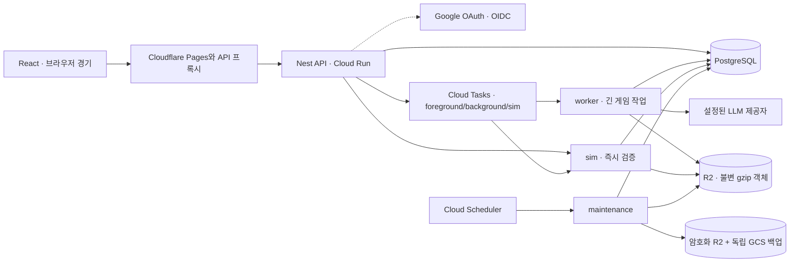

# 배포 런타임과 운영

Gaffer의 공개 런타임은 React/Vite 화면과 NestJS 서버다. 초대제·동시 접속 10명 이하를
초기 운영 범위로 삼는다. 계정마다 독립 게임을 최대 2개 보유한다. 게임 규칙과
`SAVE_VERSION`은 기존 엔진이 소유한다. 구현 검증과 미실행 환경 검증은
[구현 상태](../../plans/deployment/implementation-status.md)에 기록한다.

## 구성



| 역할        | 실행 상한                          | 책임                                 |
| ----------- | ---------------------------------- | ------------------------------------ |
| api         | 2 instances, concurrency 20, 1 GiB | 인증·소유권·작업 접수·목록·결과 조회 |
| worker      | 2 instances, concurrency 2, 2 GiB  | 온보딩·턴·장부 변경·lorebook         |
| sim         | 4 instances, concurrency 1, 1 GiB  | 결정적 경기 명령·checkpoint 재실행   |
| maintenance | 1 instance, concurrency 1, 1 GiB   | 재전달·만료·삭제·분석 전송·백업      |

모든 서비스는 최소 인스턴스 0, 요청 기반 과금이다. 초기에는 Redis나 상주 VM이 없다.
무료 제공량은 공급자·계정 전체 사용량에 따라 달라지며 LLM 호출과 무료 초과분은 유료다.
[Terraform](../../infra/terraform/main.tf.json)이 실제 인스턴스·큐·IAM·스케줄·알림 설정을 소유한다.

`apps/api/src`는 Nest 진입점과 프레임워크에 의존하지 않는 저장·작업 서비스를 함께 둔다.
역할별 배포는 같은 이미지다. `apps/web/app/api`와 `game/`의 기존 게임 핸들러를
Request/Response 함수로 재사용한다. 파일에 남은 `NextResponse`는 표준 `Response`의
호환 별칭이며 Next 서버를 기동하지 않는다. 화면은 `main.tsx`의 React Router로 이동한다.

## 로컬 실행

```sh
pnpm install --frozen-lockfile
pnpm dev
# 화면 http://localhost:5173 · API 5174
```

`PORT`, `API_PORT`, `GAFFER_DATA_DIR`로 각 실행을 분리한다. PGlite와 로컬 객체 폴더는
해당 디렉터리에 생성한다. `.env.local`, `apps/web/.env.local`을 읽되 명시한 환경변수를
덮어쓰지 않는다. 실모드는 제공자 키와 `LLM_PRICES_JSON` 또는 `LLM_PRICES_FILE`이 필요하다.
사용자의 기존 `apps/web/.data`, `.log`를 옮기거나 지우지 않는다. 기존 파일 세이브는
CLI용이며 서비스 SQL에 자동 등록되지 않는다. 테스트 import는 local + mock +
`GAFFER_TEST_FIXTURES=1`일 때만 노출된다. 기존 세이브 공개 전환은 별도 검증이 필요하다.

`pnpm dev`는 `GAFFER_AUTH_MODE`를 따로 주지 않으면 `development` 인증으로 뜬다. 로그인 화면
없이 브라우저마다 로컬 운영자 계정으로 들어가고(쿠키 `gaffer_local`, 쿠키 없는 요청은 고정 로컬
계정), 로컬 DB·실험실 도구가 열린다. API와 화면은 `127.0.0.1`에만 열린다. 이 모드는
`GAFFER_MODE=local`에서만 허용되고 운영에서는 기동을 거부한다. e2e와 시뮬레이션도 이 모드를 쓴다.

실제 Google 로그인은 `GAFFER_AUTH_MODE=google`로 확인한다. Google OAuth 클라이언트(웹
애플리케이션)의 `GOOGLE_CLIENT_ID`, `GOOGLE_CLIENT_SECRET`과 `SESSION_KEY`, `EMAIL_HASH_KEY`가
필요하다. 클라이언트의 승인된 리디렉션 URI에 `http://localhost:5173/api/auth/callback`을 등록하고
화면은 `http://localhost:5173`으로 연다(`127.0.0.1`은 Origin 검사에서 거부된다).
`ADMIN_EMAILS`에 적은 확인된 Google 이메일은 초대 없이 운영자로 가입한다. 두 모드의 회원은
서로 다른 계정이라 Google로 만든 게임은 로컬 인증에서 보이지 않는다.
운영에서는 development 인증과 mock을 금지하고 worker의 모델별 가격·제공자 키를 검사한다.
시뮬레이션 스크립트와 match-cli는 202 작업 조회와 경기 제어권 계약을 사용한다.

## 인증과 요청

- 최초 화면에는 Google 로그인 버튼만 보이며, 인증 후 게임 화면과 로그아웃을 제공한다.
  피드백은 `dhoonjang@gmail.com` 메일 링크로 받는다. 데이터·계정 설정, 비용 표시,
  피드백 폼·응답 평가 버튼은 제공하지 않는다.
- 서버가 Google OAuth 인가 코드 흐름을 직접 수행한다. 시작할 때 state·nonce·PKCE
  verifier를 AES-GCM으로 봉인한 10분 쿠키에 담고, callback에서 state를 대조한 뒤
  client secret과 verifier로 코드를 교환한다. ID token은 Google 공개키 서명·발급자·
  `aud`·만료와 nonce를 검증하며 `email_verified`인 계정만 받는다.
- 회원은 Google `sub`로 식별한다. 이메일이 같다는 이유로 다른 identity와 병합하지 않는다.
  처음 가입하는 계정은 그 이메일로 발급된 초대(`/#invite=...`, token과 이메일은 해시로
  저장)나 `ADMIN_EMAILS`가 필요하다. 실패한 callback은 `/#login_error=...`로 돌아간다.
- 서버가 발급한 7일 opaque 세션 쿠키는 HttpOnly·Secure·SameSite=Lax다. Google의
  access·refresh token은 저장하지 않는다. 로그아웃·계정 삭제는 세션 행을 지운다.
- 모든 게임·job 요청에서 활성 membership과 소유권을 확인한다. 변경 요청의 Origin은
  `APP_ORIGIN`과 같아야 한다. private schema, 전용 DB 역할, 트랜잭션별 actor RLS가
  함께 적용된다. DB TLS는 인증서 검증을 끌 수 없다. 필요하면 `DATABASE_CA_CERT`에
  Supabase CA PEM을 제공한다. 연결 문자열의 sslmode로 검증을 우회하지 않는다.
- 운영 `/api/admin`, `/api/lab`, 개발 trace는 닫힌다. 운영 도구는 보호된 CLI에서 사용한다.
- Pages Function은 고정 `API_ORIGIN`으로 `/api/*`만 전달하며 쿠키·상태를 보존하고
  오류까지 no-store 처리한다. 원본 Cloud Run 주소에도 인증·Origin 검사가 적용된다.

## 작업과 저장 계약

변경 POST는 `Idempotency-Key`가 필요하다. 같은 key·같은 내용은 같은 작업, 다른 내용은
409다. 일반 작업은 사용자당·게임당 하나다. 접수 후 202의 `jobId`를
`GET /api/jobs/:id?after=<seq>`로 조회한다. 브라우저 연결이 끊겨도 작업은 계속된다.
브라우저는 관측한 revision별 영수증을 15분 유지하며 재접속 시 활성 작업을 조회한다.
델타는 약 1초 단위, 24시간 보관하며 attempt가 바뀌면 이전 미확정 델타를 지운다.

DB claim은 60초 lease와 증가하는 attempt를 발급한다. 실행기 부모가 heartbeat를 보내고
Node Worker가 기존 엔진을 실행한다. 결과·전체 gzip 세이브·화면 view를 불변 객체로
업로드하고 SHA-256을 확인한 뒤 revision·epoch·attempt·lease·active_job 조건이 맞을 때만
SQL 포인터를 바꾼다. 삭제되거나 제어권을 잃은 작업은 늦게 완료되어도 저장하지 못한다.

주 화면 view와 목록은 저장된 결과를 읽고, 카탈로그는 인스턴스에서 재사용한다.
선수 카드·경기 리포트 등 일부 상세 조회는 별도 Worker에서 세이브를 읽는다. 이 경로의
Cloud Run 냉간 지연과 메모리는 공개 전 측정 대상이다. Worker 수는 부모가 제한한다.

경기는 브라우저에서 결정적으로 진행하고 실제 정지점의 checkpoint를 서버가 검증한다.
정기 5분/골/경고 정지점은 추가하지 않는다. client ID·epoch와 sim build를 검증한다.
창 takeover는 일반 턴이 진행 중이면 거절하며 경기 작업만 취소한다.

lorebook은 저장과 같은 트랜잭션에서 outbox에 등록한다. 생성한 patch는 R2에 보관하고
최신 인물 version에 적용한다. 일반 작업이 바쁘면 슬롯을 놓고 15초 뒤 재전달한다.
반복 실패한 편집은 해당 인물 순서를 보류하고 알린다. 운영자는 `retry-lore`로 재시도한다.
GET 요청은 기억 편집을 만들지 않는다.

## 비용과 관측

`pnpm service:ops price-template`은 현재 config의 모든 provider/model 키를 출력한다.
검증한 **토큰당 USD micro-dollar 단가**, RPM·TPM·동시성, 가격 version을 채워
Secret Manager의 `LLM_PRICES_JSON`으로 넣는다. 예: $1 / 백만 토큰은 1 micro-dollar/token이다.
숫자를 추정해 운영하지 않는다. provider별 캐시 할인은 현재 보수적으로 기본 입력 단가로
평가하므로 이 장부는 제공자 청구서와 동일한 금액을 보장하지 않는다.

실제 HTTP 시도마다 요청 크기와 출력 상한으로 비용을 예약한다. SDK retry·도구 반복과
Gemini thinking token도 계측한다. 명시적인 생성 전 거절(400/401/403/404/413/422/429)은
0으로 정산하고, 응답 유실·네트워크 단절 등 unknown은 예약을 유지한다. 성공한 요청은
실제 usage로 금액과 TPM을 정산한다. 비용 원장 기록 실패 시 다음 유료 호출을 막는다.

계정당 일 예산은 UTC 기준 $5이며 화면에 금액을 표시하지 않는다. 전체 일 예산 기본값은
$10이며 서버에서 함께 제한한다. foreground는 사용자당 한 유료 호출이다. 이미 실행 중인
background 한 건과 겹칠 수 있지만, 새 background는 foreground에 양보하고 전역 provider
제한·일 예산을 함께 따른다. 모델·프롬프트를 비용 때문에 자동 변경하지 않는다.

stdout은 request/job/attempt/오류 종류와 메트릭만 남긴다. Sentry는 본문·쿠키·헤더·breadcrumb을
전송하지 않는다. 선택 진단은 게임별 동의 후 요청/응답 일부를 암호화하고 이메일·키 형태를
마스킹한다. 하루 사용자당 20개·건당 512 KiB 상한, 7일 보관이며 진단 실패는 게임을 막지 않는다.
원문 조회는 CLI `diagnostic <id>`이며 감사 기록을 남긴다.

제품 이벤트의 원본은 SQL이다. 초대 수락, 게임 생성, 턴 확정, 첫 턴, 경기 시작/완료,
피드백을 기록한다. `pnpm service:ops report`는 30일 퍼널, 사용자 수, D1/D7의 복귀 수/대상 수,
작업 상태, 비용, DB 크기를 JSON으로 반환한다. D1/D7은 UTC 초대 수락 cohort에서 해당 날짜의
턴/경기 완료로 계산하고 아직 관측 기간이 지나지 않은 사용자는 분모에서 뺀다.

외부 PostHog 전송은 사용자 동의가 있어야 한다. 자동 수집·화면 녹화·대화 전송은 없다.
활성화할 때 maintenance에 `POSTHOG_API_KEY`, `POSTHOG_ORIGIN`, `POSTHOG_PROJECT_ID`,
삭제 가능한 `POSTHOG_PERSONAL_API_KEY`를 함께 설정한다. 외부 삭제는 비동기 접수 후
PostHog의 deletion status에서도 완료 여부를 확인한다.

사용자 피드백은 메일로 받는다. 기존에 저장된 피드백과 내부 보고는 운영 CLI에서 조회한다.

```sh
pnpm service:ops feedback
pnpm service:ops feedback-status FEEDBACK_UUID investigating '재현 확인 중'
pnpm service:ops retry-lore JOB_UUID
pnpm service:ops report
```

상태는 new → triaged → investigating → resolved/closed다. 공개 관리자 웹 UI는 없다.
운영 CLI 접근은 조직 계정의 MFA·DB/Secret Manager 접근 정책으로 제한한다.

## 보관·삭제·백업

| 데이터                      | 보관                                  |
| --------------------------- | ------------------------------------- |
| 진행 델타·완료 작업 입력    | 24시간                                |
| 작업 결과·중간 lore patch   | 완료 후 7일; 영수증 메타데이터는 유지 |
| 호출 상세 / 일별 비용 집계  | 30일 / 180일                          |
| 피드백 / 감사 / 제품 이벤트 | 90일 / 180일 / 180일                  |
| 선택 진단                   | 7일 또는 동의 철회                    |
| 게임·현재 view              | 게임 삭제까지                         |
| 완성·실패 백업 객체         | R2/GCS lifecycle 8일                  |

계정 삭제는 즉시 membership·세션·실행 fence를 무효화하고 로그인 식별자(Google `sub`·
이메일 해시)를 지운다. 의견·분석 대기·진단 참조를 삭제하고, 1일 뒤 게임 객체 참조를 정리한다.
PostHog 삭제는 전송 중 요청과 경합하지 않도록 삭제 후 1시간 뒤 접수한다. 최소 tombstone은 DB와 독립적인 R2 marker에도 즉시 기록하여
DB만 유실된 뒤 복원해도 재삭제한다. Sentry에는 사용자 식별자나 게임 원문을 보내지 않는다.

매일 private SQL의 repeatable-read snapshot과 현재 게임/view, 동의된 진단 객체를
AES-GCM 암호화해 별도 R2 bucket과 독립 GCS 프로젝트에 복제·검증한다. 과거 job 결과
전체를 백업하지 않는다. 복원 후 영수증과 최신 게임은 남고, 만료된 결과 조회는 최신 화면으로
복구한다. 백업 pin은 실행 중 갱신하며 실패 시 해제하고, 죽은 실행의 pin은 15분 뒤 재취득한다.
복원 pin은 자동 만료하지 않는다. 마지막 두 사본의 성공이 26시간 넘으면 알리고 48시간
넘으면 신규 게임·LLM 턴 접수를 막는다. 첫 초대 전 최초 백업을 실행한다.

```sh
pnpm service:ops backup
pnpm service:ops restore backups/KEY/manifest
# 검증·실제 provider 사용량 대조 후:
pnpm service:ops resume-after-restore costs-reconciled
```

복원은 운영자 DB 역할로만 수행한다. 세션·진행 작업·epoch를 무효화하고 최신 삭제 기록을
재적용한다. 재개 후에도 GC는 pin 상태이므로 백업 밖의 최신 객체를 검토한 다음 운영자가
pin을 해제한다. RPO는 마지막 성공 백업 이후(일일 정상 실행 시 최대 24시간)이며 PITR는 없다.

로그인 식별자(Google `sub`)는 private 회원 표에 있으므로 백업과 함께 복원된다. 외부 인증
저장소가 없으니 복원 뒤 계정을 다시 연결할 필요가 없다. 사용자는 다시 로그인하면 된다.

## 첫 배포와 재배포

1. production/staging의 PostgreSQL·R2 bucket·GCP 프로젝트를 분리한다. 환경마다 Google OAuth
   클라이언트(웹 애플리케이션)를 만들고 승인된 리디렉션 URI를 `<APP_ORIGIN>/api/auth/callback`
   하나로 둔다. Supabase PostgreSQL을 쓰면 `private`는 Data API 노출 schema에 추가하지 않는다.
2. `pnpm service:ops migrate`를 migration owner로 실행한다. 런타임 역할 `gaffer_api`,
   `gaffer_worker`, `gaffer_maintenance`에 각각 비밀번호를 부여한다. runtime에는 owner URL을
   넣지 않는다. Supavisor transaction URL과 CA를 실제 연결해 검증한다.
3. Session key와 backup key는 각각 독립된 32바이트 랜덤 base64, email hash key는 별도
   랜덤 secret으로 만든다. Google client secret과 함께 Secret Manager에 저장한다. 키는 명령
   출력·채팅·저장소에 남기지 않는다. 복구용 SESSION_KEY·EMAIL_HASH_KEY·BACKUP_KEY는 원본
   프로젝트와 독립된 비밀 관리소에도 보관한다. 첫 운영자는 `admin_emails`로 가입하고,
   이후 참가자는 `pnpm service:ops invite user@example.com`의 링크로 초대한다.
4. `infra/terraform/terraform.tfvars.example`을 복사해 비밀값 대신 secret ID만 지정한다.
   notification channel은 실제 수신 가능한 채널을 지정한다. Terraform state는 접근 제한된
   원격 backend에 보관한다. 예제 파일을 운영값으로 채운 파일은 gitignore 대상이다.
5. 최초에는 Terraform의 APIs·Artifact Registry·GitHub WIF/deploy IAM을 먼저 생성한다.
   GitHub production environment에 repository 숫자 ID와 맞는 WIF 변수를 설정한다.
   CI 통과 후 Deploy beta를 `publish_image_only=true`로 실행해 이미지를 올린 다음 전체
   Terraform plan/apply를 실행한다. 운영 정보가 없는 상태에서 자동 apply하지 않는다.
6. Cloudflare Pages는 Direct Upload 프로젝트로 만들고 `API_ORIGIN`을 Terraform의 api URL로,
   `APP_ORIGIN`을 실제 pages.dev 또는 도메인으로 설정한다. R2 live/backup bucket은 private로
   두고 공개 접근을 끈다. **backup bucket에만** lifecycle을 적용한다.

   ```sh
   pnpm exec wrangler r2 bucket lifecycle add BACKUP_BUCKET expire-backups backups/ --expire-days 8
   ```

7. GitHub environment variables: `GCP_PROJECT`, `GCP_REGION`, `GCP_WORKLOAD_IDENTITY_PROVIDER`,
   `GCP_DEPLOY_SERVICE_ACCOUNT`, `CLOUDFLARE_ACCOUNT_ID`, `PAGES_PROJECT`.
   Secrets: `DEPLOY_DATABASE_URL`(maintenance 역할), `MIGRATION_DATABASE_URL`(owner),
   필요한 `DATABASE_CA_CERT`, Pages 배포 범위로 제한한 `CLOUDFLARE_API_TOKEN`.
8. 일반 Deploy beta는 exact commit의 성공 CI 이미지 artifact를 가져온다(보관 1일).
   SQL expand → 접수 중지/실행 정리 → SAVE_VERSION·진행 경기 호환 검사 → 무트래픽 revision
   기동 → candidate API health smoke → backend traffic 전환 → 같은 commit의 Pages → 재개 순서다.
   artifact가 만료됐거나 문서만 바뀐 commit이면 main에서 CI를 수동 실행한다.
   수동 CI는 전체 검증과 이미지 생성을 수행한다. 문서 변경의 자동 CI는 기존대로 생략한다.
9. sim hash가 바뀌고 미완료 경기가 있으면 배포를 거절하고 **기존 서비스를 다시 연다**.
   기존 경기 완료 후 재배포한다. 현재 베타에는 여러 runtime cohort를 동시에 운영하는 기능이 없다.
   revision 전환 도중 실패하면 점검을 유지한다. 모든 서비스와 Pages를 같은 검증된 commit으로
   돌린 뒤 `tsx apps/api/src/release.ts resume`으로 재개한다.
10. 최초 백업·격리 복원·Google 초대 로그인·다른 계정 접근 차단·실제 R2 conditional write·
    Cloud Tasks 재전달·선택 진단/삭제·10세션 mock 부하를 staging에서 검증한 뒤 초대한다.
    소수의 실제 LLM 호출로 price/usage와 provider 제한을 대조한다. `billing_account_id`를 지정하면 월 예산 50/90/100% 경보도 생성한다. 이 경보는 LLM 코드 예산과 혼동하지 않는다.

설정 참고: [Google OAuth 웹 서버 흐름](https://developers.google.com/identity/protocols/oauth2/web-server),
[Google OpenID Connect](https://developers.google.com/identity/openid-connect/openid-connect),
[Supabase 연결/TLS](https://supabase.com/docs/guides/database/connecting-to-postgres),
[Google GitHub OIDC](https://github.com/google-github-actions/auth),
[Pages Direct Upload](https://developers.cloudflare.com/pages/how-to/use-direct-upload-with-continuous-integration/),
[R2 lifecycle](https://developers.cloudflare.com/r2/buckets/object-lifecycles/),
[PostHog 삭제 계약](https://posthog.com/docs/api/persons).
