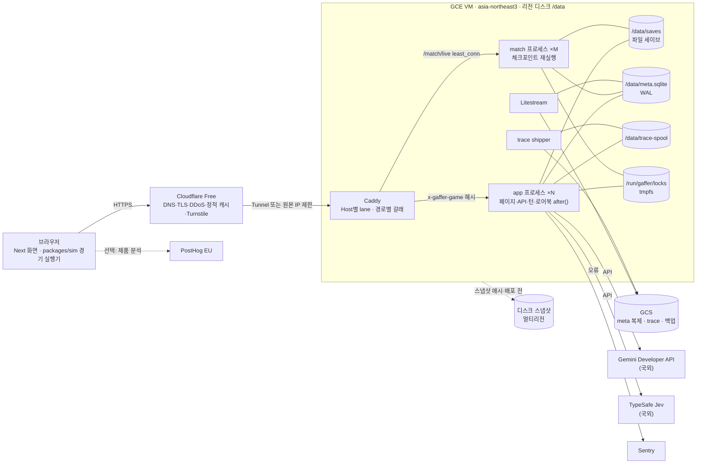
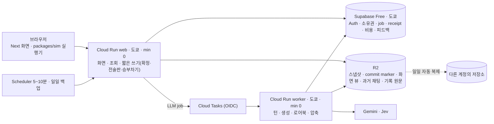

# Gaffer 공개 배포 설계 — Claude 독립안

> **⚠️ 구조건 안이다.** §0~§15는 "동시 300명 비교 조건 + 안정성을 지키는 최소 비용"이라는 앞선 입력으로 썼다. 사용자가 그 뒤 **"초기 동시 접속 10명 이하, 최대한 무료 인프라"**로 조건을 바꿨다. 원본은 그대로 보존하고, 최신 조건에서의 독립 재평가와 권장은 **§16**에 둔다. §0~§15의 코드 경계·실측·장애 분석은 §16에서도 유효하다.
>
> 기준 커밋 `0a69fac6` · 작성 2026-10-16 · 입력 [input.md](input.md)
> 이 문서는 Codex 설계를 읽기 전에 쓴 독립안이다. 구현·배포·계정 생성은 하지 않았다.
> 표기: **[실측]** 이 저장소에서 직접 잰 값 · **[공식]** 공급자 공식 문서(링크) · **[추정]** 가정에서 계산한 값 · **[결정 필요]** 사용자 몫의 제품 결정.

---

## 0. 한 장 요약

**권장 조합 — 「서울 단일 쓰기 호스트」**

- **위치**: GCP 서울(`asia-northeast3`)에 VM 한 대를 둔다.
  - 작은 베타는 e2-standard-4, 300명은 n2d-standard-8이다.
  - 이 VM이 화면·API·턴·경기 검증·로어북 편집을 모두 돌린다.
  - 같은 호스트에 Next 프로세스를 여러 개 띄워 작업 갈래별로 나눈다.
- **세이브**: 지금의 파일 세이브 형식을 그대로 둔다.
  - 디스크는 두 존에 동기 복제되는 리전 디스크다.
  - 디스크 스냅샷은 매시간 찍고, 배포 직전에도 한 번 찍는다.
- **메타데이터**: 계정·초대·소유권·턴 실행 기록·사용량·피드백·감사 기록은 같은 디스크의 SQLite(WAL)에 둔다.
  - Litestream으로 GCS에 연속 복제한다.
- **인증**: Better Auth를 쓴다(Google·Kakao OAuth, 첫 로그인 때 초대 코드 소모, 운영자 역할).
- **앞단**: Cloudflare(무료) → Caddy → Next 프로세스 순서다.
  - 대화 계열 요청은 게임 id 헤더 해시로 같은 프로세스에 붙인다.
  - 경기 검증 요청은 별도 프로세스 묶음으로 보낸다.
- **LLM**: Gemini Developer API 유료 등급을 인프라와 같은 결제 계정에 둔다.
  - 공급자 한도에 닿기 전에 앱이 먼저 끊는다: 사용자별 일일 예산, 전역 10분 지출 리미터, 회로 차단기.
- **관측**: 다섯 갈래를 섞지 않는다.
  - 호출 원문: 기존 `turn-trace` 형식을 production에서 켜고 GCS로 운반한다. `pnpm log`를 그대로 쓴다.
  - 오류: Sentry.
  - 제품 분석: 서버 이벤트 테이블. PostHog는 선택이다.
  - 피드백과 감사 기록: 자체 테이블.

**왜 이 조합인가 — 세 문장**

1. 비용의 주인은 인프라가 아니라 LLM이다. 300명 동시 플레이의 LLM 비용은 시간당 약 $190로 추정된다(§8). 반면 VM과 디스크는 월 수백 달러 규모다. 그래서 인프라는 단순하고 고장 경로가 적은 쪽을 고른다.
2. 지금의 저장·잠금 코드는 "한 호스트 안의 여러 프로세스"를 전제로 이미 검증돼 있다. 세이브를 DB나 객체 저장소로 옮기려면 분산 잠금과 fencing을 새로 짜야 한다. 그러면 원장 정확성의 위험이 커지고 비용도 늘어난다.
3. 300명 동시 접속은 8~16 vCPU 한 대로 감당된다고 추정한다(§7). 1,000명 버스트는 VM 확장 대신 입장 대기열과 LLM 지출 리미터로 막는다.

**출시 전에 반드시 고칠 코드 경계 7개** — 자세한 것은 §2.

1. 인증·소유권: 지금은 누구나 모든 게임을 나열하고, 열고, 지울 수 있다.
2. 컨테이너와 파일 락: 둘을 함께 쓰면 영구 잠금이 생긴다.
3. 기록과 오류 상세가 한 스위치에 묶여 있다. production에서 기록을 켜면 내부 오류 원문이 화면으로 샌다.
4. 사용량 예산은 프로세스 메모리에만 있어 재시작하면 사라진다.
5. 경기 임대는 문서에만 있고 구현이 없다.
6. 중복 방지 표(`appliedCommands`)가 메모리에만 있다.
7. 로어북 작업 실패는 상한 없이 재시도된다.

---

## 1. 근거

### 1.1 코드에서 확인한 사실

| 사실                                                                                                                                                             | 위치                                                                                         |
| ---------------------------------------------------------------------------------------------------------------------------------------------------------------- | -------------------------------------------------------------------------------------------- |
| 세이브는 파일 JSON이다. 쓰기는 tmp 파일 → `.bak`으로 밀어내기 → rename 순서다. `players`·`contracts`는 내용 해시 조각으로 두 벌 저장한다.                        | `packages/engine/src/app/persistence.ts:56`, `:188`                                          |
| `SAVE_VERSION = 29`. 다른 버전은 거부하고 마이그레이션은 없다.                                                                                                   | `persistence.ts:311`                                                                         |
| 데이터 디렉터리는 `GAFFER_DATA_DIR`, 없으면 `cwd/.data`. 카탈로그 오버라이드도 같은 디렉터리에 산다.                                                             | `packages/engine/src/core/catalog/paths.ts:8`                                                |
| 게임 잠금은 두 겹이다: 프로세스 안 뮤텍스, 그리고 파일 bakery 락. 기다림에 상한이 있고 넘기면 409.                                                               | `apps/web/game/turn-runner.ts:126`, `:205`                                                   |
| 파일 락은 "같은 호스트이면서 pid가 죽은 경우"만 회수한다. 살아 있거나 원격인 소유자는 만료되지 않는다.                                                           | `packages/engine/src/core/save-lock.ts:11`, `:70`                                            |
| 턴은 성공할 때만 저장된다. 실패한 턴은 없던 일이 된다. 연결이 끊겨도 서버는 턴을 끝까지 돌려 저장한다.                                                           | `turn-runner.ts:314`, `:516` · `app/api/games/[id]/turn/stream/route.ts`                     |
| 턴 시한은 모델 호출마다의 `timeout_ms`뿐이다(GM 180초, 압축 60초). 턴 전체를 묶는 시한은 없다.                                                                   | `config/llm.yml` · `packages/llm/src/deadline.ts`                                            |
| 화면은 60초 동안 아무것도 오지 않으면 기다리기를 멈추고 `GET ?settled=1`로 다시 받는다.                                                                          | `apps/web/game/turn-stream.ts:77`                                                            |
| 로어북 편집 작업은 세이브(`lorebookJobs`)에 남는다. 실행은 `after()`에서 하고, 실패하면 `attempts`만 올린 채 상한 없이 남는다.                                   | `apps/web/game/lorebook-jobs.ts:6`, `:54`                                                    |
| 실시간 경기: 서버는 클라이언트가 멈춘 구간을 같은 함수로 다시 굴려 확정한다. 서버 결과가 이긴다. 체크포인트는 `fromTick·toTick·digest`뿐이고 빌드 식별자가 없다. | `packages/engine/src/match/match-flow.ts:493` · `packages/domain/src/match/live-input.ts:62` |
| 전술판 중복 방지 표는 프로세스 메모리다.                                                                                                                         | `apps/web/game/live-match-server.ts:30`                                                      |
| 경기 "임대"는 문서에 있지만 코드에는 없다(`lease`·`임대` 검색 결과 0건).                                                                                         | `docs/match/live-match.md` §8.4                                                              |
| 기록(trace)은 `NODE_ENV !== "production"`일 때만 켜진다. 오류 응답의 `detail`도 같은 함수가 연다.                                                                | `packages/llm/src/turn-trace.ts:327` · `turn-runner.ts:296`                                  |
| 토큰 장부와 예산(`LLM_TOKEN_BUDGET`)은 프로세스 메모리의 게임별 Map이다. 관리 화면은 "최근 연 게임"을 읽는다.                                                    | `packages/llm/src/usage-meter.ts:48`, `:230`, `:237`                                         |
| 게임 목록은 데이터 디렉터리 전체를 훑는다. 인증이 없다.                                                                                                          | `apps/web/app/api/games/route.ts:28` · `persistence.ts:718`                                  |
| 어드민 쓰기는 `ADMIN_ENABLED`로 연다(production 기본은 닫힘). 읽기와 계측 GET은 열려 있다.                                                                       | `apps/web/app/api/admin/admin-guard.ts:28` · `app/api/admin/usage/route.ts:31`               |
| 게임 id는 `game-<seed36>-<Math.random 6자>`다.                                                                                                                   | `packages/engine/src/app/create-game.ts:764`                                                 |
| 대화 이름 색인 캐시는 프로세스에 하나뿐이다. 여러 게임이 번갈아 오면 매번 다시 짓는다.                                                                           | `apps/web/game/store.ts:134`                                                                 |
| 제공자 키는 환경변수(`GOOGLE_API_KEY`·`GEMINI_API_KEY`·`TYPESAFE_API_KEY`)에서 읽는다.                                                                           | `packages/llm/src/config.ts:394`                                                             |

**문서와 코드가 어긋난 곳** — 이번 작업 범위에서는 고치지 않고 보고만 한다.

- `docs/agents/models.md` §1-1은 "15분 지난 락은 회수하고, 회수는 rename으로 한다"고 적는다. 지금 `save-lock.ts`는 bakery 순번 방식이고 시간으로 회수하지 않는다.
- `live-match.md` §8.4의 "한 경기는 한 클라이언트가 임대한다"는 구현이 없다.
- `persistence.ts:49`의 "세이브 6MB 중 5.2MB(86%)" 주석은 지금 측정값과 다르다(아래 표).

### 1.2 측정 [실측]

**세이브 하나 (Apple M2 Max, 스크래치패드 데이터 디렉터리, LLM 없음)**

조건: `createGame(seed 7)` → `saveGame` → `loadGame`을 8회 반복했다.

| 항목                         | 값                                                                                                                                                                                                |
| ---------------------------- | ------------------------------------------------------------------------------------------------------------------------------------------------------------------------------------------------- |
| 직렬화 전체                  | 10.6M자(JS `string.length`, UTF-16 단위) = **UTF-8 약 12.8 MB** (gzip 1.34 MB) — 선수 5,795명 · 계약 5,795건 · 경기 2,281건. 디스크 파일 합계(본체 5.4 + 조각 6.5 + 0.9)와 같다 (정정 2026-10-16) |
| 디스크의 파일들              | 본체 5.4 MB, players 조각 6.5 MB ×2, contracts 조각 0.9 MB ×2, 두 번째 저장부터 `.bak` 5.4 MB가 더 생긴다                                                                                         |
| 게임 하나의 디스크 사용량    | 약 25.6 MB                                                                                                                                                                                        |
| `createGame`                 | 1,436 ms                                                                                                                                                                                          |
| `loadGame` 중앙값            | 133 ms (그중 순수 `JSON.parse`는 25 ms)                                                                                                                                                           |
| `buildOfficeViews`           | 53 ms                                                                                                                                                                                             |
| `saveGame` (조각 변화 없음)  | 57 ms                                                                                                                                                                                             |
| 로드된 `GameState` 하나의 힙 | 약 17.3 MB (`--expose-gc`, 4개를 쥐고 측정)                                                                                                                                                       |
| `toPayload` 전체 응답        | 105 ms · 423K자(UTF-16 길이. 바이트로는 이보다 크다) (gzip 47 KB). 그중 `competitions` 뷰 204K자                                                                                                  |
| 일부 응답(squad, match)      | 98 KB (gzip 11 KB)                                                                                                                                                                                |

- 코디네이터의 별도 합성 표본은 JSON 12.8 MB였다. 이 표본에서는 lorebook이 4.4 MB였다.
- 본체 5.4 MB의 대부분이 로어북이다. 그런데 로어북은 조각으로 빠져 있지 않다.

**실시간 경기 CPU**

- `pnpm match --games 3`은 실제 시간 37.5 s, user CPU 39.4 s가 걸렸다(RSS 263 MB).
- 서버가 경기 하나를 처음부터 끝까지 다시 굴리는 데 **약 12 CPU초**가 든다(M2 Max 단일 스레드).

**개발 기록 집계 [실측 · 대표성 낮음]**

- 기간과 규모: `apps/web/.log`, 2026-09-13~10-16, 게임 157개, 채팅 타임라인 682개.
- 실제 LLM 호출이 있는 턴은 148개다. 실패는 2개이고, 둘 다 종류가 `unknown`이다.
- 게임 버전이 9.x~21.x로 섞여 있고, mock 턴에는 호출이 없다.
- 개발자 한 명의 플레이라서 300명 부하를 대표하지 않는다.
- 숫자 메타데이터만 집계했다. 원문과 식별자는 출력하지 않았다.

| 지표                                        | p50    | p90    | p99    | 평균                 |
| ------------------------------------------- | ------ | ------ | ------ | -------------------- |
| 호출이 있는 턴의 소요 시간                  | 7.7 s  | 15.1 s | 29.3 s | 9.0 s                |
| 턴당 호출 수 (Jev 포함)                     | 1      | 7      | 30     | 3                    |
| 턴당 입력 토큰                              | 32.3k  | 70.9k  | 121k   | 37.6k                |
| 턴당 출력 토큰                              | 500    | 1.85k  | 4.9k   | 957                  |
| GM 호출의 입력 토큰                         | 35.5k  | 64.0k  | 103k   | 38.9k                |
| 체크포인트 처리 시간 (로드 + 재실행 + 저장) | 0.66 s | 1.48 s | 2.88 s | 0.95 s (최대 11.6 s) |
| 전술판 등 board 타임라인                    | 0.31 s | 1.05 s | 2.29 s | 0.49 s               |

- GM 캐시 적중률은 평균 23.8%, 중앙값 0%였다.
- 에이전트별 총량으로 다시 나누면 턴당 Gemini Flash 입력은 약 **28.5k 토큰**이다(Flash-Lite 약 1.3k, Jev 약 7.3k). Flash 출력은 약 **450 토큰**이다.
- **⚠️ 정정 (2026-10-16, 코디네이터 지적을 코드로 확인함)**
  - Gemini 어댑터는 `outputTokens = candidatesTokenCount`만 기록한다(`packages/llm/src/gemini-adapter.ts:217`).
  - `thoughtsTokenCount`는 패키지 어디에서도 읽지 않는다.
  - 공식 가격의 출력은 사고 토큰을 포함한다. 그래서 위 출력 450과 이를 쓴 모든 비용은 **사고 토큰이 빠진 하한**이다.

### 1.3 공식 자료 (확인일 2026-10-16)

**Gemini Developer API**

- 요금 [공식] — [pricing](https://ai.google.dev/gemini-api/docs/pricing), 2026-10-15 갱신.

  | 모델 · 시기                         | 입력  | 출력(사고 토큰 포함) | 캐시 입력 |
  | ----------------------------------- | ----- | -------------------- | --------- |
  | `gemini-3.8-flash` · 2026-12-31까지 | $0.75 | $3.75                | $0.075    |
  | `gemini-3.8-flash` · 2027-01-01부터 | $1.50 | $7.50                | $0.15     |
  | `gemini-3.5-flash-lite`             | $0.30 | $2.50                | —         |
  - 단위는 1M 토큰당이다.
  - Batch·Flex는 50% 할인이다.

- 한도 [공식] — [rate-limits](https://ai.google.dev/gemini-api/docs/rate-limits)
  - RPM·입력 TPM·RPD를 프로젝트 단위로 건다.
  - 모델별 수치는 공개하지 않고 AI Studio에서만 보여 준다.
  - 등급과 상한:

    | 등급   | 조건               | 10분 누적 지출 한도 | 월 상한     |
    | ------ | ------------------ | ------------------- | ----------- |
    | Tier 1 | —                  | $10                 | $250        |
    | Tier 2 | $100 결제 + 3일    | $50                 | $2,000      |
    | Tier 3 | $1,000 결제 + 30일 | $200                | $20k~$100k+ |

  - 결제 금액은 결제 계정의 **Google Cloud 지출 누계**로 센다.
- 월 상한에 닿으면 [공식] "service is paused for all projects linked to that billing account" — [billing](https://ai.google.dev/gemini-api/docs/billing)
- 묵시적 캐시 [공식] — 3.8 Flash 기준 최소 4,096 토큰. [caching](https://ai.google.dev/gemini-api/docs/caching)
- 데이터 사용 [공식]
  - 유료 등급의 프롬프트는 제품 개선에 쓰지 않는다. [terms](https://ai.google.dev/gemini-api/terms)
  - 남용 감시 로그는 55일 보관한다. [usage-policies](https://ai.google.dev/gemini-api/docs/usage-policies)

**Vertex AI**

- `gemini-3.8-flash`는 `global`·`us`·`eu`에만 있고 ML 처리도 us/eu에서만 한다. 서울·도쿄 리전은 모델 페이지에 없다. [3.8 Flash](https://docs.cloud.google.com/gemini-enterprise-agent-platform/models/gemini/3-8-flash)
- 그래서 **한국 내 처리 옵션은 없다고 보고** 국외 이전으로 다룬다.

**TypeSafe Jev**

- 입력 $0.042/1M, 출력 무료.
- 한도는 조직별 tokens/s·requests/s이고, 수치는 콘솔에서만 보인다. 429·529를 돌려준다.
- 출처: [models](https://docs.typesafe.ai/models), [api](https://docs.typesafe.ai/api)

**컴퓨트·DB 대안의 제약**

- Cloud Run [공식]
  - SIGTERM 뒤 10초에 SIGKILL한다. [container-contract](https://docs.cloud.google.com/run/docs/container-contract)
  - 세션 어피니티는 best-effort다. [session-affinity](https://docs.cloud.google.com/run/docs/configuring/session-affinity)
  - 응답 뒤 작업은 instance-based 과금에서만 CPU를 받는다. [billing-settings](https://docs.cloud.google.com/run/docs/configuring/billing-settings)
  - 서울 리전은 Tier 2 가격이다. [locations](https://docs.cloud.google.com/run/docs/locations)
- Vercel [공식]
  - 요청·응답 본문은 4.5 MB가 상한이다. `after`도 함수 시한을 공유한다. [limitations](https://vercel.com/docs/functions/limitations), [functions api](https://vercel.com/docs/functions/functions-api-reference/vercel-functions-package)
- Fly.io와 Neon은 서울 리전이 없다. [Fly regions](https://docs.fly.io/reference/regions), [Neon regions](https://neon.com/docs/introduction/regions)
- Supabase는 서울에 있다.
  - Pro $25(컴퓨트 크레딧 $10 포함), 일일 백업 7일.
  - PITR은 7일 $100/월이다.
  - 출처: [pricing](https://supabase.com/pricing), [PITR](https://supabase.com/docs/guides/platform/manage-your-usage/point-in-time-recovery)
- Cloud SQL Enterprise [공식]
  - PITR 1~7일, 유지보수 다운타임 60초 미만.
  - HA는 단독 구성의 두 배 가격이다.
  - 출처: [editions](https://docs.cloud.google.com/sql/docs/editions-intro), [HA](https://docs.cloud.google.com/sql/docs/postgres/high-availability)

**인증**

- Better Auth [공식]
  - Kakao·Naver 제공자를 내장한다. [Kakao](https://www.better-auth.com/docs/authentication/kakao)
  - 매직 링크의 `disableSignUp`으로 초대 전용을 강제할 수 있다. [magic-link](https://www.better-auth.com/docs/plugins/magic-link)
  - 관리자 플러그인으로 역할·밴·세션 폐기를 한다. [admin](https://www.better-auth.com/docs/plugins/admin)
  - Auth.js는 Better Auth 팀이 유지한다. [blog](https://www.better-auth.com/blog/authjs-joins-better-auth)
- Kakao 이메일 동의항목은 비즈 앱 전용이다. 개인 개발자 비즈 앱은 본인인증이 필요하다. [Kakao](https://developers.kakao.com/docs/ko/kakaologin/utilize)

**법령**

- 개인정보 보호법
  - 제28조의8 국외 이전: 이전 항목·국가·시기·방법·수령자·목적·보유기간을 공개하거나 고지해야 한다. [법령](https://law.go.kr/lsLinkCommonInfo.do?chrClsCd=010202&lsJoLnkSeq=1029331899)
  - 제22조의2: 만 14세 미만은 법정대리인 동의가 필요하다.
  - 제21조: 목적을 이루면 파기한다.
  - 시행령 제39조: 유출 시 72시간 안에 통지한다.
- 게임산업법 제21조: 등급분류를 받거나 시험용 게임물 확인을 받아야 한다. 시험용은 60일·2만 명 이하·무료 조건이다. [법령](https://www.law.go.kr/LSW//lsSideInfoP.do?lsiSeq=265811&joNo=0021&joBrNo=00&docCls=jo&urlMode=lsScJoRltInfoR)

**VM·프록시·셀프 호스팅** — §8.4와 §15에 정리한다.

---

## 2. 배포를 막는 코드 경계 (질문 1)

| #   | 경계                               | 지금의 동작                                                                                                             | 공개하면 생기는 일                                                                                                                                                | 처리                                                                                                                                                                         |
| --- | ---------------------------------- | ----------------------------------------------------------------------------------------------------------------------- | ----------------------------------------------------------------------------------------------------------------------------------------------------------------- | ---------------------------------------------------------------------------------------------------------------------------------------------------------------------------- |
| B1  | 인증·소유권 없음                   | `/api/games`가 디렉터리 전체를 나열한다. `[id]` 라우트는 id만 맞으면 읽기·쓰기·삭제를 허용한다.                         | 남의 게임을 열고 지울 수 있다.                                                                                                                                    | 세션 → 소유권 래퍼(§4). 목록은 DB 색인에서만 읽는다. id는 crypto 난수로 바꾼다.                                                                                              |
| B2  | 파일 락의 생존 판정                | `hostname()`과 pid로 살아 있는 소유자를 판정한다.                                                                       | 컨테이너는 pid·hostname 네임스페이스가 따로다. 재시작한 컨테이너의 낮은 pid가 재사용되거나 hostname이 바뀌면 죽은 기록이 영영 "살아" 있다 → 그 게임이 영구히 409. | 앱 프로세스를 호스트 pid·uts 네임스페이스에서 돌린다. 락 디렉터리는 재부팅 때 지워지는 tmpfs에 둔다(`GAFFER_LOCK_DIR` 추가). 2단계에서는 DB 임대와 fencing으로 바꾼다(§5.6). |
| B3  | 기록 스위치와 오류 상세의 결합     | `traceEnabled()` 하나가 기록·trace 라우트·응답 `detail`을 함께 연다.                                                    | production에서 기록을 켜면 내부 예외 원문(프롬프트 조각·경로)이 사용자 화면으로 간다.                                                                             | `GAFFER_TRACE_STORE`(기록)와 `GAFFER_DEV_DETAILS`(상세 노출)를 나눈다. trace 라우트는 운영자 역할만 연다.                                                                    |
| B4  | 예산이 메모리에 있음               | `LLM_TOKEN_BUDGET`은 프로세스별 게임 장부다. 재시작하면 0이다.                                                          | 사용자 한 명이 여러 게임과 재시작을 타고 무제한으로 쓴다. 비용 상한이 없다.                                                                                       | SQLite `usage_daily`로 사용자 단위 일일 예산을 둔다. 전역 10분·일일 리미터를 둔다(§8).                                                                                       |
| B5  | 경기 임대 미구현                   | 문서에만 있다. 두 탭이 같은 경기를 동시에 굴리면 서로를 `stale`로 되감는다.                                             | 다른 기기와 탭에서 경기가 덜컹거리고, 확정이 반복된다.                                                                                                            | 서버에 임대 표를 두고 탭 id(`x-gaffer-client`)를 받는다. 나머지 탭은 관전한다(§4.5).                                                                                         |
| B6  | 중복 방지가 메모리에 있음          | `appliedCommands`는 프로세스 Map이고, 턴에는 요청 id가 없다.                                                            | 재시작이나 다른 프로세스를 거친 재전송이 교체·지시를 두 번 적용한다.                                                                                              | 출시용 세이브 버전에 `recentRequestIds`를 넣는다. 효과와 같은 원자적 쓰기 안에서 중복을 거른다(§5.3).                                                                        |
| B7  | 로어북 재시도 상한 없음            | 실패한 작업이 남아 있으면 GET과 턴이 끝날 때마다 다시 부른다.                                                           | 영구 실패 하나가 접속할 때마다 LLM 비용을 낸다.                                                                                                                   | `attempts`가 3 이상이면 멈추고, 지수 백오프와 운영자 알림을 둔다.                                                                                                            |
| B8  | 이벤트 루프를 막는 동기 CPU        | 체크포인트 재실행이 하프 하나에 수 초(최대 11.6 s 관측) 걸린다. 로드 133 ms, 저장 57 ms, 페이로드 105 ms도 모두 동기다. | 같은 프로세스의 다른 사용자 스트림이 멈칫한다. 하트비트도 늦는다.                                                                                                 | 프로세스를 갈래별로 나눈다(경기 검증 묶음 분리). 2단계에서는 worker thread로 옮긴다.                                                                                         |
| B9  | 매 요청 전체 로드                  | GET·선수 카드·리포트도 10 MB 세이브를 통째로 읽고 Zod로 검사한다.                                                       | 읽기만으로 CPU의 절반을 쓴다(§7).                                                                                                                                 | 읽기 전용 경로에 프로세스 핫 캐시를 둔다. 파일 지문이 같으면 재사용하고, 쓰기 경로는 언제나 새로 로드한다.                                                                   |
| B10 | 어드민·실험실·카탈로그 오버라이드  | 데이터 디렉터리의 오버라이드가 모든 새 게임에 적용된다. 계측 GET은 공개다.                                              | 운영 중 카탈로그 편집이 모든 사용자의 세계를 바꾼다. 남의 사용량이 보인다.                                                                                        | production에서는 `ADMIN_ENABLED`를 끄고 카탈로그를 이미지에 굽는다. `/admin`·`/lab`·계측은 운영자 역할만 연다.                                                               |
| B11 | 턴 전체 시한 없음                  | 호출별 시한의 합이 최대치다(GM 180 s + 압축 60 s + …).                                                                  | 배포 drain 시간을 정할 수 없다.                                                                                                                                   | 턴 전체 시한(예: 300 s)을 걸고, 넘기면 abort 신호를 보내 실패로 처리한다.                                                                                                    |
| B12 | 빌드 불일치                        | 클라이언트 번들·시뮬과 서버의 일치를 확인하지 않는다.                                                                   | 배포 직후 옛 탭이 digest 불일치를 반복하고, 옛 청크는 404가 난다.                                                                                                 | 모든 API에 `x-gaffer-build` 헤더를 싣고, 불일치하면 409 `{reload:true}`. Next `deploymentId`를 설정한다(§11.3).                                                              |
| B13 | 세이브 크기·쓰기량                 | 턴마다 본체 5.4 MB를 다시 쓴다. 대부분은 로어북이다.                                                                    | 디스크 쓰기 약 6 MB/턴, 300명이면 약 20 MB/s(§7).                                                                                                                 | `SHARDED_TABLES`에 `lorebook`을 더한다. 로드는 조각 맵을 일반적으로 읽으므로 세이브 버전을 올리지 않아도 된다.                                                               |
| B14 | 사고 토큰 미계측 (2026-10-16 추가) | Gemini 어댑터가 `candidatesTokenCount`만 출력으로 센다(`gemini-adapter.ts:217`). `thoughtsTokenCount`는 읽지 않는다.    | 예산 상한과 비용 장부가 실제 청구(출력 = 사고 포함)보다 적게 센다. 비용 통제가 새는 경로다.                                                                       | 어댑터가 사고 토큰을 출력에 포함하거나 별도 칸으로 기록한다. 예산과 정산은 청구 기준으로 센다. **출시 차단 항목.**                                                           |

---

## 3. 아키텍처 (질문 2)



### 3.1 작업이 어디서 도는가

| 작업                                          | 실행 위치                                 | 이유                                                                                                                                                 |
| --------------------------------------------- | ----------------------------------------- | ---------------------------------------------------------------------------------------------------------------------------------------------------- |
| 프론트엔드(SSR·정적 파일)                     | app 프로세스 + Cloudflare 캐시            | 클라이언트의 시뮬 코드와 서버가 같은 빌드에서 나와야 한다. 정적 파일은 `immutable` 헤더 덕분에 Cloudflare가 캐시한다.                                |
| API·턴 실행(NDJSON 스트림)                    | app 프로세스                              | 지금의 `runTurnLocked` 경로를 그대로 쓴다. 스트림은 수 분 동안 열려 있고 10초 하트비트가 Cloudflare의 유휴 시한(§15)을 넘지 않게 한다.               |
| 경기 체크포인트 검증·전술판 조작·마감         | match 프로세스 묶음                       | 수 초짜리 동기 재실행이 대화 스트림을 막지 않게 경로로 분리한다. 실시간 경기 라우트는 이미 `/api/games/[id]/match/*`로 모여 있다.                    |
| 로어북 비동기 편집                            | 그 게임을 저장한 app 프로세스의 `after()` | 작업 큐는 이미 세이브(`lorebookJobs`)에 있다. 프로세스가 죽어도 다음 GET이나 턴이 다시 연다. 별도 큐 서비스가 필요 없다. 재시도 상한만 추가한다(B7). |
| 이력 압축                                     | 턴 안, 저장 직전                          | 지금 계약을 유지한다.                                                                                                                                |
| 메일 회신·날짜 진행                           | 턴 안                                     | 지금 계약을 유지한다.                                                                                                                                |
| 새 게임 생성(`createGame` 1.4 s + 온보딩 LLM) | app 프로세스                              | 사용자당 하루 생성 수를 제한해(§8) CPU 버스트를 막는다.                                                                                              |
| 기록 운반·SQLite 복제·스냅샷                  | 사이드카와 GCP 스케줄                     | 요청 경로 밖에서 돈다.                                                                                                                               |

### 3.2 프로세스와 격리

- **갈래** (300명 기준 시작값)
  - app 프로세스 N=6.
  - match 프로세스 M=3.
  - 각 프로세스에 `--max-old-space-size=2560`을 준다.
  - 작은 베타에서는 N=2, M=1로 시작한다.
- **어피니티**
  - 화면이 게임 API 요청마다 `x-gaffer-game: <id>` 헤더를 붙인다.
  - Caddy는 대화 갈래에 `lb_policy header x-gaffer-game`을 쓴다. 같은 게임은 같은 프로세스로 가서 핫 캐시 적중률이 높아진다.
  - **정확성은 어피니티에 기대지 않는다.** 프로세스 사이는 파일 락이 직렬화한다.
- **컨테이너**
  - 이미지로 배포한다(Next `output: 'standalone'`).
  - 실행할 때 `pid: host`, `uts: host`, `network_mode: host`를 준다.
  - 락 디렉터리 `/run/gaffer/locks`는 호스트 tmpfs를 바인드한다.
  - 이렇게 해야 B2의 pid 생존 판정이 모든 색깔(blue/green)의 프로세스에 걸쳐 성립한다. 재부팅하면 락이 비워진다.
  - systemd로 직접 돌려도 같은 조건이 성립한다.
- **CPU 상한**: 갈래마다 cgroup 상한을 둔다. 경기 재실행이 폭주해도 대화 갈래가 숨을 쉰다.

### 3.3 lane — 세이브 버전마다 독립 배포 단위

- **lane은 `SAVE_VERSION` 하나에 대응하는 빌드 하나다.**
  - 화면·API·시뮬·프롬프트·`config/llm.yml`을 모두 한 빌드로 묶는다.
  - 호스트는 `play.<도메인>`(최신)과 `s<N>.play.<도메인>`(이전 lane)으로 나눈다.
- 게임 목록은 최신 lane이 그린다. DB의 `games.lane`을 보고 이전 lane 게임에는 그 호스트로 가는 링크를 단다.
- 세션 쿠키는 상위 도메인으로 공유한다.
- 이전 lane 프로세스는 1개(약 0.5~1 GB)면 충분하다. 운영 정책은 §11.2에 둔다.

---

## 4. 인증 · 초대 · 소유권 · 권한 · 동시 접근 (질문 3)

### 4.1 인증

- **Better Auth**를 앱 안에 라이브러리로 둔다. 저장소는 SQLite(Kysely 어댑터)다.
- 로그인 수단
  - Google OAuth와 Kakao OAuth로 시작한다.
  - Kakao 이메일은 비즈 앱 전용이다. 그래서 식별자는 Kakao 사용자 id로 하고 이메일은 받지 않는다.
  - 이메일 매직 링크는 메일 발송 공급자를 하나 더 쓰게 만든다. 초대 베타에서는 쓰지 않는다. [결정 필요]
- 세션 쿠키: `HttpOnly`, `Secure`, `SameSite=Lax`, 상위 도메인 공유(§3.3).
- CSRF: 상태를 바꾸는 모든 게임 API는 `Origin`과 `Sec-Fetch-Site`를 검사한다. Better Auth의 trusted origins 설정과 같은 목록을 쓴다.
- 가입할 때 받는 것: 만 14세 이상 확인, 이용약관·개인정보처리방침(국외 이전 포함) 동의, 초대 코드.
  - 만 14세 미만을 받지 않으면 법정대리인 동의 절차가 필요 없다(§10). [결정 필요]

### 4.2 초대

- 운영자가 코드를 발급한다: `invites(code_hash, cohort, max_uses, expires_at)`.
- 첫 OAuth 로그인 콜백에서 코드를 한 트랜잭션으로 검증하고 소모한다(`used_count < max_uses`). 코드 없이 들어온 신규 계정은 만들지 않는다.
- 코호트 태그(`cohort`)로 입장 속도를 조절한다. 같은 태그가 분석과 비용 집계의 축이 된다(§9).
- Turnstile은 초대 코드 입력 폼에만 붙인다(무료).

### 4.3 소유권

- `games(id, owner_user_id, lane, created_at, last_played_at, deleted_at)`가 권위 있는 색인이다.
  - 세이브 본문에는 계정 식별자를 넣지 않는다. 내보낸 세이브와 계정이 묶이지 않게 하려는 것이다.
- `apps/web/game/owned-game.ts` 래퍼를 둔다. `[id]` 라우트는 모두 `export const POST = ownedGame(async (req, ctx, { game, user }) => …)` 꼴로만 쓴다.
  - 래퍼는 세션 확인 → id 형식 검사(지금의 `invalidGameId`) → `owner_user_id == user.id` 또는 운영자 역할 순서로 본다.
  - 운영자가 열면 `audit_events`에 남긴다. 다 통과한 뒤에야 디스크에 닿는다.
  - 빠뜨릴 자리가 없게 감싸는 방식이다. 지금의 `adminWrite`와 같은 원리다.
- **라우트 표 테스트**
  - `app/api/games/[id]/**/route.ts`의 모든 export가 래퍼를 지나는지 테스트 하나가 열거한다.
  - 이 테스트는 "아무도 알아채지 못하는 것"을 잡는다(AGENTS.md §5 Tests).
- 게임 id: `game-<crypto.randomUUID 22자>`. 64자 정규식 안에 든다. 문자열일 뿐이라 세이브 형태가 바뀌지 않는다.
- 사용자 한도: 활성 게임 3개, 새 게임 하루 3개(§8). [결정 필요]

### 4.4 운영자 권한

| 역할       | 할 수 있는 것                                                                                                  |
| ---------- | -------------------------------------------------------------------------------------------------------------- |
| `player`   | 자기 게임                                                                                                      |
| `operator` | 피드백 처리, 사용자 메타데이터 열람, 쿼터 조정. 신고되었거나 동의받은 게임의 세이브·기록 열람(감사 기록 남음). |
| `admin`    | 초대 발급, 역할 변경, 계정 삭제·밴, kill switch, lane 일몰                                                     |

- 카탈로그 편집기(`/admin`의 쓰기)는 production에서 꺼 둔다. 카탈로그는 저장소 PR → 배포로만 바꾼다.
  - 지금의 오버라이드는 모든 새 게임에 퍼지므로, 런타임 편집은 다중 사용자 환경에서 사고 경로다.
- trace 라우트와 원문 열람은 운영자 이상만 연다. 플레이어에게는 열지 않는다(프롬프트 노출, 스포일러).

### 4.5 다른 기기와 탭

**턴**

- 게임 잠금이 직렬화한다. 지금처럼 두 번째 요청은 409(`retry`)를 받는다.
- 응답과 payload에 `revision`을 싣는다.
- 상태를 바꾸는 요청은 `baseRevision`을 보낸다. 뒤처진 탭의 요청은 409 `{stale:true, payload}`로 돌려보낸다. 그래서 감독은 바뀐 세계를 보고 나서 다시 말한다.
  - 예외: 실시간 체크포인트. tick 기반 `stale`이 이미 있다.

**전술판 자동 저장**

- 같은 `baseRevision` 규칙을 쓴다. 옛 탭의 차분이 다른 탭의 편집을 덮지 않는다.

**실시간 경기 임대 (B5)**

- `match_leases(game_id, client_id, expires_at)`을 SQLite에 둔다. 탭마다 `sessionStorage`의 UUID를 `x-gaffer-client`로 싣는다.
- 동작
  - `enter`·`checkpoint`·`orders`·`resume` 요청이 임대를 얻거나 갱신한다(만료 60초).
  - 다른 탭의 요청은 409 `{reason:"leased"}`를 받고 확정 상태만 받는 관전 모드가 된다.
  - 관전 탭에는 「이 창에서 이어 하기」(`takeover`)가 있다. 누르면 임대를 옮기고, 옛 탭의 다음 제출은 409로 멈춘다.
  - 문서 §8.4의 "끊기면 다음 클라이언트가 이어받는다"는 만료로 성립한다.

**같은 브라우저의 다른 탭**

- `BroadcastChannel`로 `revision` 변경을 알린다.
- 다른 기기는 창이 포커스를 얻을 때 `revision`을 묻는다.

---

## 5. 세이브 · 원자성 · 중복 · 복구 · 삭제 · 백업 (질문 4)

### 5.1 저장소 배치

```
/data (리전 디스크 · 두 존 동기 복제)
  saves/<gameId>.json · .json.bak · .shard-<hash>.json(.bak) · .meta.json   ← 지금 형식 그대로 (GAFFER_DATA_DIR)
  meta.sqlite (+ -wal, -shm)                                                ← 계정·색인·턴 실행·사용량·피드백·감사
  trace-spool/<gameId>/{index.jsonl,turns,board,calls}                      ← 지금 turn-trace 형식 (GAFFER_LOG_DIR)
/run/gaffer/locks (tmpfs)                                                   ← 게임 락 (GAFFER_LOCK_DIR — 추가)
```

### 5.2 원자성 — 바꾸지 않는 것

- tmp → `.bak` → rename 순서, 조각 먼저 쓰기, 성공할 때만 저장 — 모두 지금 그대로다.
- 한 게임의 쓰기는 언제나 한 손이다: 프로세스 뮤텍스와 파일 락.
- 바꾸는 것은 락 디렉터리의 위치뿐이다(B2).
- 메타데이터(SQLite)와 세이브 파일은 원자적으로 묶이지 않는다. 묶을 필요가 있는 사실은 세이브 안에 둔다(§5.3). SQLite의 값은 세이브에서 다시 지을 수 있거나, 어긋나도 원장이 다치지 않는 것만 둔다.

### 5.3 출시용 세이브 버전 — 한 번에 묶어 올린다

- 공개 전에 `SAVE_VERSION` 29 → 30으로 **한 번** 올린다.
- 공개 전 세이브는 개발 세이브뿐이라 거부되어도 사용자 손실이 없다. 대신 사용자 로컬 `.data`의 기존 게임은 새 빌드에서 열리지 않는다.
  - 로컬 개발 서버가 새 버전을 쓰면 그렇게 된다. 운영 디스크는 따로다.

| 새 필드                      | 왜 세이브 안인가                                                                                                                                                                                               |
| ---------------------------- | -------------------------------------------------------------------------------------------------------------------------------------------------------------------------------------------------------------- |
| `revision: number`           | 단조 증가하며 `saveGame`이 1씩 올린다. 화면의 뒤처짐 판정과 기록 상관관계의 축이다. 파일과 함께 굳어야 거짓이 없다.                                                                                            |
| `recentRequestIds: string[]` | 최근 64개다. 턴·전술판·실시간 조작·메일·협상의 `requestId`를 담는다. **효과와 같은 쓰기에 굳어야** 크래시·재시작·다른 프로세스를 거친 재전송을 정확히 한 번만 적용한다. 메모리의 `appliedCommands`를 대체한다. |

- 조각 추가(`lorebook`)는 형태 변경이 아니다. `attachShards`가 조각 맵을 일반적으로 읽기 때문이다. 그래서 같은 릴리스에 넣되 버전 판단과는 무관하다.

### 5.4 중복 요청

- 화면은 사용자 행동 하나에 `requestId`(UUID) 하나를 만든다. 재시도는 같은 id로 보낸다.
- 서버는 잠금 안에서 로드한 직후 `recentRequestIds`를 본다.
  - 이미 있으면 다시 적용하지 않고 지금 payload를 돌려준다(`duplicate:true`).
- 턴 실행 기록 `turn_runs`는 상태 조회와 관측용이다. 정확성은 세이브의 id 목록이 진다.

### 5.5 장애 복구

| 실패                                         | 남는 것                                | 복구                                                                                                               |
| -------------------------------------------- | -------------------------------------- | ------------------------------------------------------------------------------------------------------------------ |
| 프로세스 크래시(턴 도중)                     | 저장 전이면 아무것도 남지 않는다.      | 같은 호스트의 죽은 pid라 락은 다음 시도에서 회수된다. `turn_runs`는 하트비트가 끊겨 `abandoned`가 된다(§6).        |
| 저장 도중 크래시                             | tmp가 남거나 `.bak`만 남는다.          | 지금 로직대로 `.bak`으로 읽는다. `recentRequestIds`로 커밋 여부를 판정한다.                                        |
| VM 재부팅·호스트 장애                        | 디스크는 그대로다.                     | GCE 자동 재시작. tmpfs 락은 비워진다. RPO 0, RTO는 수 분(추정).                                                    |
| 존 장애                                      | 리전 디스크의 다른 존 복제본이 남는다. | 런북: 다른 존에 VM 생성 → 디스크 force-attach → 기동. RPO 약 0, RTO 30분(추정, 수동).                              |
| 논리 손상(버그가 스키마에 맞는 나쁜 값을 씀) | 매시 스냅샷, 배포 전 스냅샷            | 스냅샷으로 디스크를 만들어 읽기 전용으로 붙인다. 해당 게임 파일만 복원하고, SQLite는 Litestream으로 시점 복원한다. |
| 세이브 파일 하나 손상                        | `.bak`, 조각 두 벌                     | 지금 로직대로 자동 폴백. 그래도 못 열면 스냅샷에서 개별 복원한다.                                                  |
| SQLite 손상·삭제                             | Litestream GCS 복제                    | `litestream restore`(RPO 약 1초, §15)                                                                              |
| 실수로 지움                                  | 스냅샷, GCS soft delete 7일            | 스냅샷·GCS에서 복원                                                                                                |

### 5.6 2단계로 넘어갈 때만 필요한 것 (지금은 만들지 않는다)

- 호스트가 여럿이 되면 파일 락이 호스트 경계를 넘지 못한다.
- 그때는 다음을 함께 도입한다.
  - 게임별 임대 `game_leases(game_id, holder, token, expires_at)`. TTL 30초, 10초마다 갱신.
  - 저장할 때 fencing: `BEGIN IMMEDIATE` 또는 `SELECT … FOR UPDATE`로 토큰과 `revision == base`를 확인한 뒤, 같은 트랜잭션 안에서 rename하고 `revision`을 올린다.
  - 저장소는 Postgres로 옮긴다.
- **1단계에서 이것을 미리 짓지 않는 이유**: 분산 임대의 버그는 원장을 조용히 망가뜨린다. 한 호스트에서는 지금의 검증된 경로로 충분하다.

### 5.7 삭제

- **계정 삭제**
  1. 게임마다 게임 잠금을 얻는다.
  2. 세이브 파일을 지운다(`deleteGame`).
  3. GCS `traces/<gameId>/` 접두사를 지운다.
  4. 피드백 본문을 지운다.
  5. PostHog person을 삭제한다(API).
  6. `usage_daily.user_id`는 해시로 가명화한다.
  7. Better Auth 계정과 세션을 지운다.
- 스냅샷과 Litestream 복제본에서는 보존 기간이 지나면 사라진다(최대 35일). 처리방침에 그렇게 적는다.
- **게임 삭제**: 지금 `DELETE /api/games/:id`에 소유권 래퍼를 씌운다. 기록 접두사 삭제는 계정 삭제 때와 운영 정책(§10)을 따른다.
  - 지금 개발 모드는 "기록은 게임을 지워도 남는다"이다. 운영에서는 개인정보 보존 기한이 우선한다.

### 5.8 백업

| 대상           | 방식                                                  | 보존                 | RPO                                |
| -------------- | ----------------------------------------------------- | -------------------- | ---------------------------------- |
| `/data` 디스크 | 리전 디스크(두 존 동기)                               | —                    | 약 0 (존 장애)                     |
| `/data` 디스크 | 스냅샷 스케줄 매시 · 배포 직전 · 증분 · 멀티리전 저장 | 매시 48개, 일일 14개 | ≤1시간 (논리 오류)                 |
| `meta.sqlite`  | Litestream → GCS                                      | 7일 스냅샷 + WAL     | 약 1초                             |
| 기록           | shipper → GCS                                         | §10                  | 분 단위 — 기록이라 손실이 허용된다 |

- 세이브와 SQLite가 같은 디스크에 있다. 그래서 디스크 스냅샷 하나가 둘의 **같은 시점**을 담는다(크래시 일관성).
  - 관리형 DB를 따로 두면 두 복구 시점이 어긋난다. 예: 색인에는 있는데 세이브가 없는 게임.
  - 이것이 메타데이터를 같은 호스트에 둔 이유 중 하나다.
- **복원 훈련**은 출시 게이트다(§11.5): 스냅샷에서 게임 하나 복원, Litestream 시점 복원, 존 이동 런북.

---

## 6. 끊긴 스트림과 재시작 이후 이어받기 (질문 5)

**턴 실행 기록** — `turn_runs`

| 열                            | 내용                                                           |
| ----------------------------- | -------------------------------------------------------------- |
| `id`                          | = `requestId`                                                  |
| `game_id`, `user_id`, `kind`  |                                                                |
| `status`                      | `running` · `committed` · `failed` · `abandoned` · `duplicate` |
| `instance_id`, `heartbeat_at` | 프로세스 시작마다 난수 하나. 하트비트는 10초마다 갱신한다.     |
| 버전 축                       | `build_sha`, `lane`, `game_version`                            |
| 결과                          | `base_revision`, `result_revision`, `error_kind`, `retry`      |
| 상관관계                      | `trace_turn_id`                                                |
| 사용량                        | 입력·캐시·출력 토큰, `cost_micros`                             |

**흐름**

1. 스트림의 첫 줄로 `{"type":"accepted","requestId","revision"}`을 보낸다. `done`에는 `revision`을 싣는다.
2. 화면이 기다리기를 멈추거나 연결이 끊기면 `GET /api/games/:id/turns/:requestId`를 2초 간격으로 묻는다.
   - 가벼운 SQLite 조회이고, 지금의 `settled=1`(잠금 대기)을 대체한다.
   - `committed`이면 payload를 받는다. 델타 애니메이션은 잃지만 본문은 payload에 있다.
   - **흐르던 델타에 다시 붙지는 않는다.** 그러려면 프로세스 사이 pub/sub이 필요하다. 그 복잡도에 비해 얻는 것(타이핑 연출)이 작다.
3. **서버 재시작이나 크래시**
   - 하트비트가 60초 넘게 멈춘 `running`은 sweeper가 판정한다.
   - 먼저 세이브의 `recentRequestIds`를 확인한다.
     - id가 있으면 `committed`로 고친다. 저장 직후, DB 갱신 직전에 죽은 경우다.
     - 없으면 `abandoned`.
   - `abandoned`를 받은 화면은 「반영되지 않음 · 다시 보내기」를 세운다. 입력창 문장은 `turn_runs`의 짧은 보존 본문(24시간)이나 화면의 로컬 초안에서 되살린다.
4. **배포 중**
   - drain 프로세스는 새 요청을 받지 않고 진행 중인 턴을 끝까지 저장한다. 시한은 턴 전체 시한 300초 + 여유다.
   - 그래서 배포 때문에 생기는 `abandoned`는 원칙적으로 없다. 예외는 강제 종료다.
5. **경기**: 지금 설계 그대로다. 마지막 확정 체크포인트에서 다시 굴리고, 같은 입력이면 같은 결과다. 끊긴 동안의 구간은 화면이 다시 보여 줄 뿐이다.
6. **로어북 작업**: 프로세스가 죽으면 다음 트리거가 이어 간다. 작업이 세이브 안에 있기 때문이다.

---

## 7. 300명 동시 접속의 환산 (질문 6)

### 7.1 가정 [추정]

300명은 동시에 활성 세션을 가진 사람 수다.

| 상태        | 비율        | 활동량                                                                                     |
| ----------- | ----------- | ------------------------------------------------------------------------------------------ |
| 대화·관리   | 60% (180명) | 75초에 한 턴 — 읽기 + 입력 + 생성 8초                                                      |
| 실시간 경기 | 30% (90명)  | 경기는 실제 시간 약 18분(live-match.md §8.3). 4분에 한 번 말을 걸고, 2.5분에 한 번 멈춘다. |
| 메뉴·유휴   | 10% (30명)  | —                                                                                          |

- 클라우드 vCPU는 M2 Max 단일 코어보다 1.5배 느리다고 가정한다.

### 7.2 환산표

| 항목                        | 산식                                                                               | 300명                                    | 1,000명 버스트                   |
| --------------------------- | ---------------------------------------------------------------------------------- | ---------------------------------------- | -------------------------------- |
| 턴/초                       | 180/75 + 90/240                                                                    | **2.8** (범위 1.5~4.5)                   | 9.3                              |
| 동시에 도는 턴              | 턴/초 × 평균 9.0 s (리틀의 법칙)                                                   | 25                                       | 84                               |
| Gemini Flash 입력 TPM       | 2.8 × 60 × 28.5k                                                                   | **4.8M**                                 | 16M                              |
| Flash 출력 TPM              | 2.8 × 60 × 450                                                                     | 76k                                      | 250k                             |
| Gemini 요청/분              | 턴당 약 2.5 왕복(GM 도구 평균 2)                                                   | 약 420 RPM                               | 약 1,400 RPM                     |
| Jev 요청/초                 | 턴당 약 1.7                                                                        | 약 4.8                                   | 약 16                            |
| LLM 비용/시간 (2026년 가격) | 턴당 약 $0.019 (§8.1)                                                              | **약 $190**                              | 약 $640                          |
| LLM 비용/시간 (2027년 가격) | 턴당 약 $0.037                                                                     | 약 $370                                  | 약 $1,240                        |
| CPU: 턴                     | 2.8 × 0.75 s (로드 + 엔진 + 페이로드 + 저장)                                       | 2.1 vCPU                                 | 7                                |
| CPU: 읽기                   | 7.5 req/s × 0.36 s (캐시 없음) / × 0.05 s (캐시)                                   | 2.7 / 0.4                                | 9 / 1.3                          |
| CPU: 경기 검증              | 90 × 18 CPU초 / 1,080 s + 확정 로드·저장                                           | 1.7                                      | 5.6                              |
| CPU: 새 게임·전술판·기타    | 0.1/s × 2.1 s + α                                                                  | 0.4                                      | 1.3                              |
| CPU 합계 (캐시 있음)        |                                                                                    | **약 4.6 vCPU 사용** → 8 vCPU면 여유 40% | 약 15 → 32 vCPU 또는 입장 제한   |
| 메모리                      | 프로세스 9 × 기본 0.4 GB + 진행 중 턴 25 × 17~~40 MB + 핫 캐시 300게임 × 17~~40 MB | 약 10~16 GB → **32 GB**                  | 핫 캐시 상한에 막힌다            |
| DB 쓰기                     | 턴당 약 5회(turn_runs 2, usage, events, 하트비트)                                  | 약 15~25 쓰기/s                          | 약 60/s — SQLite WAL의 여유 범위 |
| 디스크 쓰기                 | 턴 2.8 × 6 MB + 체크포인트 0.6/s × 6 MB                                            | 약 20 MB/s                               | 로어북 조각화 뒤 약 5 MB/s       |
| 디스크 사용                 | 게임 25.6 MB × 게임 수                                                             | 2,000게임이면 약 51 GB                   | 압축은 2단계 선택                |
| 하향 트래픽                 | 턴·읽기마다 gzip 약 60 KB                                                          | 약 0.6 MB/s (5 Mbit/s)                   | 약 2 MB/s                        |

**표에서 읽어야 할 것**

1. **먼저 묶이는 것은 LLM이다.**
   - 300명의 10분 지출은 2026년 가격으로 약 $32이고, Tier 2 한도 $50 안에 든다. 2027년 가격으로는 약 $62라 Tier 3이 필요하다.
   - Tier 2의 월 상한 $2,000은 300명 동시 플레이 약 10시간이면 닿는다.
   - 그래서 **300명 시나리오의 전제는 Tier 3**이다. Tier 3은 결제 $1,000 + 30일이 지나야 받을 수 있다.
2. **그다음은 디스크 쓰기량이다.** 로어북을 조각으로 빼면 다섯 배 안팎 줄어든다(B13). 디스크 종류와 크기는 §8.4의 처리량 상한에 맞춘다.
3. CPU와 메모리는 8 vCPU / 32 GB 한 대로 충분하다. 단 **읽기 캐시가 있어야 한다**(B9).
4. 1,000명 버스트는 VM을 키워서가 아니라 **입장 대기열**로 막는다(§8.3). 미리 알고 있는 이벤트라면 그 전에 VM 크기를 바꾼다. 바꾸려면 몇 분 정지해야 한다.

**검증**

- 이 표는 가정이다. 출시 게이트에서 mock 어댑터 부하 시험으로 CPU·메모리·이벤트 루프 지연을 확인한다(§11.5).
- mock 어댑터에는 실측 지연과 토큰 분포를 넣는다. 유료 호출은 쓰지 않는다.

---

## 8. 비용 상한 · 쿼터 · 재시도 폭증 · 독점 (질문 7)

### 8.1 턴 하나의 LLM 비용 [추정 = 실측 토큰 × 공식 가격]

**2026-12-31까지**

| 항목       | 계산                                    | 비용             |
| ---------- | --------------------------------------- | ---------------- |
| Flash 입력 | 28.5k × (76% × $0.75 + 24% × $0.075)/1M | $0.0168          |
| Flash 출력 | 450 × $3.75/1M                          | $0.0017          |
| Flash-Lite | 약 1.3k × $0.30/1M                      | $0.0004          |
| Jev        | 7.3k × $0.042/1M                        | $0.0003          |
| **합계**   |                                         | **약 $0.019/턴** |

- 활성 1인·1시간(34턴)으로 환산하면 **약 $0.64**다.
- 2027-01-01부터는 Flash 가격이 두 배라 약 $0.037/턴, $1.25/인·시간이다.
- **⚠️ 위 값은 하한이다** (§1.2 정정). 사고 토큰이 출력 장부에서 빠져 있다.
  - 사고 토큰을 턴당 500~~2,000으로 가정하면 Flash 출력이 $0.0019~~0.0075 늘어난다.
  - 그러면 **턴당 약 $0.021~0.026**(2026년 가격), **$0.041~0.052**(2027년)다 [가정].
  - 이 문서의 다른 LLM 비용(§7·§8.2·§16)도 같은 비율로 하한이다.
  - 실제 값은 B14를 고친 뒤 유료 soak(게이트 2)에서 정한다.

**가장 큰 지렛대 — GM 캐시 적중률**

- 지금 평균은 24%다.
- 70%가 되면 Flash 입력 비용이 약 55% 준다. 품질을 깎지 않고 고정층과 프리픽스 안정성만 손보는 일이다(AGENTS.md §6-3).
- 이것은 운영 전에 별도 PR로 측정할 항목이다. 이번 설계의 코드 변경 범위에는 넣지 않는다.

### 8.2 비용 표 — 두 시나리오를 나눈다

> 인프라 단가는 §8.4·§15의 공식 자료를 따른다. 확인하지 못한 단가는 [추정]으로 표시했다.

| 항목                             | 작은 초대 베타 (초대 50명, 1인 하루 30분, 동시 최대 약 20명) | 300명 활성 (동시 300명이 하루 4시간)                                         |
| -------------------------------- | ------------------------------------------------------------ | ---------------------------------------------------------------------------- |
| VM                               | e2-standard-4 **$125.51** (1년 Flex CUD $90.37)              | n2d-standard-8 (32 GB) **약 $253** (SUD 반영. 이벤트 날만 16~32 vCPU로 키움) |
| 리전 pd-balanced                 | 100 GiB × $0.26 = **$26**                                    | 300 GiB × $0.26 = **$78** (처리량 여유)                                      |
| 스냅샷 (멀티리전 $0.083/GiB)     | 약 30 GiB → **약 $2.5** [추정 용량]                          | 약 300 GiB → **약 $25** [추정 용량]                                          |
| GCS (Litestream·기록·백업)       | 수 GB → 월 $1~3 [추정, 서울 단가 미확인]                     | 수백 GB → 월 $10~30 [추정]                                                   |
| 하향 트래픽                      | 월 $5 미만 [추정]                                            | 약 300 GB → 월 $30~45 [추정, 단가 미확인]                                    |
| Cloud Logging·Monitoring         | 무료 구간 안 [추정]                                          | 무료 구간 안팎 [추정]                                                        |
| Cloudflare                       | Free $0                                                      | Free $0                                                                      |
| Sentry                           | Developer $0                                                 | Team $29                                                                     |
| PostHog (선택)                   | 무료 구간                                                    | 무료 구간 또는 수십 달러                                                     |
| Better Auth · Litestream · Caddy | $0 (오픈소스)                                                | $0                                                                           |
| **인프라 소계**                  | **약 $160/월** (CUD를 쓰면 약 $125)                          | **약 $430~480/월**                                                           |
| **LLM (2026년 가격)**            | 750 인·시간 × $0.64 ≈ **$480/월**                            | 1,200 인·시간/일 × $0.64 ≈ **$23,000/월**                                    |
| LLM (2027년 가격)                | 약 $940/월                                                   | 약 $45,000/월                                                                |
| Gemini 등급                      | Tier 2 필요 ($250 월 상한의 Tier 1은 부족)                   | Tier 3 필요, 월 상한 상향 신청                                               |

**비교: 대안 A(Cloud Run + Cloud SQL HA)의 작은 베타 고정비** [추정]

- Cloud Run 상주 인스턴스 2개(2 vCPU / 4 GiB, instance-based)
  - Tier 1 단가로 계산하면 약 $116 × 2.
  - 서울은 Tier 2라 더 비싸다(단가 미확인).
- Cloud SQL Enterprise 1 vCPU HA는 약 $120~130(미확인).
- 합계 약 **$370~420/월**로, 권장안의 2.5배 안팎이다.
- 300명 부하에서는 vCPU 시간이 비슷해져 차이가 좁혀진다. 그래도 두 경우 모두 LLM 비용의 2% 안팎이다.

- 운영 부담은 사람의 시간이다. VM 패치·백업 훈련·배포 스크립트로 월 수 시간을 추정한다.
  - 관리형 컨테이너(Cloud Run)를 써도 lane·fencing 작업이 생기므로 이 부담은 줄지 않는다. 비교는 §12.

### 8.3 막는 장치

**사용자 한 명이 독점하지 못하게**

- 진행 중인 턴은 사용자당 **1개**다. 여러 게임을 열어도 마찬가지다.
  - SQLite의 `turn_runs`에서 `status='running'`인 행 수로 판정한다.
  - 지금의 게임 잠금은 게임 하나만 직렬화하므로 이 규칙을 따로 둔다.
- 턴 빈도: 분당 6턴.
- 새 게임: 하루 3개(1.4 CPU초 + 온보딩 LLM).
- 체크포인트: 초당 2회.
- **일일 LLM 예산**: `usage_daily.cost_micros`에서 센다.
  - 80%에 닿으면 화면에 남은 양을 사실로 보여 준다.
  - 100%면 LLM이 필요한 요청을 429 `{scope:"user_daily", retryAfterMs}`로 거절한다. 전술판·경기 진행처럼 LLM이 없는 조작은 계속 된다.
  - 기본값은 [결정 필요]. 예: 하루 $0.60 ≈ 약 30턴.
  - `quota_overrides`로 사람마다 조정한다.
- 예산을 넘었을 때 건너뛸 수 있는 에이전트를 건너뛰는 지금 동작은 그대로 둔다(`SKIPPABLE_AGENTS`). 다만 장부를 사용자 단위로 바꾼다.

**전역 지출 리미터**

- 10분 창 리미터를 Gemini 등급 한도의 **60%**에 맞춘다(Tier 2면 $30, Tier 3이면 $120).
- 일일 상한은 월 상한 ÷ 일수 × 1.5로 둔다.
- 넘으면 새 턴은 공급자에 닿기 전에 **입장 대기열**로 간다(대기 순번과 예상 시간을 보여 준다).
  - 턴 도중에 429를 맞으면 이미 쓴 토큰이 버려진다. 그래서 입구에서 거른다.
- 비용 추정: 입장할 때는 최근 p90 비용으로 예약하고, 끝나면 실제 사용량으로 정산한다.

**재시도 폭증**

- 요청 하나 안의 재시도(`max_retries: 2`)는 유지하되, `Retry-After`를 따르고 지터를 더한다.
- **회로 차단기**: 1분 동안 429·503 비율이 20%를 넘으면 30초 동안 새 턴을 즉시 거절한다(`retry:true`, `retryAfterMs`). 반쯤 열린 상태에서는 소수만 통과시킨다.
- 화면의 「다시 시도」는 서버가 준 `retryAfterMs`가 지나야 다시 선다. 같은 `requestId`라 중복 적용이 없다.
- 로어북 작업: 3회 상한 + 백오프(B7).

**공급자 쪽**

- 인프라와 Gemini를 같은 결제 계정에 둔다. GCP 지출이 등급 승급 누계에 들어간다.
- 결제 계정 예산 알림을 월 상한의 50·75·90%에 건다.
- 월 상한에 닿으면 그 결제 계정에 연결된 프로젝트들의 Gemini API가 멈춘다(공식 문구 해석. 인프라까지 멈춘다고 단정하지 않는다). 그래서 상한의 80%에서 상향 신청을 시작하는 것이 런북이다.

**kill switch**

- `/data/flags/turns-disabled` 파일이 있거나 운영자 토글이 켜지면, 모든 LLM 턴을 503과 함께 사실 한 줄(점검 중)로 돌려보낸다.

### 8.4 인프라 단가

- 위 표의 단가 출처는 §15다.
- 결론: **인프라 비용은 작은 베타에서도 LLM의 4분의 1 안팎, 300명 운영에서는 2% 안팎이다.** 인프라에서 아낄 수 있는 돈은 크지 않다.
- 비용을 줄이는 지렛대는 다음 셋이다.
  - GM 캐시 적중률(§8.1).
  - 사용자 예산(§8.3).
  - 비동기 에이전트(로어북 편집)를 Flex·Batch(50%)로 보내기. 지연이 허용되는지 확인한 뒤, `config/llm.yml` 소관이다.

---

## 9. 피드백 · 제품 분석 · 오류 · 호출 원문 · 감사 — 연결하되 섞지 않는다 (질문 8)

| 갈래                  | 무엇을 담나                                           | 어디                                                                                              | 원문 텍스트               | 보존                     | 누가 본다          |
| --------------------- | ----------------------------------------------------- | ------------------------------------------------------------------------------------------------- | ------------------------- | ------------------------ | ------------------ |
| 호출 원문·턴 타임라인 | 지금의 `turn-trace` (입력·호출·명령·체크포인트·결과)  | 로컬 spool → GCS `traces/<lane>/<gameId>/…`                                                       | 있음                      | 원문 30일, 타임라인 90일 | 운영자(IAM + 감사) |
| 턴 실행·사용량        | `turn_runs`, `usage_daily`                            | SQLite                                                                                            | 없음 (입력 초안 24시간만) | 13개월. 삭제할 때 가명화 | 운영자             |
| 오류                  | 예외·스택·요청 id·빌드                                | Sentry (`beforeSend`로 본문·채팅 제거, `sendDefaultPii:false`)                                    | 없음                      | 플랜 기본                | 개발자             |
| 제품 분석             | 가입·게임 생성·턴·경기 시작과 종료·세션·리텐션 이벤트 | SQLite `events`(권위). 선택적으로 PostHog EU(autocapture 텍스트 끔, 리플레이 끔 또는 전부 마스크) | 없음                      | 13개월                   | 운영자             |
| 피드백                | 턴별 👍👎 + 한 줄, 버그·의견 폼                       | SQLite `feedback`                                                                                 | 있음 (사용자가 쓴 것)     | 처리 후 1년              | 운영자             |
| 감사                  | 운영자의 열람·삭제·역할·쿼터·초대·kill switch         | SQLite `audit_events` (추가만 가능)                                                               | 없음                      | 3년                      | admin              |
| 인프라 로그           | 구조화 stdout(JSON)                                   | Cloud Logging                                                                                     | 없음                      | 30일                     | 개발자             |

**상관관계 키** — 모든 갈래에 같은 이름으로 싣는다.

- `request_id`: 요청마다. Cloudflare `cf-ray` 또는 생성한 값.
- `turn_run_id`: = 화면의 `requestId`.
- `trace_turn_id`: `turn-…`.
- `llm_call_id`: `gm-…`.
- 게임과 사용자: `game_id`, `user_id`(내부 UUID. PostHog `distinct_id`는 그 해시).
- 버전: `build_sha`, `lane`(=SAVE_VERSION), `game_version`(config/game-version.yml).

**피드백 → 원인을 찾는 길**

1. 피드백에는 자동으로 `game_id`, `chat_index`, `turn_run_id`, `trace_turn_id`, 버전 셋이 붙는다.
2. 운영자는 피드백 화면에서 `trace_turn_id`를 복사한다.
3. `pnpm log:pull <gameId>`(GCS → 로컬 `.log-prod`)를 하고, `GAFFER_LOG_DIR=.log-prod pnpm log <turn-id>`로 연다.
   - 기존 도구를 그대로 쓴다. 새 UI를 만들지 않는다.
4. 같은 키로 Sentry와 Cloud Logging을 거른다.
5. 원문을 열 때마다 감사 기록을 남긴다. GCS 접근은 IAM 데이터 접근 로그로도 남는다.

**production 기록 켜기 (B3)**

- `traceEnabled()`를 `GAFFER_TRACE_STORE=1`로 바꾼다. 오류 상세 노출은 `GAFFER_DEV_DETAILS`(production에서 끔)로 분리한다.
- 쓰기 실패는 지금도 삼킨다. 턴을 깨지 않는다.
- **로컬 상한**: 지금은 게임당 호출 5,000개다. production에서는 운반이 끝난 뒤 지우고 7일만 남긴다.
- **샘플링**: 원문 100%를 30일 남긴다.
  - 초대 베타의 목적이 개선 재료이기 때문이다.
  - 300명 운영에서 비용이나 용량이 문제가 되면 `calls/` 원문만 샘플링한다. 타임라인은 100%다.

---

## 10. 개인정보와 게임 원문 (질문 9)

**수집하는 것**

- 계정: OAuth 제공자 id, 표시 이름, 선택 이메일, 가입 시각.
- 동의: 연령 확인, 약관·방침 버전.
- 접속: IP·UA는 Cloudflare·인프라 로그에만 둔다.
- 게임: 감독 이름, 배경 문장, 채팅 원문.
- 피드백 본문.
- 호출 원문: 채팅과 상태가 들어간다. **자유 입력이 있으므로 개인정보로 취급한다.**

**보관과 삭제**

| 데이터                | 보관               | 삭제                                                   |
| --------------------- | ------------------ | ------------------------------------------------------ |
| 계정·소유권           | 탈퇴까지           | 탈퇴 즉시 삭제. 백업에서는 최대 35일 뒤                |
| 세이브(채팅 포함)     | 게임·계정 삭제까지 | 즉시 삭제. 스냅샷에서는 최대 14일                      |
| 호출 원문             | 30일               | GCS lifecycle로 자동 삭제. 탈퇴하면 접두사를 즉시 삭제 |
| 턴 타임라인           | 90일               | 같은 방식                                              |
| 사용량 집계           | 13개월             | 탈퇴하면 `user_id`를 가명화                            |
| 피드백                | 처리 후 1년        | 탈퇴하면 본문 삭제                                     |
| 제품 이벤트           | 13개월             | 탈퇴하면 삭제. PostHog도 API로 삭제                    |
| Gemini 남용 감시 로그 | 55일 (Google)      | 우리가 통제하지 못한다. 처리방침에 적는다              |

**접근**

- 운영자만 본다. 원문을 열면 감사 기록이 남는다.
- 플레이어는 자기 게임의 화면만 본다. 원문 열람 권한은 없다.
- 세이브 내보내기는 2단계 기능이다. [결정 필요]

**국외 이전 (제28조의8)**

- Google(Gemini API, 미국·전 세계), TypeSafe(미국 추정), Sentry(US 또는 EU — 조직을 만들 때 고정), PostHog(EU 권장), Cloudflare(전 세계).
- 이전 항목·국가·시기·방법·수령자·목적·보유기간·거부 방법과 그 결과를 개인정보처리방침에 공개한다.
- 계약 이행 근거라면 공개 또는 개별 고지로 충분하다. 별도 동의가 필요한지는 법무 확인 사항이다. [결정 필요]

**연령**: 만 14세 미만은 가입시키지 않는다(제22조의2 절차를 피한다). [결정 필요]

**유출 대응**: 72시간 통지와 신고 런북을 둔다(시행령 제39조). Sentry·기록에 원문이 새지 않게 막는 것이 1차 방어다.

**게임 등급**

- 초대 베타도 게임산업법 제21조 대상이다.
- 시험용 게임물 확인(60일·2만 명·무료·표시 의무)을 받거나 등급분류를 받아야 한다.
- **출시 게이트**에 넣는다. [결정 필요]

---

## 11. 배포 · 롤백 · 호환성 · 장애 대응 · 출시 검증 · 구현 순서 (질문 10)

### 11.1 배포 (같은 lane 안, blue/green)

1. CI가 green이고 태그가 붙으면 이미지를 빌드한다. `BUILD_SHA`를 서버와 클라이언트(`NEXT_PUBLIC_BUILD_SHA`, Next `deploymentId`)에 굽는다.
2. 배포 스크립트가 `SAVE_VERSION`과 `config/game-version.yml`의 변화를 확인한다. **`SAVE_VERSION`이 바뀌었으면 같은 lane 배포를 거부**하고 새 lane 절차(§11.2)로 보낸다.
3. 디스크 스냅샷을 찍는다(증분, 1분 이내).
4. green 프로세스를 띄운다(다른 포트, 같은 lock tmpfs, 같은 `/data`).
5. 헬스체크: 카탈로그 로드, `/data` 쓰기, SQLite 쓰기, 시뮬 빌드 해시.
6. **카나리**: 운영자 쿠키(`gaffer_canary=1`)만 green으로 30분 보낸다.
7. Caddy 설정을 graceful reload해 새 요청을 모두 green으로 보낸다.
8. blue를 drain한다. Next의 신호 처리에 기대지 않고 순서로 보장한다(§15.2).
   1. reload 시점에 Caddy가 blue에 새 요청을 보내지 않는다.
   2. 배포 스크립트가 blue의 내부 엔드포인트 `GET /internal/inflight`를 진행 중 턴·체크포인트 수가 0이 될 때까지 묻는다. 상한은 턴 전체 시한 300초 + 60초다.
   3. 0이 되면 SIGTERM.
   - 진행 중인 `after()` 로어북 작업은 기다리지 않는다. 세이브에 남아 있으므로 다음 트리거가 잇는다.
   - 컨테이너 `stop_grace_period`는 7분이다.
9. 같은 lane 안의 시뮬 코드가 바뀌었다면 옛 탭은 `x-gaffer-build` 불일치로 409를 받고 다시 불러온다.
   - 서버가 권위를 갖고 있으므로 원장은 다치지 않는다. 사용자는 한 번 새로고침한다.

**롤백**: 같은 lane이면 이전 이미지로 같은 절차를 밟는다. 세이브 형태가 같으므로 안전하다.

### 11.2 `SAVE_VERSION`이 바뀌는 배포 = 새 lane

- **기존 lane을 제자리에서 올리지 않는다.** 새 lane `s<N+1>`을 띄우고, 새 게임 생성만 그쪽으로 보낸다.
- 기존 게임은 원래 lane에서 계속된다. 같은 빌드, 같은 시뮬, 같은 프롬프트다.
- 롤백: 새 게임 생성을 이전 lane으로 되돌린다. 새 lane에서 이미 만든 게임은 고쳐서 앞으로 간다.
  - 마이그레이션 금지 아래에서 새 lane의 세이브는 이전 빌드가 열지 못한다.
- **정책** [결정 필요]
  - 세이브 형태 변경은 2주에 한 번 "패치 데이"로 묶는다.
  - lane은 최대 3개까지 둔다. 가장 오래된 lane은 4주 일몰을 예고한 뒤 닫는다.
  - 닫힌 lane의 게임은 열리지 않는다. 지금 규칙의 "버전이 달라 열 수 없음"과 같다.
- **대안 — 베타 wipe 공지**: lane 없이 매번 초기화한다. 가장 싸지만 진행을 잃는다.
- lane의 보안 수정은 태그 브랜치에 cherry-pick한다. 그래서 lane 수를 3개 이하로 묶는다.
- `config/llm.yml`의 모델을 바꾸는 것도 알아 둘 일이다.
  - `StoredLlmHistory`는 제공자·모델 태그가 다르면 버려진다. 그래서 모델을 바꾸면 그 lane의 모든 게임에서 GM 원형 이력이 한 번 초기화된다. 로어북과 요약은 남는다.
  - 모델 교체는 lane 경계에 맞추는 편이 낫다.

### 11.3 클라이언트·서버 시뮬레이터 일치

- 한 lane의 페이지·JS·API는 한 빌드에서 나온다. Host로 lane을 가르기 때문이다(§3.3).
- 같은 lane 안의 배포 사이 불일치는 `x-gaffer-build`로 막는다.
  - 경기·턴·전술판 라우트에서 강제한다. 읽기 GET은 경고만 한다.
- 체크포인트 digest 불일치는 지금도 서버 상태로 되돌린다. 그래서 빌드 검사가 뚫려도 원장은 안전하다. 빌드 검사는 화면이 덜컹거리지 않게 하는 장치다.
- 정적 청크: 지금 빌드와 이전 빌드의 `/_next/static`을 drain 동안 함께 둔다. 강제 새로고침이 다음 단계다.

### 11.4 장애 대응 런북 (최소)

| 상황                   | 감지                                     | 1차 대응                                                             |
| ---------------------- | ---------------------------------------- | -------------------------------------------------------------------- |
| Gemini 429·503 폭증    | 회로 차단기 열림, `turn_runs.error_kind` | 대기열과 상태 배너. 원인이 등급 한도면 상향 신청.                    |
| Gemini 월 상한 근접    | 결제 계정 예산 알림                      | 80%에서 상향 신청. 100%가 되기 전에 kill switch와 공지.              |
| VM 다운                | 업타임 체크                              | 자동 재시작을 확인. 실패하면 같은 존에 재생성하고 디스크를 붙인다.   |
| 존 장애                | GCP 상태 페이지·업타임                   | 리전 디스크 force-attach 런북                                        |
| 디스크 사용률 80%      | Ops Agent 알림                           | 기록 spool 정리. 디스크 확장(온라인).                                |
| Litestream 지연        | 복제 지연 지표                           | 프로세스 재시작. 복구되지 않으면 스냅샷 주기를 줄인다.               |
| 잘못된 배포            | 오류율·턴 실패율                         | 같은 lane 롤백. 데이터 문제라면 배포 전 스냅샷에서 해당 게임만 복원. |
| 비용 폭주              | 10분 지출·사용자 상위                    | 리미터를 낮춘다, 사용자 밴, kill switch                              |
| 게임 하나가 409로 굳음 | `GameBusyError` 연속                     | 락 레코드 점검. 2단계 전에는 B2 구성으로 일어나지 않아야 한다.       |

**지표**

- 턴: 소요 p50·p95, 실패 종류별 비율.
- 진행 중인 턴 수, 이벤트 루프 지연(프로세스별), CPU·메모리·디스크.
- Litestream 지연, 스냅샷 나이.
- 10분·일일 지출, 사용자 상위 10명.
- 에이전트별 캐시 적중률(`cacheAlerts`를 지표로 노출).

### 11.5 출시 게이트

**게이트 0 — 코드** (§11.6의 1~9 완료)

- 소유권 라우트 표 테스트를 통과한다.
- 세이브 버전 30, 중복 방지, 임대, 빌드 헤더가 들어 있다.

**게이트 1 — 부하·장애 시험** (유료 호출 없이)

- mock 어댑터로 가상 사용자 300명과 1,000명을 돌린다. 어댑터에는 실측 지연과 토큰 분포를 넣는다.
  - CPU < 70%, 이벤트 루프 p99 < 200 ms, 메모리 < 75%, 턴 p95가 mock 지연 + 2 s 이하.
- 카오스 시험
  - 턴 도중 `kill -9` → 중복 없음, 락이 회수됨.
  - 저장 도중 kill → `.bak` 폴백.
  - 배포 도중 턴 → 끝까지 저장됨.
  - 두 탭 경기 → 임대가 동작함.
- 복원 훈련: 스냅샷에서 게임 하나, Litestream 시점 복원, 존 이동.

**게이트 2 — 유료 소규모 soak** [결정 필요: 예산]

- 운영자 5명이 하루 동안 플레이하며 확인한다: 실제 턴당 비용, 캐시 적중률, 지연, 등급 한도 표시.

**게이트 3 — 법·운영**

- 개인정보처리방침(국외 이전), 약관, 연령 확인.
- 시험용 게임물 확인 또는 등급분류.
- Gemini Tier 2 이상.
- 알림 경로 점검.

**단계별 입장**

| 단계 | 인원              | 등급 조건             | 다음 단계로 가는 조건                  |
| ---- | ----------------- | --------------------- | -------------------------------------- |
| A    | 지인 10~20명      | Tier 2                | 1주 동안 데이터 손실 0, 턴 실패율 < 2% |
| B    | 초대 50~100명     | Tier 2                | 비용과 지연이 추정 ±30% 안             |
| C    | 300명 동시 이벤트 | Tier 3 + 월 상한 상향 | 사전 확인                              |

### 11.6 구현 순서

| 순서 | 일                                                                                                                                     | 크기 |
| ---- | -------------------------------------------------------------------------------------------------------------------------------------- | ---- |
| 1    | 인증·초대·`ownedGame` 래퍼·게임 색인·id 난수화. 목록을 DB로 옮긴다. 라우트 표 테스트.                                                  | 큼   |
| 2    | 기록·상세 스위치 분리(B3). `turn_runs`, 사용량 장부를 SQLite로. 사용자 예산, 전역 리미터, 회로 차단기, kill switch.                    | 큼   |
| 3    | 세이브 버전 30(`revision`, `recentRequestIds`) + 로어북 조각화. `appliedCommands` 제거.                                                | 중   |
| 4    | 경기 임대 + 관전 모드. `baseRevision` 409. `BroadcastChannel`.                                                                         | 중   |
| 5    | 턴 전체 시한, graceful drain, 헬스 엔드포인트, `x-gaffer-build`, `output: 'standalone'`, `GAFFER_LOCK_DIR`                             | 중   |
| 6    | 읽기 핫 캐시. 대화 이름 색인을 게임별 LRU로. 로어북 재시도 상한.                                                                       | 중   |
| 7    | 어드민·실험실·계측의 운영자 역할화. production 카탈로그 동결.                                                                          | 소   |
| 8    | 피드백 UI·테이블, 제품 이벤트, Sentry, (선택) PostHog. 처리방침 페이지. 탈퇴 흐름.                                                     | 중   |
| 9    | 인프라: VM·리전 디스크·Caddy·Cloudflare·Litestream·GCS lifecycle·스냅샷 스케줄·Secret Manager·Ops Agent 알림·배포 스크립트·lane 라우팅 | 중   |
| 10   | 게이트 1·2·3                                                                                                                           | —    |

- 문서 원칙: `docs/`는 현재만 적는다. 그래서 각 단계의 PR이 그 동작을 docs에 먼저 반영한다.
  - 해당 문서: architecture.md의 서버 요청, game-state.md §6, models.md §1-1·§4·§5, live-match.md §8.4.
- 프롬프트는 바꾸지 않는다. 그래서 게임 버전은 움직이지 않는다.
  - 예외: 캐시 적중률 개선 PR을 따로 낼 때.

---

## 12. 권장 조합과 대안, 선택 조건 (질문 11)

**권장**: §0의 「서울 단일 쓰기 호스트」.

### 12.1 보장 범위 — 무엇을 지키고 무엇을 지키지 않는가

| 보장한다                                                                                  | 보장하지 않는다 (필요해지면 2단계)                                             |
| ----------------------------------------------------------------------------------------- | ------------------------------------------------------------------------------ |
| 저장된 턴은 잃지 않는다. 디스크가 두 존에 동기 복제되므로 존 장애에서도 RPO 약 0이다.     | 컴퓨트의 존 이중화. 존 장애 RTO는 약 30분(수동 force-attach)이다.              |
| 같은 요청은 한 번만 적용된다(`recentRequestIds`).                                         | 다중 리전. 한국 사용자만 대상이고, 서울 리전 전체 장애는 감수한다.             |
| 한 게임에 쓰는 손은 언제나 하나다(뮤텍스 + 파일 락).                                      | 호스트 장애 때의 무중단. 자동 재시작 3~5.5분 동안 멈춘다.                      |
| 같은 lane 배포에서 진행 중인 턴을 끝까지 저장한다(drain).                                 | `SAVE_VERSION` 변경 뒤에도 옛 게임을 무기한 유지하는 것. lane에는 일몰이 있다. |
| 논리 오류는 매시 스냅샷과 배포 전 스냅샷으로 되돌린다(RPO ≤1시간). 메타데이터는 약 1초다. | 단일 VM SLA(99.9%, 월 약 43분)를 넘는 가용성                                   |

**다중 리전·다중 존 컴퓨트가 이 단계에서 비싼 이유**

- 상시 대기 VM과 부하 분산기가 고정비를 두 배로 만든다.
- 그보다 큰 비용은 따로 있다. 호스트가 둘이 되는 순간 파일 락을 분산 임대와 fencing으로 바꿔야 한다(§5.6). 그 코드가 원장 정확성의 새 위험이다.
- 초대 베타에서 월 43분의 비가용이 그 위험보다 싸다.

| 대안                                 | 구성                                                                                             | 고를 조건                                                                                           | 이 안에서 고르지 않은 이유                                                                                                                                                                                                     |
| ------------------------------------ | ------------------------------------------------------------------------------------------------ | --------------------------------------------------------------------------------------------------- | ------------------------------------------------------------------------------------------------------------------------------------------------------------------------------------------------------------------------------ |
| **A. 관리형 컨테이너 + 외부 세이브** | Cloud Run(instance-based, 최소 2) + Cloud SQL/Supabase + GCS 세이브 + 임대·fencing               | 자동 확장, 무중단 배포, 존 단위 컴퓨트 이중화가 **필요해질 때**. 운영팀이 VM 패치를 원하지 않을 때. | 세이브 경로를 비동기 저장소로 다시 짜야 한다. 분산 임대와 fencing이 새 원장 위험이다. SIGTERM 10초라 수 분짜리 턴을 drain하지 못한다. 어피니티가 best-effort라 캐시 적중이 낮다. 상주 인스턴스 2개 + DB HA로 고정비도 더 크다. |
| **B. 단일 호스트 + 관리형 Postgres** | 권장안에서 SQLite 자리에 Supabase Pro + PITR 7일(약 $130/월) 또는 Cloud SQL Enterprise(PITR 7일) | 운영자가 SQL 도구와 원격 접속을 원할 때. 2단계가 가까울 때.                                         | 호스트 밖에 장애 지점이 하나 더 생긴다. 세이브와 메타데이터의 복구 시점이 달라진다. 고정비가 든다. 이점은 2단계에서 얻으면 된다.                                                                                               |
| **C. Vercel 화면 + VM API**          | 프론트만 Vercel(icn1)                                                                            | 프리뷰 배포가 중요할 때                                                                             | 화면과 서버가 다른 빌드가 되면 시뮬 일치(§11.3)가 깨질 위험이 있다. 교차 출처 인증도 생긴다.                                                                                                                                   |
| **D. AWS 서울 동형**                 | EC2 + EBS + S3 + 동일 구성                                                                       | 팀이 AWS에 익숙하거나 Supabase와 같은 리전에 두고 싶을 때                                           | Gemini 등급 승급이 GCP 결제 계정 누계에 묶여 있어, 같은 계정에 두는 이점을 잃는다.                                                                                                                                             |

**2단계로 넘어갈 조건** — 하나라도 성립하면 넘어간다.

- 계획된 동시 접속이 32 vCPU 한 대의 70%를 넘는다.
- 배포 중단(같은 lane 롤링 drain)이 허용되지 않는 SLA가 생긴다.
- 존 장애 RTO 30분이 허용되지 않는다.

**2단계 구성**

- 게임 소유 호스트를 여럿 둔다. `games.host`로 라우팅하고, drain한 뒤 옮긴다.
- §5.6의 임대·fencing을 쓰고, 메타데이터는 Postgres로 옮긴다.
- 각 호스트는 지금 형식의 파일 세이브를 유지한다. 단일 쓰기 원칙을 보존하는 확장이다.

### 남은 제품 결정

1. 사용자별 일일 LLM 예산(기본값과 초과 시 동작).
2. lane 정책(패치 데이 주기, lane 수, 일몰 기간) 또는 베타 wipe.
3. 로그인 수단(Google·Kakao, 이메일 매직 링크 여부), 만 14세 미만 정책.
4. 원문 기록 보존 기간·샘플링, 플레이어 동의 문구.
5. 시험용 게임물 확인과 등급분류 중 어느 것을 받을지, 그리고 그 일정.
6. Gemini Tier 3 준비 일정(30일 대기), 유료 soak 예산.
7. 세이브 내보내기 제공 여부.
8. 지원 채널(피드백 처리 담당과 응답 기준).

---

## 13. 최소 장애 시나리오 검토

| #   | 시나리오                              | 기대 결과                                                                                | 근거 장치                                      |
| --- | ------------------------------------- | ---------------------------------------------------------------------------------------- | ---------------------------------------------- |
| F1  | 턴 도중 사용자가 창을 닫음            | 서버가 끝까지 저장한다. 다시 오면 반영돼 있다.                                           | 지금 라우트 + `turn_runs`                      |
| F2  | 턴 도중 프로세스 OOM                  | 저장 없음. 락이 회수되고 `abandoned`. 같은 문장을 다시 보내도 중복이 없다.               | 성공할 때만 저장, pid 회수, `recentRequestIds` |
| F3  | 저장 rename 직후, DB 갱신 전에 크래시 | 세이브에 id가 있어 `committed`로 판정한다. 재전송은 `duplicate`.                         | §6-3                                           |
| F4  | 응답을 잃은 전술판 교체 재전송        | 한 번만 적용된다.                                                                        | `recentRequestIds`                             |
| F5  | 두 기기에서 같은 경기                 | 한쪽이 진행하고 다른 쪽은 관전한다. 이어 하기로 넘긴다.                                  | `match_leases`                                 |
| F6  | 옛 탭의 전술판 저장                   | 409 stale + 새 payload                                                                   | `baseRevision`                                 |
| F7  | 배포 중 진행 중인 턴                  | blue가 끝까지 저장한다. 다음 요청은 green.                                               | drain + 공유 tmpfs 락                          |
| F8  | 배포 뒤 옛 탭의 경기 체크포인트       | 409 reload. 무시되더라도 서버 상태가 이긴다.                                             | `x-gaffer-build` + digest                      |
| F9  | `SAVE_VERSION` 증가 배포              | 옛 게임은 옛 lane에서 계속, 새 게임은 새 lane                                            | §11.2                                          |
| F10 | Gemini 429 폭증                       | 입구에서 대기열. 턴 도중 실패는 저장하지 않는다. 재시도 폭증 없음.                       | 리미터 + 회로 차단기                           |
| F11 | 사용자가 탭 열 개로 턴 난사           | 진행 중인 턴 1개, 분당 6턴, 일일 예산                                                    | §8.3                                           |
| F12 | 영구 실패하는 로어북 작업             | 3회 뒤 멈추고 알림                                                                       | B7                                             |
| F13 | VM 호스트 장애                        | 자동 재시작. 데이터 손실 0, 진행 중 턴은 `abandoned`                                     | 리전 디스크 + GCE                              |
| F14 | 존 장애                               | 30분 안팎에 다른 존에서 재개. 손실 약 0                                                  | 리전 디스크 런북                               |
| F15 | 버그가 세이브 100개를 오염            | 배포 전 스냅샷에서 해당 게임만 복원. 사용자 공지.                                        | §5.5                                           |
| F16 | 기록 GCS 운반 실패                    | 로컬 spool에 남고 재시도. 턴에는 영향 없음                                               | 기록 쓰기는 예외를 삼킨다                      |
| F17 | 탈퇴 도중 그 게임의 턴이 진행 중      | 탈퇴는 게임 잠금을 기다렸다가 지운다.                                                    | §5.7                                           |
| F18 | 컨테이너가 재시작되며 pid 재사용      | 호스트 pid 네임스페이스와 tmpfs 락이라 성립하지 않는다. 게이트 1 카오스 시험이 확인한다. | B2                                             |

---

## 14. 주요 데이터 계약

### 14.1 SQLite (`/data/meta.sqlite`, WAL, `busy_timeout=5000`)

```sql
-- Better Auth 표(user/session/account/verification)는 라이브러리 스키마. user에 role·status·cohort 추가
CREATE TABLE invites (id TEXT PRIMARY KEY, code_hash TEXT UNIQUE NOT NULL, cohort TEXT NOT NULL,
  max_uses INTEGER NOT NULL, used_count INTEGER NOT NULL DEFAULT 0, expires_at INTEGER,
  created_by TEXT NOT NULL, created_at INTEGER NOT NULL, revoked_at INTEGER);
CREATE TABLE games (id TEXT PRIMARY KEY, owner_user_id TEXT NOT NULL, lane INTEGER NOT NULL,
  created_at INTEGER NOT NULL, last_played_at INTEGER, deleted_at INTEGER, summary TEXT);
CREATE INDEX games_owner ON games(owner_user_id) WHERE deleted_at IS NULL;
CREATE TABLE turn_runs (id TEXT PRIMARY KEY, game_id TEXT NOT NULL, user_id TEXT NOT NULL,
  kind TEXT NOT NULL, status TEXT NOT NULL, instance_id TEXT NOT NULL, heartbeat_at INTEGER NOT NULL,
  build_sha TEXT NOT NULL, lane INTEGER NOT NULL, game_version TEXT NOT NULL,
  base_revision INTEGER, result_revision INTEGER, error_kind TEXT, retry INTEGER,
  trace_turn_id TEXT, input_tokens INTEGER, cached_tokens INTEGER, output_tokens INTEGER,
  cost_micros INTEGER, draft_text TEXT, started_at INTEGER NOT NULL, finished_at INTEGER);
CREATE INDEX turn_runs_running ON turn_runs(user_id) WHERE status = 'running';
CREATE TABLE usage_daily (user_id TEXT NOT NULL, day TEXT NOT NULL, cost_micros INTEGER NOT NULL,
  turns INTEGER NOT NULL, input_tokens INTEGER NOT NULL, output_tokens INTEGER NOT NULL,
  PRIMARY KEY (user_id, day));                       -- day는 KST
CREATE TABLE spend_windows (bucket INTEGER PRIMARY KEY, cost_micros INTEGER NOT NULL); -- 1분 버킷
CREATE TABLE quota_overrides (user_id TEXT PRIMARY KEY, daily_cost_micros INTEGER NOT NULL,
  until INTEGER, set_by TEXT NOT NULL);
CREATE TABLE match_leases (game_id TEXT PRIMARY KEY, client_id TEXT NOT NULL, user_id TEXT NOT NULL,
  expires_at INTEGER NOT NULL);
CREATE TABLE feedback (id TEXT PRIMARY KEY, user_id TEXT, game_id TEXT, chat_index INTEGER,
  turn_run_id TEXT, trace_turn_id TEXT, kind TEXT NOT NULL, rating INTEGER, text TEXT,
  build_sha TEXT, lane INTEGER, game_version TEXT, client TEXT, status TEXT NOT NULL DEFAULT 'new',
  created_at INTEGER NOT NULL);
CREATE TABLE events (id INTEGER PRIMARY KEY, user_id TEXT, game_id TEXT, name TEXT NOT NULL,
  props TEXT, at INTEGER NOT NULL);                  -- props에 자유 텍스트 금지
CREATE TABLE audit_events (id INTEGER PRIMARY KEY, actor_user_id TEXT NOT NULL, action TEXT NOT NULL,
  target_type TEXT, target_id TEXT, reason TEXT, at INTEGER NOT NULL);
```

### 14.2 세이브 (`SAVE_VERSION` 30)

- `revision: number`: 단조 증가.
- `recentRequestIds: string[]`: 최대 64개.
- 저장 형식: `SHARDED_TABLES = ["players", "contracts", "lorebook"]`.

### 14.3 API

**모든 `/api/games/**`**

- 세션이 필요하다.
- `ownedGame` 래퍼를 지난다.
- `x-gaffer-build`를 확인한다.

**상태를 바꾸는 요청**

- 본문 `requestId: uuid`, `baseRevision: number`.
- 응답 `revision`, `duplicate?`.
- 실패: 409 `{stale:true, payload}` · 409 `{reload:true}` · 429 `{scope, retryAfterMs}`.

**턴 스트림**

- 이벤트 `accepted` · `delta` · `ping` · `done(payload, revision)` · `error(error, retry, retryAfterMs?)`.
- `GET /api/games/:id/turns/:requestId` → `{status, revision?, error?, retry?}`.

**실시간 경기**

- 헤더 `x-gaffer-client`.
- 409 `{reason:"leased"}`.
- `POST {kind:"takeover"}`.

**피드백·운영**

- `POST /api/feedback`.
- `GET/PATCH /api/ops/*`(운영자).
- `DELETE /api/account`.

### 14.4 환경 변수 (추가)

- `GAFFER_LOCK_DIR`, `GAFFER_TRACE_STORE`, `GAFFER_DEV_DETAILS`, `GAFFER_META_DB`, `BUILD_SHA`, `GAFFER_LANE`.
- 키는 Secret Manager에서 주입한다. `.env`를 이미지에 넣지 않는다.
- `LLM_MODE=real`을 명시한다. 키가 없으면 mock으로 떨어지는 길을 production에서 막는다.

---

## 15. 인프라 단가와 VM·프록시 근거 (확인일 2026-10-16)

### 15.1 Compute Engine 서울 (`asia-northeast3`) [공식]

GCP 가격은 공식 가격 페이지 HTML에 들어 있는 리전별 표에서 읽었다. 월은 730시간 기준이다.

**VM** — [general-purpose pricing](https://cloud.google.com/products/compute/pricing/general-purpose)

| 머신                            | 온디맨드 월 | 1년 Flex CUD | 비고                                   |
| ------------------------------- | ----------- | ------------ | -------------------------------------- |
| e2-standard-4 (4 vCPU / 16 GB)  | $125.51     | $90.37       | SUD 없음                               |
| e2-standard-8                   | $251.02     | $180.73      | SUD 없음                               |
| n2d-standard-8 (8 vCPU / 32 GB) | $316.84     | $228.13      | SUD 최대 20%라 한 달 내내 쓰면 약 $253 |
| c3-standard-8                   | $378.00     | —            | **리전 디스크를 붙일 수 없다**         |

- SUD 대상 머신: [SUD](https://docs.cloud.google.com/compute/docs/sustained-use-discounts)

**디스크** (GiB·월) — [disk pricing](https://cloud.google.com/compute/disks-image-pricing)

| 종류                  | 단가                  |
| --------------------- | --------------------- |
| pd-balanced           | $0.13                 |
| 리전 pd-balanced      | $0.26                 |
| Hyperdisk Balanced HA | $0.1824 + IOPS·처리량 |

**리전 디스크** — [regional PD](https://docs.cloud.google.com/compute/docs/disks/about-regional-persistent-disk)

- 두 존에 동기 복제한다.
- 장애 조치는 수동이다. 다른 존 VM에 force-attach하는 데 1분이 걸리지 않는다고 문서에 적혀 있다.
- **E2·N1·N2·N2D에만 붙는다.** 그래서 권장안의 머신은 e2(작은 베타)와 n2d(300명)다.
- 쓰기 처리량과 지연 수치는 문서에 없다 → 게이트 1에서 잰다.

**스냅샷**

- 증분·압축이고, 기본 저장 위치는 가까운 멀티리전이다. 아시아 멀티리전은 $0.083/GiB·월.
- 매시·일일 스케줄과 보존 정책을 지원한다.
- 출처: [snapshots](https://docs.cloud.google.com/compute/docs/disks/snapshots), [schedules](https://docs.cloud.google.com/compute/docs/disks/scheduled-snapshots)

**단일 VM 가용성**

- 호스트 유지보수 때 live migration을 한다(블랙아웃은 보통 1초 미만).
- 호스트 장애 때는 자동 재시작한다(보통 3분 안, 최대 5.5분).
- SLA는 단일 인스턴스 99.9%, 다중 존 99.99%다.
- 출처: [host maintenance](https://docs.cloud.google.com/compute/docs/instances/host-maintenance-overview), [SLA](https://cloud.google.com/compute/sla)
- 단일 VM 99.9%는 한 달에 약 43분이다. 초대 베타에서는 이 값을 받아들이는 것이 권장안의 전제다. 다중 존 컴퓨트(99.99%)는 2단계의 몫이다.

**AWS 서울** (비교용, [price list](https://pricing.us-east-1.amazonaws.com/offers/v1.0/aws/AmazonEC2/current/ap-northeast-2/index.csv))

- m7g.2xlarge $0.4012/h (약 $293/월).
- EBS gp3 $0.0912/GB·월, 스냅샷 $0.05/GB·월.
- EBS는 단일 AZ다. AZ를 넘는 디스크 복제를 따로 짜야 한다는 점이 GCP 리전 디스크와의 차이다.

### 15.2 앞단과 프로세스 [공식]

**Cloudflare**

- 프록시 읽기 시한은 **125초**다. [connection limits](https://developers.cloudflare.com/fundamentals/reference/connection-limits/)
- 이 시한은 문서상 "원본에서의 두 연속 읽기 사이의 시간"으로 정의된다. 그래서 10초 하트비트면 몇 분짜리 NDJSON도 끊기지 않는다고 본다. [cache rules settings](https://developers.cloudflare.com/cache/how-to/cache-rules/settings/)
  - 스트리밍 응답에 이 정의가 적용된다는 명시적 문장은 없다 → 게이트 1에서 확인한다.
- 응답 본문 버퍼링은 Configuration Rule의 `Response Body Buffering = None`으로 턴 스트림 경로에서 끈다. [response body inspection](https://developers.cloudflare.com/rules/configuration-rules/response-body-inspection/)
  - Free 플랜에서 이 설정이 되는지는 문서에 명시가 없다 → 게이트 1에서 확인한다.
- 무료 플랜 rate limiting은 규칙 1개뿐이다 → 앱에서 rate limit을 건다. [rate limiting](https://developers.cloudflare.com/waf/rate-limiting-rules/)
- Turnstile은 무료다. [Turnstile](https://developers.cloudflare.com/turnstile/plans/)

**Caddy** — [reverse_proxy](https://caddyserver.com/docs/caddyfile/directives/reverse_proxy), [API](https://caddyserver.com/docs/api)

- 길이를 모르는 응답은 즉시 flush한다.
- `header`·`least_conn` 정책, 능동·수동 헬스체크를 지원한다.
- Host별로 사이트 블록을 나눌 수 있다(lane 라우팅).
- 설정을 reload해도 진행 중인 요청을 기다린다(`grace_period` 기본은 무기한).

**Next.js 15.5**

- `output: 'standalone'`은 `public`·`.next/static`을 직접 복사해야 한다. [output](https://nextjs.org/docs/app/api-reference/config/next-config-js/output)
- `after()`는 셀프 호스팅 Node에서도 동작한다. [after](https://nextjs.org/docs/15/app/api-reference/functions/after)
- `deploymentId`는 자산에 `?dpl=`를 붙이고, 불일치하면 전체 새로고침을 한다. [deploymentId](https://nextjs.org/docs/app/api-reference/config/next-config-js/deploymentId)
- 해시가 붙은 정적 자산은 `immutable`로 서빙된다.
- 15.5가 수 분짜리 스트림이 끝날 때까지 SIGTERM을 미루는지는 문서로 확인되지 않는다. [self-hosting](https://nextjs.org/docs/15/app/guides/self-hosting)
- `NEXT_MANUAL_SIG_HANDLE`은 Pages Router 문서에만 있다.
- 그래서 drain은 Next 신호 처리에 기대지 않고 §11.1처럼 순서로 보장한다: Caddy에서 먼저 뺀다 → 진행 중 카운터가 0이 되기를 기다린다 → 그다음 SIGTERM.

**Litestream v0.5.14** — [config](https://litestream.io/reference/config/), [restore](https://litestream.io/reference/restore/)

- GCS 복제를 지원한다. `sync-interval` 기본 1초라 손실 창이 약 1초다.
- `restore -timestamp`로 시점 복원한다.
- 두 앱이 같은 경로로 복제하면 복원할 수 없게 된다 → lane이 여럿이어도 메타 DB 하나를 Litestream 프로세스 하나가 복제한다.

**SQLite 드라이버**

- `node:sqlite`는 Node 26에서 Release Candidate(1.2)다. [node:sqlite](https://nodejs.org/docs/latest-v26.x/api/sqlite.html)
- 운영은 성숙한 better-sqlite3를 기본으로 한다. Better Auth의 SQLite 어댑터 조합은 구현 단계에서 확인한다(미확인).

### 15.3 메타 DB는 lane 사이에서 공유한다

- 계정·게임 색인·사용량은 lane과 무관하다. 그래서 SQLite 하나를 모든 lane이 읽는다.
- 메타 DB의 스키마 변경은 **추가만** 허용한다. 옛 lane 코드가 새 열을 몰라도 돌아야 한다.
- 세이브의 "마이그레이션 금지"는 세이브 형태에 대한 규칙이다. 메타 DB의 추가형 변경과는 별개다.

---

## 16. 최신 조건 재평가 — 초기 동시 10명 이하 · 무료 인프라 우선

> 2026-10-16 추가. 사용자 최신 조건: "일단 처음에 동시 접속자는 10명 이하로 생각하고, 최대한 무료 인프라를 활용하도록 해 줘."
> 이 절은 Codex 초기안과 최신 final-design을 읽은 **뒤에** 썼다. 그래서 완전한 독립은 아니다. 대신 §0~§15의 실측과 아래 추가 공식 확인으로 다시 따졌고, final과 다르게 판단한 곳은 따로 표시했다.

### 16.0 결론

**무료 우선이면 §0의 "상주 VM + 파일 세이브"를 접는다.**

- 무료 VM은 안정적인 기반이 못 된다(§16.3).
- 무료 인프라는 결국 상태 없는 실행 + 외부 저장소다. 그래서 세이브 경로를 저장소 계층과 포인터 CAS로 다시 짜야 한다.
- 이 점에서 final의 큰 골격(Cloud Run min 0 + 무료 Postgres/Auth + R2 + Cloud Tasks)에 **동의**한다.

**권장 조합 (Claude, 최신 조건)**

| 구성 요소         | 선택                                                                                                                                                                |
| ----------------- | ------------------------------------------------------------------------------------------------------------------------------------------------------------------- |
| 지역              | **Cloud Run 도쿄(`asia-northeast1`)**. 서울·싱가포르는 Tier 2라 무료량을 1.4배 빨리 쓴다(§16.3).                                                                    |
| 실행              | 서비스 하나(web)가 화면과 **LLM 없는 짧은 쓰기**를 요청 안에서 끝낸다. LLM job(턴·생성·로어북)만 Cloud Tasks → worker 서비스(min 0)로 보낸다.                       |
| DB·인증           | **Supabase Free (도쿄)**: Auth(Google, 나중에 Kakao) + Postgres(소유권·job·receipt·비용·피드백).                                                                    |
| 세이브            | **R2 Standard**의 전체 gzip 스냅샷 + DB 포인터 CAS + **R2 commit marker**(DB 손실 시 운영자 승인 반자동 구출 · 설계 보장은 24시간).                                 |
| 화면 뷰·과거 채팅 | R2의 gzip 객체로 둔다. DB에는 작은 요약만.                                                                                                                          |
| 관측              | 구조화 로그(Cloud Logging), Sentry Free, 기록 원문은 R2(30일 lifecycle), PostHog Free(선택)                                                                         |
| 비용              | **인프라 월 $0~5** [추정. 대부분 GCP → R2 전송]. **LLM은 별도로 6,000턴/월 ≈ $114 이상**(2026년 가격, 사고 토큰을 뺀 하한 · 사고 토큰을 넣으면 약 $126~156) [추정]. |

**final과 다르게 판단한 곳** (자세한 것은 claude-review.md §8)

1. 지역: 싱가포르 → 도쿄.
2. 짧은 쓰기는 큐 홉 없이 요청 안에서 처리한다(계약은 같다).
3. projection·chat은 DB가 아니라 R2에.
4. commit marker로 DB 손실 뒤의 세이브를 구출할 길을 남긴다. 자동 롤포워드는 계정·소유권의 원자성을 재구성하지 못하므로 설계 보장은 24시간을 유지한다(코디네이터 판단 수용, claude-review §8.6).
5. 정리 작업은 매분이 아니라 기회적 실행 + 5~10분 Scheduler.
6. LLM 비용과 Gemini 등급은 공식 가격 × 실측으로.

**다리(bridge) 선택지 — 무료가 아니다.**

- 새 저장소 계층이 완성되기 전에 첫 10명을 받아야 한다면 소형 VM 한 대로 시작할 수 있다. §0 구성을 축소한 것이다.
  - e2-small 또는 e2-medium, 월 약 $15~31 [추정: 서울 e2-standard-4 공식가에서 비례 환산] + 디스크 20 GB.
- 고칠 것: fsync 추가, receipt를 세이브 컨테이너 필드로, Litestream과 세이브 백업을 R2로, Cloudflare Tunnel.
- 나중에 파일을 R2 스냅샷으로 **복사**한다. 저장 위치를 옮기는 일이고 세이브 형태는 그대로라 마이그레이션이 아니다.
- 선택 조건: 출시 일정이 저장소 재작성보다 앞설 때. 그 외에는 권장하지 않는다.

### 16.1 조건이 바꾸는 것

- **규모가 30분의 1이다.**
  - 턴 0.05~~0.17/s, 동시에 도는 턴은 많아야 1~~2개.
  - CPU는 평균 0.1 vCPU 미만이고, 경기 재실행 때만 1 vCPU 덩어리가 생긴다.
- **비용의 주인은 여전히 LLM이다.** 인프라가 0이어도 LLM은 월 $100대다(§16.2).
- **안정성의 정의가 바뀐다.**
  - 10명 초대 베타에서 가용성(무중단)은 값이 작다.
  - 지켜야 할 것은 **확정된 원장을 잃지 않는 것**과 **복원할 수 있는 것**이다.
  - 콜드 스타트와 무료 DB 휴면으로 생기는 일시 중단은 받아들인다.
- **콜드 스타트가 기본 경로가 된다.** 10명 베타는 대부분 유휴라 min 0 인스턴스는 자주 차갑다.
  - 그래서 대화형 경로(경기 정지 → 확정 → 발화)가 콜드 스타트를 몇 번 지나는지가 품질을 정한다(AGENTS.md 원칙 4).

### 16.2 10명 환산 [실측 기반 추정]

| 항목                          | 값                                                                                                                                                                                                        | 근거                                                                                   |
| ----------------------------- | --------------------------------------------------------------------------------------------------------------------------------------------------------------------------------------------------------- | -------------------------------------------------------------------------------------- |
| 턴/초                         | 0.05 (30%가 입력 중) ~ 0.17 (10명 모두 분당 1턴)                                                                                                                                                          | final과 같은 가정                                                                      |
| 동시에 도는 LLM job           | 0.5~1.5 (평균 9.0 s), 꼬리 p99 29 s                                                                                                                                                                       | 개발 기록 [실측]                                                                       |
| Gemini Flash 입력 TPM         | 0.09M~0.29M                                                                                                                                                                                               | 턴당 28.5k [실측]                                                                      |
| Gemini 요청                   | 약 8~25 RPM                                                                                                                                                                                               | 턴당 약 2.5 왕복                                                                       |
| 월 턴 (10 DAU × 10~20턴/일)   | 3,000~6,000                                                                                                                                                                                               | final과 같은 가정                                                                      |
| **LLM 비용/월** (2026년 가격) | **$57~114 이상** (하한). 사고 토큰 500~2,000/턴을 넣으면 $63~156                                                                                                                                          | 턴당 약 $0.019(하한) = 공식 가격 × 실측 토큰. 출력에 사고 토큰이 빠져 있다(B14, §8.1). |
| LLM 비용/월 (2027-01-01부터)  | $111~222 이상 (하한). 사고 토큰을 넣으면 $123~312                                                                                                                                                         | Flash 가격 두 배                                                                       |
| Gemini 등급                   | Tier 1(월 상한 $250)로 시작할 수 있다. **예상 월 Gemini 지출(사고 토큰 포함)이 상한의 60%($150)를 넘을 전망이면 Tier 2로 승급한다.** 2027년 가격 + 6,000턴이면 사고 토큰을 넣었을 때 상한을 넘을 수 있다. | [공식] rate-limits·billing                                                             |
| Cloud Run vCPU초/월 (도쿄)    | 약 60k~95k                                                                                                                                                                                                | 아래 표                                                                                |
| 메모리                        | 인스턴스 RSS 약 0.5 GB + 상태 17 MB × 동시 job                                                                                                                                                            | [실측]                                                                                 |
| DB 연결                       | 인스턴스당 2, transaction pooler                                                                                                                                                                          | final과 같다                                                                           |
| 하향 트래픽                   | 턴당 gzip 50~~100 KB → 월 0.3~~0.6 GB                                                                                                                                                                     | [추정]                                                                                 |

**Cloud Run 무료량 소비 추정** (요청 기반 과금, 1 vCPU, 동시 처리 중첩 절감 전)

| 소비      | 산식                                                             | vCPU초/월                                                     |
| --------- | ---------------------------------------------------------------- | ------------------------------------------------------------- |
| LLM 턴    | 6,000 × (9 s + 오버헤드 3 s: 콜드·R2·gzip·커밋)                  | 약 72k (2 GiB면 144k GiB초)                                   |
| 경기 확정 | 월 300경기 × 정지 25회 × 약 2 s (로드 + 구간 재실행 평균 + 저장) | 약 15k                                                        |
| 화면·폴링 | 6,000턴 × 폴링 8회 × 0.05 s + 페이지 로드                        | 약 3k~5k                                                      |
| 정리·백업 | 5분 Scheduler 8,640회 × 0.5 s + 일일 백업 30 × 60 s              | 약 6k                                                         |
| **합계**  |                                                                  | **약 95k** (무료 180k의 약 53%). 서울·싱가포르면 약 133k(74%) |

### 16.3 무료 호스팅 후보 — 공식 확인 (2026-10-16)

| 후보                         | 사실 [공식]                                                                                                                                                                                                                                                                                                                                                                                                             | 판단                                                                                                                                                                                                      |
| ---------------------------- | ----------------------------------------------------------------------------------------------------------------------------------------------------------------------------------------------------------------------------------------------------------------------------------------------------------------------------------------------------------------------------------------------------------------------- | --------------------------------------------------------------------------------------------------------------------------------------------------------------------------------------------------------- |
| Oracle Always Free A1        | 2 OCPU / 12 GB로 축소(1,500 OCPU·9,000 GB시간/월). 춘천에는 A1 제외. 홈 리전에만 둘 수 있다. 7일 동안 CPU p95·네트워크·메모리가 모두 20% 미만이면 유휴로 **회수**. PAYG 전환이 회수를 면제한다는 공식 문서는 없다. "out of host capacity"는 며칠 갈 수 있다. [Always Free](https://docs.oracle.com/en-us/iaas/Content/FreeTier/freetier_topic-Always_Free_Resources.htm), [FAQ](https://www.oracle.com/cloud/free/faq/) | **기각.** 10명 베타는 사용률이 낮아 회수 조건에 걸리기 쉽다. 용량 확보도 보장되지 않는다.                                                                                                                 |
| GCP e2-micro (무료)          | 미국 3개 리전만. 0.25 vCPU(약 30초 버스트), 1 GB RAM, 표준 PD 30 GB, 북미발 egress 1 GB. [free features](https://docs.cloud.google.com/free/docs/free-cloud-features), [machine types](https://docs.cloud.google.com/compute/docs/general-purpose-machines)                                                                                                                                                             | **기각.** 프로세스 RSS가 약 0.5 GB이고, 하프 재실행은 M2로 약 6 CPU초다. 버스트가 끝나면 0.25 vCPU에서 수십 초가 걸린다.                                                                                  |
| Vercel Hobby                 | 비상업적 개인 용도만. 함수는 최대 300초. [fair use](https://vercel.com/docs/limits/fair-use-guidelines)                                                                                                                                                                                                                                                                                                                 | **기각.** 게임 서비스 운영 용도와 맞지 않는다. 지속 저장소도 따로 필요하다.                                                                                                                               |
| Cloud Run (요청 기반, min 0) | 무료 180k vCPU초·360k GiB초·200만 요청. 무료량은 **Tier 1 가격 기준의 지출 할인**으로 적용된다. Tier 1은 도쿄·오사카, Tier 2는 서울·싱가포르(요청 기반 단가 1.4배). Startup CPU boost는 추가 과금이다. [pricing](https://cloud.google.com/run/pricing), [CPU](https://docs.cloud.google.com/run/docs/configuring/services/cpu)                                                                                          | **채택 · 도쿄**                                                                                                                                                                                           |
| Supabase Free                | 500 MB DB, egress 5 GB, 무료 프로젝트 2개. 7일 동안 활동이 낮으면 일시 중지(하루 몇 번의 요청이면 충분). 자동 백업 없음 → `db dump`. 서울·도쿄 리전 있음. [pausing](https://supabase.com/docs/guides/platform/free-project-pausing), [backups](https://supabase.com/docs/guides/platform/backups)                                                                                                                       | **채택 · 도쿄**                                                                                                                                                                                           |
| Neon Free                    | 프로젝트당 1 GB, 100 CU시간, 5분 뒤 0으로 축소, **복원 창 6시간(변경 1 GB까지)**, Neon Auth 무료(60k MAU). 가장 가까운 리전이 싱가포르(도쿄·서울 없음). [plans](https://neon.com/docs/introduction/plans), [regions](https://neon.com/docs/introduction/regions)                                                                                                                                                        | **대안.** 6시간 복원 창은 Supabase Free에 없는 장점이다. 하지만 도쿄 Cloud Run과 싱가포르 DB 사이에는 쿼리마다 왕복이 붙는다. DB 손실 RPO를 24시간보다 짧게 해야 하는데 Pro($25)를 원하지 않을 때 고른다. |
| R2                           | 10 GB·월, Class A 100만, Class B 1,000만, egress 무료(Standard만). [R2 pricing](https://developers.cloudflare.com/r2/pricing/)                                                                                                                                                                                                                                                                                          | **채택**                                                                                                                                                                                                  |

### 16.4 권장 구성



| 작업                                              | 위치                                                                                                             | 이유                                                                                                                                                                                                |
| ------------------------------------------------- | ---------------------------------------------------------------------------------------------------------------- | --------------------------------------------------------------------------------------------------------------------------------------------------------------------------------------------------- |
| 화면·인증·조회                                    | web                                                                                                              | min 0. 첫 접속의 콜드 스타트는 받아들인다.                                                                                                                                                          |
| 경기 체크포인트·전술판·승부차기·경기 마감 전 확정 | **web 요청 안**                                                                                                  | final과 같은 `game_jobs`·fence·receipt·revision 조건을 쓴다. 클레임 → 계산 → R2 PUT → 커밋을 한 요청에서 끝낸다. 하프 재실행은 worker thread로 격리한다. 콜드 스타트를 한 번만 지나고 큐 홉이 없다. |
| 턴·새 게임·로어북 편집·이력 압축                  | Cloud Tasks → worker                                                                                             | 브라우저 연결과 무관하게 수명을 보장한다. 요청 기반 과금에서 응답 뒤의 `after()`는 CPU를 받지 못한다.                                                                                               |
| 델타                                              | worker가 1초·수 KB 단위로 DB에 쓰고, 화면은 1~2초 폴링                                                           | final과 같다. web이 LLM 대기 동안 같이 과금되지 않는다.                                                                                                                                             |
| 기록 원문                                         | 턴이 끝나면 timeline과 calls를 gzip해 R2 `traces/<gameId>/`에 둔다(30일 lifecycle). 실패하면 `trace_incomplete`. | 기존 `pnpm log` 형식을 유지한다. 운영자는 내려받아 `GAFFER_LOG_DIR`로 연다.                                                                                                                         |

### 16.5 원장 · 복구 계약 — 반론 ①~⑦과 Codex·final 계약을 합친 것

**포인터 CAS**

1. 쓰기 순서: R2에 새 키로 PUT하고 checksum을 확인한다.
2. DB 트랜잭션 하나에서 다음을 모두 검증한다: 소유권, membership, `revision == base`, `active_job == job`, fence token, lease, deadline, 취소 여부.
3. 통과하면 같은 트랜잭션에 포인터·revision·receipt·job 완료·outbox를 커밋한다.

- 파일 rename이 없으므로 반론 ①·②(rename 원자성, fsync)는 이 구조에서 해당 사항이 없다.

**receipt (반론 ③·⑥)**

- `operation_receipts(game_id, request_key, payload_hash, result_revision)`를 **게임 수명 동안** 둔다.
- 같은 키 + 같은 입력이면 기존 결과를 돌려주고, 다른 입력이면 409다. 늦은 재전송은 `baseRevision`이 stale로 걸러 낸다.
- receipt와 revision이 DB에 있으므로 **`SAVE_VERSION`을 올리지 않는다.**

**경기 임대 (반론 ④)**

- `match_sessions(client_id, epoch, lease_until)`. 모든 확정과 명령이 `epoch`와 `fromTick`을 검증한다.
- 이어 하기는 epoch를 올린다.

**비용 (반론 ⑤)**

- 외부 요청 시도마다 최대 토큰 기준으로 예약 → 정산한다. 미보고는 unknown(보수적 예약 유지)이다.
- 사용자 일 예산과 전역 일 예산은 `spent + outstanding`으로 판정한다.
- 전역 10분 리미터를 Gemini 등급의 10분 지출 한도의 60%에 둔다.

**commit marker** (final과 다름)

- 커밋 뒤 R2에 `markers/<gameId>/<revision>.json`을 쓴다. 내용: snapshot key·sha, job id, receipt keys.
- outbox로 재전송하니 손실 창은 outbox 주기다.
- DB를 일일 덤프로 복원하면 다음 순서로 한다.
  1. GC를 동결한다.
  2. marker의 최고 revision으로 포인터와 receipt를 롤포워드한다.
  3. tombstone을 재적용한다.
  4. 세션을 무효화한다.
- ~~이렇게 하면 세이브 RPO가 약 1~5분이 된다~~ → **정정**: 사라진 새 계정·소유권·초대·비용·삭제를 원자적으로 재구성할 수 없다. 그래서 자동 롤포워드는 보장이 아니다.
- 대신 런북의 **반자동 구출** 절차로 둔다.
  1. tombstone을 먼저 재적용한다.
  2. 복원된 DB에 소유자가 그대로 있는 게임만 후보로 둔다.
  3. marker의 revision과 sha를 검증한다.
  4. 운영자가 승인한 뒤 포인터를 옮긴다.
  5. 소유자가 없는 객체는 격리한다.
- 설계 보장 RPO는 DB와 세이브 모두 24시간이다.

**GC**

- 대상은 미참조 + 24시간 경과 + marker 없음 + backup pin 없음, 넷을 모두 만족하는 객체다.
- 복원 중에는 동결한다.

**백업**

- 일일: `db dump`(auth 스키마 포함 경로를 게이트에서 검증) + 참조 스냅샷 manifest pin.
- **다른 계정의 저장소로 자동 복제**한다. 주간 수동 다운로드에 기대지 않는다.

**삭제**: 즉시 tombstone을 남기고 fence를 무효화한다. 실제 삭제는 비동기다. 복원 뒤 tombstone을 재적용한다(Codex·final).

**기록과 상세 노출 분리 (B3)**

- `TraceSink`와 노출 스위치를 나눈다. `errorDetail`은 production에서 언제나 닫는다.

**로어북 재시도 (B7)**: 3회 상한, 백오프, dead 상태.

**빌드 일치 (B12)**

- cohort별 web·worker를 한 이미지로 묶는다(min 0이라 상주비가 없다).
- `x-gaffer-build`가 다르면 409 reload.

**세이브 크기 (B13)**

- 초기는 전체 gzip(1.34 MB)으로 시작한다.
- GCP → R2 전송비나 R2 저장량이 문제가 되면 players·contracts·lorebook 청크를 먼저 도입한다.
- 전술판 자동 저장은 다음 턴에 묶어 커밋 수를 줄인다.

### 16.6 무료량 예산과 유료 전환 조건 (수치)

| 지표                       | 경고                  | 전환 행동                                                     |
| -------------------------- | --------------------- | ------------------------------------------------------------- |
| Cloud Run 무료 vCPU초      | 월 예상 70%           | 폴링 간격과 커밋 수 조정 → 청크화 → 유료 사용 수용(도쿄 단가) |
| Supabase DB                | 400 MB (80%)          | projection·이벤트 정리. 정리 뒤에도 넘으면 Pro $25(PITR 아님) |
| Supabase egress            | 4 GB (80%)            | R2로 옮기지 못한 projection을 이전. 정리 뒤에도 넘으면 Pro    |
| R2 저장                    | 7 GB (70%)            | GC 주기·기록 보존 축소, 청크화                                |
| 콜드 경로 p95(정지 → 확정) | 5 s                   | startup CPU boost(유료) → web min 1(유료) 검토                |
| 백업                       | 26시간 동안 성공 없음 | 알림. 48시간이면 신규 초대·유료 작업 중단(final과 같다)       |
| 복원 훈련                  | 실패                  | 신규 초대 중단                                                |
| 사용자 수                  | 동시 10명을 넘을 계획 | §16.8 확장 경로                                               |

### 16.7 데이터 손실 허용 범위 (수치)

| 사건                   | 손실                                                                                                                               |
| ---------------------- | ---------------------------------------------------------------------------------------------------------------------------------- |
| 인스턴스·worker 크래시 | 확정 상태 손실 0. 진행 중이던 job은 커밋 전이면 버려지고 자동 1회 재실행된다(LLM 비용 추가).                                       |
| 실시간 경기 도중 끊김  | 마지막 확정 체크포인트 이후 구간. 같은 입력이면 같은 결과로 다시 굴러간다.                                                         |
| Supabase 손실·복원     | 계정·초대·비용 원장과 세이브 포인터 모두 **최대 24시간**(설계 보장). 기존 소유자의 게임은 marker로 운영자가 반자동 구출할 수 있다. |
| R2 계정 손실           | 다른 계정 사본 시점까지, 최대 24시간                                                                                               |
| 무료 DB 휴면           | 손실 없음. 재개될 때까지 서비스 중단(수동 또는 하루 몇 번의 실제 요청으로 예방).                                                   |

### 16.8 300명 확장 경로

- 같은 계약(job·receipt·fence·포인터 CAS)을 유지한 채 다음 순서로 키운다.
  1. Supabase Pro + PITR.
  2. worker 동시성과 max instances.
  3. 청크 저장.
  4. Gemini Tier 3(결제 $1,000 + 30일이 필요하니 미리 준비).
- §7의 300명 환산(CPU 약 4.6 vCPU, 디스크·메모리, LLM 시간당 약 $190)은 그 시점의 용량 계획에 그대로 쓴다.
- 이때 다중 인스턴스라도 정확성은 DB fence가 진다. §5.6의 파일 락 확장은 필요 없다.

### 16.9 §0~§15에서 유지하는 것과 폐기하는 것

| 유지한다                                                       | 폐기한다 (최신 조건)                                   |
| -------------------------------------------------------------- | ------------------------------------------------------ |
| §1 실측(단위 정정 포함)                                        | GCE VM(e2/n2d)과 리전 디스크                           |
| §2 코드 경계 B1·B3~B13                                         | SQLite + Litestream                                    |
| §8.1 턴당 LLM 비용 모델과 Gemini 등급 위험                     | Caddy 프로세스 갈래                                    |
| §9 관측 다섯 갈래와 상관관계 키                                | 호스트 tmpfs 파일 락(B2는 해당 없음)                   |
| §10 개인정보 항목. 법령 세부는 공개 전 정책 확인 목록으로 분리 | 300명을 기준으로 한 고정 용량과 비용                   |
| §11.2~11.3 lane = cohort, 빌드 일치                            | `recentRequestIds`를 세이브 안에 두는 것(→ DB receipt) |
| §13 장애 시나리오(F1~F17)를 job·fence 계약으로 다시 대입       | 출시용 `SAVE_VERSION` 30 증가                          |
