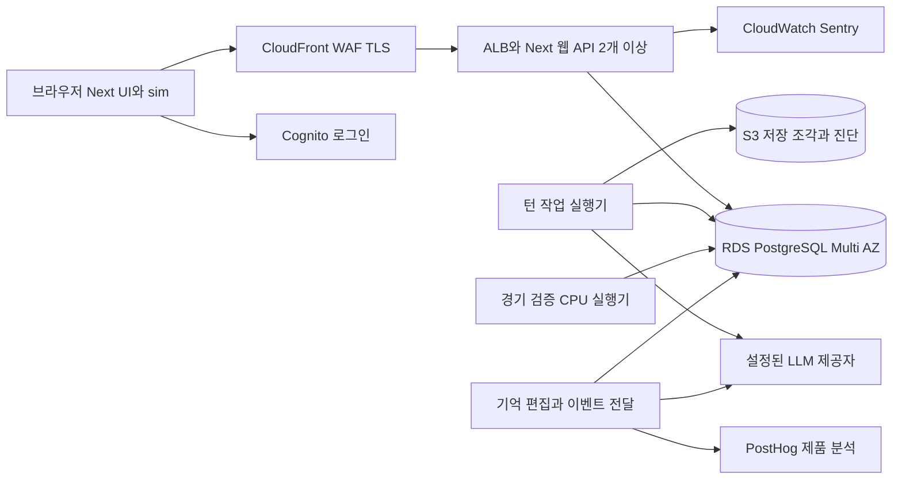

# Gaffer 배포 독립 설계 Codex

> **원래의 수백 명 조건으로 먼저 작성한 독립 검토 자료다. 현재 권장안이 아니다.** 이후 사용자가 초대제·초기 동시 접속 10명 이하·무료 인프라 우선으로 조건을 좁혔다. 현재 권장은 [final-design.md](final-design.md)를 따른다. 이 파일은 Claude가 독립안 완료 후 교차 검토한 원본을 보존한다.

공통 입력은 [input.md](input.md)다. 이는 구현 전 제안이다. 권장은 AWS 서울의 상주 컨테이너, PostgreSQL 원장, 객체 저장소를 쓰는 모듈식 단일 애플리케이션이다. 웹/API와 작업 실행의 프로세스만 분리하고 축구 도메인은 그대로 재사용한다.

## 1. 현재 코드에서 출발할 지점

| 근거                                               | 현재 경계                                                              | 배포에 필요한 변화                               |
| -------------------------------------------------- | ---------------------------------------------------------------------- | ------------------------------------------------ |
| `apps/web/app/api/games/route.ts`                  | 서버 전체 게임 목록, 로그인·소유자 없음, 생성 중 LLM 호출              | 로그인 소유권, 생성 작업 ID와 중복 방지          |
| `packages/engine/src/app/persistence.ts`           | 동기 파일 IO, JSON 본체와 players/contracts 해시 조각, SAVE_VERSION 29 | 비동기 저장 어댑터, 트랜잭션과 revision          |
| `packages/engine/src/core/save-lock.ts`            | 호스트/PID 기반 파일 잠금, 원격 소유자는 시간 만료 없음                | DB 기반 claim·lease·fencing                      |
| `apps/web/game/turn-runner.ts`                     | 메모리 Map + 파일 잠금을 LLM 호출 동안 유지                            | 짧은 DB claim 후 잠금 없는 계산, 마지막 CAS 커밋 |
| `apps/web/app/api/games/[id]/turn/stream/route.ts` | NDJSON 요청 안에서 턴 실행, 연결이 끊겨도 현재 프로세스는 진행         | 지속 작업과 조회/재접속 가능한 이벤트            |
| `apps/web/game/live-match-server.ts`               | 같은 Node 이벤트 루프에서 구간 재실행, 중복 명령은 메모리 Map          | CPU 실행 풀, DB 중복 방지와 소유자 임대          |
| `apps/web/game/lorebook-jobs.ts`                   | 저장된 jobs + 프로세스 Map, GET/after에 재개 의존                      | 지속 스케줄러, 항목별 버전 충돌 처리             |
| `packages/llm/src/usage-meter.ts`                  | 메모리 사용량과 게임별 토큰 상한                                       | 실패 포함 영구 사용량, 사용자/전체 비용 예약     |
| `packages/llm/src/turn-trace.ts`                   | production에서 trace 비활성                                            | 운영 메타데이터와 제한된 원문 저장 경로          |
| `apps/web/app/api/admin/admin-guard.ts`            | 쓰기만 환경변수 차단, 운영자 인증은 없음                               | 사용량·lab·trace·catalog 포함 중앙 권한 검사     |

`docs/match/live-match.md`에는 한 클라이언트 임대 설명이 있지만 현재 라이브 라우트에서는 서버 임대 검사가 확인되지 않는다. 문서상 보장을 출시된 보장으로 간주하지 않는다. 같은 문서의 SAVE_VERSION 표기도 현재 코드와 다르므로 기준은 코드 29다.

## 2. 배포 구성

- 서울 단일 리전, 2 AZ, ECS Fargate의 web / turn-worker / sim-worker 서비스. 보조 작업은 turn-worker에서 낮은 우선순위와 별도 동시성 예산으로 처리할 수 있다.
- RDS PostgreSQL Multi-AZ를 소유권·게임 revision·작업·이벤트·비용의 원본으로 사용한다. 세션도 DB에 둔다.
- 큐는 PostgreSQL `FOR UPDATE SKIP LOCKED` 기반 지속 jobs. Redis/SQS/Kafka는 첫 버전에 넣지 않는다. 알림은 깨우기 힌트이고 DB 재조회가 복구 경로다.
- S3 Standard private 버킷: 불변 세이브 조각, 제한된 진단 원문, 동의된 피드백 첨부. CloudFront 공개 정적 자산과 분리한다.
- Cognito OIDC code + PKCE 로그인, Google로 시작. Next BFF가 토큰을 검증하고 임의의 세션 ID를 HttpOnly Secure SameSite 쿠키로 보관한다. 브라우저는 AWS 자격증명을 받지 않는다.
- Sentry는 오류, CloudWatch/OTel은 운영 지표, PostHog는 선별한 행동 이벤트. 서버 제품 이벤트는 outbox를 통해 전달한다.

수백 명에서는 Kubernetes나 도메인별 마이크로서비스가 필요하지 않다. 대안은 Railway 상주 컨테이너 + Supabase Auth/Postgres/Storage다. 배포 속도와 소규모 비용에는 유리하지만 서울 중심 구성·자동 장애 전환·백업 조건을 별도로 맞춰야 한다. AWS 예산을 감당하기 어려운 초대 테스트에는 이 대안을 선택할 수 있고, 작업·저장 계약은 동일하게 유지한다.

## 3. 인증과 테넌트 경계

로그인과 게임 권한을 분리한다. `users(id, issuer, subject, status, role)`로 외부 계정과 연결하고 이메일 자동 병합은 하지 않는다. 초대 허용 여부를 서버가 판단한다. 작업 제출 시와 실행 시작 시 계정 차단·게임 소유권을 확인한다.

모든 게임 하위 API는 session → user → owner(game) → action 순으로 검사한다. 타인의 game/job/feedback ID는 404. 요청 body의 user ID는 신뢰하지 않는다. RLS를 추가하되 앱 역할은 table owner/superuser/BYPASSRLS가 아니어야 한다. pooled connection에는 트랜잭션마다 `SET LOCAL`로 사용자 범위를 적용한다. worker는 좁은 서비스 권한으로 claim된 작업의 사용자 범위를 사용한다.

변경 API는 동일 출처 확인과 CSRF 토큰, Zod 제한, 콘텐츠 길이 제한, 사용자별 rate limit을 둔다. 운영자는 별도 권한과 MFA, 원문 조회 감사 기록을 사용한다. `/admin`, `/api/admin`, `/lab`, trace 경로와 카탈로그 변경을 프로덕션 공개 경로에서 기본 차단한다.

## 4. 데이터 모델과 세이브

| 테이블                        | 핵심 계약                                                                                                                         |
| ----------------------------- | --------------------------------------------------------------------------------------------------------------------------------- |
| users / sessions / invites    | 계정 상태, 해시된 세션 ID, 만료·폐기, 초대 수락                                                                                   |
| games                         | owner_id, status, revision, active_job_id, save_version, runtime_id, catalog_version, 목록 요약                                   |
| game_snapshots                | game_id + revision, 작은 본체, players/contracts 불변 객체 참조, checksum                                                         |
| game_jobs                     | id, owner_id, game_id, kind, payload_hash, idempotency_key, base_revision, status, attempt, lease_until, fencing_token, run_after |
| job_events                    | job_id + attempt + seq, queued/running/delta/attempt_reset/committed/failed                                                       |
| llm_calls / cost_reservations | 실제 호출 시도, 제공자 요청 ID, 토큰·가격 버전·비용 추정, unknown 사용량                                                          |
| outbox / product_events       | 커밋과 같은 트랜잭션에서 생성한 이벤트 ID와 전달 상태                                                                             |
| feedback / feedback_context   | 사용자 평가, game/job/turn/release 참조, 사용자가 선택한 첨부 범위                                                                |
| match_sessions / audit_events | client 임대 epoch, 권한·삭제·운영자 접근 감사                                                                                     |

기존 거대한 GameState를 선수별 SQL 테이블로 다시 모델링하지 않는다. 저장 codec이 본체와 큰 불변 조각을 나누고 동일 GameState로 복원한다. 새 저장 컨테이너 형식은 게임 의미를 바꾸지 않으면 SAVE_VERSION과 별개다. 채팅·경기 기록은 증가량을 측정한 뒤 append 전용 저장/읽기 페이지로 분리하며, LLM의 현재 이력 의미는 유지한다.

불변 객체를 먼저 업로드하고 checksum을 확인한 뒤 DB에서 snapshot 참조와 revision을 커밋한다. 실패한 업로드/커밋은 참조되지 않은 객체만 남긴다. 삭제 GC는 현재 참조, 보존 revision, PITR 복구 범위의 참조를 모두 보호한다. 단순한 객체 생성일 TTL로 현재 세이브 조각을 지우지 않는다. 사용자 간 전역 중복 제거는 하지 않고 게임별 prefix를 사용한다.

## 5. 작업의 정확성

1. `POST /api/games/:id/operations`에 `idempotencyKey`, `expectedRevision`, 구조화 입력을 보낸다. 소유권과 예산을 검증하고 job + 게임 active_job + 최초 이벤트를 한 DB 트랜잭션으로 생성한다. `202 {jobId,statusUrl,eventsUrl}`를 반환한다.
2. 같은 키·같은 입력은 기존 job을 반환한다. 같은 키·다른 입력은 409. 한 게임에는 한 변경 작업만 허용한다. 두 탭이 다른 변경을 동시에 제출하면 뒤 요청은 409로 명시적으로 충돌한다.
3. worker가 짧은 트랜잭션으로 claim한다. lease 60초, heartbeat 10초를 출발 설정으로 둔다. 회수마다 fencing token이 증가한다. LLM 호출 중 SQL 트랜잭션/행 잠금을 유지하지 않는다.
4. 최신 snapshot을 가져와 private 메모리에서 기존 코어와 GM을 실행한다. CPU 연산은 별도 worker thread/process에 위임해 heartbeat가 막히지 않게 한다.
5. 업로드한 결과를 `revision == base_revision AND active_job == this_job AND fencing_token == token AND lease_until > DB clock AND game not deleted` 조건으로 커밋한다. snapshot + revision + 결과 이벤트 + outbox + 작업 완료는 같은 트랜잭션이다.
6. 늦게 살아난 이전 worker는 갱신할 수 없다. 실행은 at-least-once이며 상태의 한 번 반영은 DB 제약으로 만든다. 외부 LLM 호출의 exactly-once/동일 응답은 보장하지 않는다.

턴·라인업·협상·메일·checkpoint·경기 마감·기억 편집·삭제를 모두 같은 변경 직렬화 경계로 통과시킨다. 저지연 경기 검증과 라인업은 높은 우선순위 CPU 큐, LLM은 별도 풀을 사용한다. 게임 삭제는 즉시 tombstone을 세우고 token을 무효화하여 실행 중인 worker의 재생성을 막는다.

기억 편집은 읽은 character version으로 외부 호출을 하고 적용할 때 다시 짧게 직렬화한다. 게임 전체의 낡은 snapshot을 덮어쓰지 않는다. 같은 인물의 앞 작업이 실패하면 후속 작업을 앞질러 적용하지 않는다. 주기적인 DB 스캔으로 재개하며 GET은 더 이상 작업 시작의 근거가 아니다.

## 6. 스트림과 경기 클라이언트

job 이벤트는 NDJSON fetch로 `after=seq`를 지원한다. 기존 클라이언트 파서를 확장하므로 WebSocket/SSE 전환은 필요하지 않다. 10초 ping은 연결 확인이며 lease/성공의 증거가 아니다. 델타를 250ms 또는 수 KB 단위로 묶어 저장하고 종료 이벤트는 DB 커밋 후 보낸다. 재연결에서는 job 상태를 먼저 읽고 cursor 이후 이벤트를 받는다. 복구 attempt가 달라지면 기존 미확정 텍스트를 교체한다.

게임 화면은 accepted/queued/running/reconnecting/committed/failed를 구분한다. `done` 전 텍스트는 미확정이다. 마지막 서버 revision보다 오래된 응답은 적용하지 않는다. 전체 chat 대신 cursor 페이지와 바뀐 view를 받는다. 모든 인증 응답은 private/no-store이며 CDN 캐시는 공개 정적 자산에만 적용한다.

라이브 sim은 계속 브라우저에서 돈다. 서버는 checkpoint 구간을 같은 build의 sim으로 다시 실행한다. DB `match_sessions`의 client_id와 lease epoch로 다른 기기의 오래된 지시를 거부한다. 임대 heartbeat는 경기 상태 커밋과 분리한다. checkpoint/명령의 중복 키와 결과는 DB에 보관한다. 탭 복귀·배포 후 client sim build가 다르면 계산 전 중단하고 마지막 확정 상태와 맞는 자산을 다시 받는다.

## 7. 부하와 비용

300명 접속을 300개 LLM 동시 실행으로 계산하지 않는다. 아래는 초기 가정이다.

- 평상시 300명 중 30%가 분당 턴 하나: 1.5 turns/s.
- 평균 턴 wall time 20초라면 30 in-flight jobs. 여유 포함 시작 목표 60개, 부하 검증 후 조정.
- 300명 모두 분당 하나면 5 turns/s, 평균 20초에서 100개 동시 작업. burst는 큐 대기와 admission으로 제한한다.
- 턴당 외부 호출 4회라면 평상시 360 RPM, 피크 1,200 RPM. 호출당 10k 입력/1k 출력 가정이면 평상시 3.6M input TPM/0.36M output TPM. 실제 GM 도구 왕복·Jev·기억 편집·retry별 측정으로 대체한다.
- 동시 경기 60개가 평균 30초마다 검증하면 2 checkpoints/s. 요청당 CPU 0.5초라면 1 vCPU 소비, 50% 목표에는 2 vCPU. 하프 전체 버스트는 이 평균으로 보장할 수 없으므로 따로 테스트한다.
- 메모리 = 동시 GameState × 실제 heap 배수 + clone + 캐시 + 런타임. raw JSON 크기를 heap과 같게 취급하지 않는다.

전체 provider/project/model별 RPM·TPM·동시 요청 admission을 모든 replica가 공유한다. 게임 수 대신 사용자·일·조직 비용을 제한하고 신규 게임 생성에도 적용한다. 호출 전에 최대 토큰/도구 라운드 예산을 예약하고 실제 청구로 정산한다. usage가 누락된 시도는 unknown이며 0원 처리하지 않는다. 승인된 저가 모델로 몰래 바꾸지 않고 대기·제한 상태를 보여 준다.

AWS 인프라 예산은 베타 상주 구성 월 USD 500–1,200을 계획 범위로 둔다. 이는 공급자 견적이나 300명 처리 인증이 아니다. Fargate replica 시간, RDS Multi-AZ/IO/백업, ALB/LCU, NAT/전송, S3, 로그, Auth, Sentry/PostHog를 합산해 출시 전 확정한다. LLM은 별도다. 예를 들어 300 DAU × 하루 20턴 × 30일 = 180,000턴이고, 측정 비용이 턴당 $0.01/$0.05/$0.10이면 월 $1,800/$9,000/$18,000이다. 가격 가정은 실제 모델 가격표가 아니다.

## 8. 피드백과 관측

세 가지 질문을 한 운영 화면에서 연결한다: 어디에서 떠나는가, 무슨 턴이 실패하는가, 왜 지시가 기대와 달랐는가.

- 제품: 초대 수락 → 게임 생성 성공 → 첫 턴 성공 → 첫 경기 완료, D1/D7 복귀, 세션당 성공 턴, 피드백 비율.
- 운영: queue wait와 execution/TTFT 분리, 저장 충돌, lease 재회수, retry/429, DB 연결과 CPU, checkpoint CPU와 mismatch.
- 비용: model/agent/release별 input/output/cache, 실패 호출 비용, 성공 턴당 비용, 일 상한 소진 예상.
- 공통 키: pseudonymous user ID, game ID, operation/job/turn ID, trace ID, build ID, game version, sim version. 개인 식별자를 metric label로 사용하지 않는다.

기본 metadata는 모든 시도에 기록한다. prompt/response와 입력 원문은 별도 제한 저장이며 analytics·Sentry로 보내지 않는다. 베타 진단 동의/고지를 분명히 하고, 원문은 7일, 피드백에 사용자가 첨부한 근거는 90일, 운영 메타데이터는 30일 등 명시된 정책을 둔다. 기본 session replay/autocapture는 끈다. 사용자 삭제는 DB·S3 버전·분석 도구·백업의 만료 및 복구 후 재삭제까지 연결한다.

피드백에는 마지막 턴 평가, 문제 범주, 자유 의견과 선택 첨부를 둔다. `feedback_id`로 해당 revision과 LLM call IDs를 찾을 수 있고 운영자는 triage 상태/담당/해결 release를 관리한다. 이벤트는 서버 커밋에서 생성하고 고유 event ID로 중복 제거한다. 클라이언트 클릭을 게임 성공 사실로 간주하지 않는다.

## 9. 릴리스와 복구

개발/스테이징/운영의 DB·bucket·identity pool·LLM 키를 분리한다. Docker image와 공개 자산을 commit digest로 고정하고 Terraform으로 네트워크·IAM·ECS·DB·알람을 관리한다. GitHub Actions OIDC로 배포하고 장기 AWS 키를 저장하지 않는다. 기존 CI gate를 통과한 image만 canary에 배포한다.

배포 전 worker가 새 claim을 멈추고 현재 작업을 drain한다. Fargate 종료 유예 최대 120초를 긴 턴의 완료 보장으로 사용하지 않는다. scale-in protection과 사전 drain을 사용하고 갑작스러운 종료는 lease recovery가 담당한다. LLM 결과/도구 호출을 임의로 재실행해 동일한 문장이 나온다고 보장하지 않는다.

현재 정책은 세이브 마이그레이션 금지다. 첫 공개 cohort에서는 SAVE_VERSION을 동결한다. 깨지는 업데이트는 별도 runtime cohort로 새 게임만 받으며 기존 cohort는 호환 runtime·sim 자산으로 계속 실행한다. 최대 동시 cohort 수와 지원 기한은 제품 정책으로 정하고 오래된 게임을 자동 삭제/새 버전으로 강제 로드하지 않는다. DB 운영 스키마의 expand/contract migration과 GameState 마이그레이션은 다르다.

RDS PITR 14일과 S3 객체 버전/보호를 같은 복구 창에 맞춘다. DB 시점 복구 뒤의 snapshot 참조를 실제 읽어 검증하는 복구 연습을 한다. 목표 RPO ≤5분, RTO ≤60분은 검증해야 할 운영 목표다. 계정 삭제 tombstone은 복원으로 되살아나지 않게 별도로 적용한다.

## 10. 구현 순서와 출시 기준

1. 저장 codec/repository 경계 추출, 코드에 없는 임대·원자성 요구를 문서화.
2. 인증·소유권·초대와 DB 어댑터, API 권한 목록, 운영 경로 차단.
3. 작업 수락·중복 방지·lease/fencing·원자 커밋과 durable 이벤트, frontend 재접속.
4. CPU 풀·경기 임대·기억 편집·가격/사용량 예약.
5. 피드백·metadata·원문 정책·outbox·운영 화면.
6. IaC·스테이징·백업 복구·배포 drain·호환성 검사.
7. 10 → 50 → 300명 확대. 초대 수 자체보다 처리율·지연·비용·실패율로 결정.

출시 조건은 권한 교차 접근 0, 같은 요청 100회 재전송에도 상태 1회 반영, worker kill/재시작/lease 만료 후 늦은 commit 차단, 저장 완료 후 응답 유실 복구, lorebook 충돌 무손실, 서로 다른 기기 임대 경합, 실제 배포 중 sim 버전 일치, DB+객체 함께 복구, 삭제 중 실행 작업의 재생성 방지다. 300 가상 사용자 부하는 LLM mock으로, provider quota와 실제 비용은 작은 승인된 실호출 파일럿으로 검증한다. 현재 문서 작업에서 부하 성능을 검증했다고 주장하지 않는다.

## 공식 근거

- [Next.js self hosting](https://nextjs.org/docs/app/guides/self-hosting): streaming과 다중 인스턴스 캐시/버전 일치.
- [PostgreSQL SELECT](https://www.postgresql.org/docs/current/sql-select.html): queue용 SKIP LOCKED.
- [PostgreSQL RLS](https://www.postgresql.org/docs/current/ddl-rowsecurity.html): owner/BYPASSRLS 예외.
- [Cognito authorize](https://docs.aws.amazon.com/cognito/latest/developerguide/authorization-endpoint.html): code/PKCE.
- [ECS task definition](https://docs.aws.amazon.com/AmazonECS/latest/developerguide/task_definition_parameters.html), [scale in protection](https://docs.aws.amazon.com/AmazonECS/latest/developerguide/task-scale-in-protection.html): 종료와 보호 제약.
- [S3 consistency](https://docs.aws.amazon.com/AmazonS3/latest/userguide/Welcome.html): 객체 읽기 일관성은 DB와의 원자 트랜잭션을 대신하지 않는다.
- [RDS backups](https://docs.aws.amazon.com/AmazonRDS/latest/UserGuide/USER_WorkingWithAutomatedBackups.html), [Fargate pricing](https://aws.amazon.com/fargate/pricing/), [RDS pricing](https://aws.amazon.com/rds/postgresql/pricing/).
- [Railway regions](https://docs.railway.com/deployments/regions), [Supabase regions](https://supabase.com/docs/guides/platform/regions).
