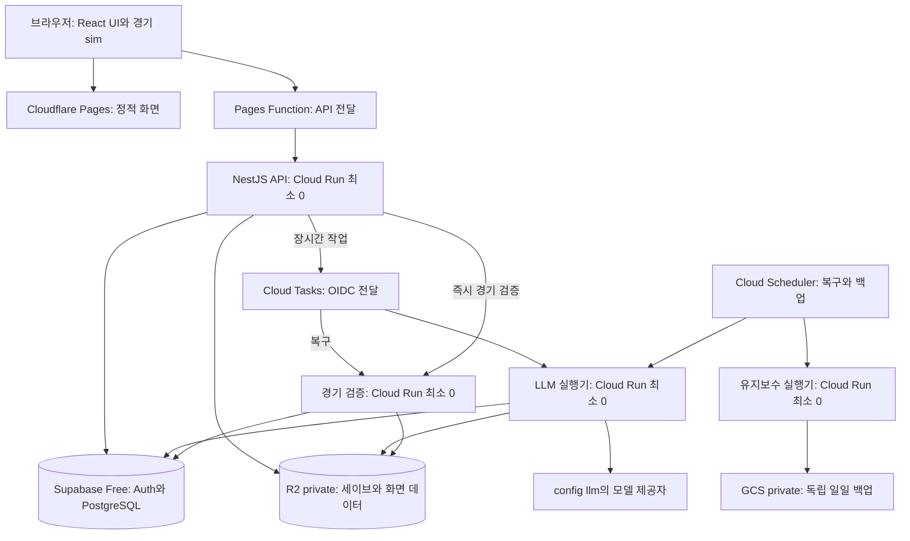
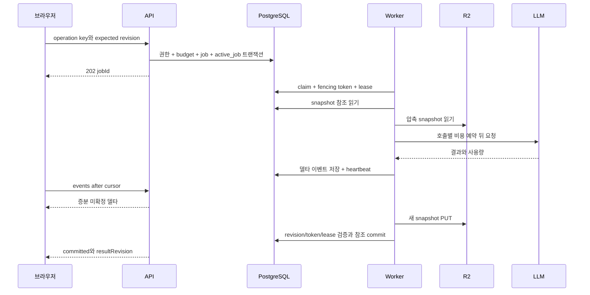

# Gaffer 초대 베타 배포 설계

**상태: 구현 전 설계.** 저장·작업·복구 계약은 Codex·Claude 교차 검토를 마쳤다. React/Vite + NestJS와 프론트 프록시 구성은 후속 대화에서 보완한 제안이며 별도 통합 검증이 필요하다. 초기 목표는 **동시 접속 10명 이하·초대제·무료 인프라 우선**이다. 수백 명 처리는 확장 경로이며 처음부터 그 비용을 내지 않는다. 기존 결정적 코어, 모델 품질, 사용자별 게임 격리와 중복 저장 방지는 유지한다. 채택·기각의 근거는 [교차 검토 결과](review-results.md)에 있다.

권장 조합은 **Cloudflare Pages의 React/Vite 화면 + Cloud Run의 NestJS API와 작업 실행기 + Supabase Free의 Auth/PostgreSQL + Cloud Tasks + R2 + 무료 관측 도구**다. 먼저 [전체 인프라 설명](infrastructure-overview.md)을 읽으면 실행기의 역할과 요청 흐름을 확인할 수 있다. 상주 서버와 유료 PITR는 시작 조건이 아니다. 작은 사용량에서 인프라 비용을 0에 가깝게 줄이되, LLM API·네트워크·무료 초과분까지 무료라고 약속하지 않는다.

## 1. 범위와 운영 보장

| 구분        | 초기 결정                                                                                                                 |
| ----------- | ------------------------------------------------------------------------------------------------------------------------- |
| 공개 방식   | 초대제. 초대 없는 가입과 게임 접근을 서버에서 차단                                                                        |
| 사용자 관계 | 사용자마다 독립 세계. 공동 세계 멀티플레이는 범위 밖                                                                      |
| 초기 규모   | 동시 접속 10명 이하. 최초 10계정 초대와 활성 게임 계정당 2개를 운영 초깃값으로 제안하며, 동시 접속 수와 총 계정 수를 구분 |
| 지역        | 한국 중심 임시 가정, Cloud Run과 Supabase는 도쿄. R2 지역 힌트는 국내 보관 보장이 아님                                    |
| 정확성      | 한 게임의 변경 직렬화, 요청 중복 제거, 낡은 실행 결과 차단, 소유권 격리                                                   |
| 가용성      | 콜드 스타트·무료 DB 휴면·공급자 장애 시 일시 중단 허용. 자동 작업 복구                                                    |
| 복구        | 프로세스 장애에서는 확정 데이터 손실 0 목표. DB 손실은 매일 백업 기준 최대 24시간 손실 가능, 복구 목표 1영업일 이내       |
| 품질        | 비용 때문에 모델·프롬프트를 몰래 바꾸거나 필수 판정을 생략하지 않음                                                       |
| 버전        | 첫 베타 동안 SAVE_VERSION 동결, 기존 세이브 자동 변환 없음                                                                |

무료 Supabase에는 자동 백업/PITR가 없고, 낮은 활동량이 지속되면 휴면될 수 있다. **일일 외부 백업과 실제 복원 검증을 출시 조건으로 둔다.** 휴면 방지용 가짜 트래픽에 의존하지 않는다. 24시간 손실 가능성이나 수동 복구가 허용되지 않는 서비스 단계가 되면 무료 구성을 졸업한다. [Supabase 요금](https://supabase.com/pricing), [휴면 정책](https://supabase.com/docs/guides/platform/free-project-pausing)

## 2. 현재 코드와 필요한 변경

| 현재 근거                                                      | 공개 운영에서 필요한 변화                       |
| -------------------------------------------------------------- | ----------------------------------------------- |
| `apps/web/app/api/games/route.ts`는 서버 전체 게임 목록을 반환 | 사용자 소유권 필터, 초대·인증·생성 한도         |
| `persistence.ts`는 동기 파일과 JSON 조각 저장                  | 비동기 repository와 DB 원자 커밋                |
| `save-lock.ts`는 호스트/PID 파일 잠금                          | DB lease와 fencing token                        |
| `turn-runner.ts`는 LLM 실행 전체에 잠금 유지                   | 짧은 claim, 메모리 계산, 조건부 결과 커밋       |
| turn stream 요청이 실행 생명주기를 소유                        | 작업 제출과 상태/이벤트 조회 분리               |
| `live-match-server.ts`의 명령 중복 표는 프로세스 Map           | 영구 command ID와 서버의 경기 client lease      |
| checkpoint 재실행은 동기 CPU 작업                              | 웹 이벤트 루프와 분리한 실행 풀                 |
| lorebook 재개는 `after()`와 게임 GET에도 의존                  | 지속 스케줄러와 인물 버전 검사                  |
| `usage-meter.ts`는 메모리 장부이고 일부 호출만 상한 적용       | GM을 포함하는 영구 비용 예약·정산               |
| `traceEnabled()`가 production에서 false                        | 운영 수집과 개발 원문 노출을 별도 설정으로 분리 |
| admin 쓰기 환경변수, 사용량 조회 등은 사용자 인증 없음         | 모든 운영 경로에 운영자 권한과 접근 감사        |

자세한 코드 링크와 확인 한계는 [evidence.md](evidence.md)에 있다. 새 게임 합성 표본의 JSON은 **12.82MB**, gzip은 **1.34MB**다. players 6.51MB, lorebook 4.42MB, contracts 0.91MB가 대부분을 차지한다. 현재도 화면용 `toPayload`가 있으므로 이를 유지하고, 이력 페이지와 변경된 뷰만 반환하도록 확장한다.

## 3. 시스템 구성



- **화면**: 기존 React 컴포넌트·CSS·브라우저 sim을 Vite 앱으로 옮겨 정적 배포한다. Next 라우팅·Link·Metadata는 교체하고 게임 코어는 재사용한다. 무료 `pages.dev` 주소에서 시작할 수 있다. SSR 서버는 운영하지 않는다. [Vite 정적 배포](https://vite.dev/guide/static-deploy.html)
- **api**: NestJS가 로그인·소유권·짧은 API·job 조회와 LLM 없는 가벼운 명령을 담당한다. Controller/Guard는 공통 서버 서비스를 호출하며 게임 규칙과 Zod 스키마를 중복 정의하지 않는다. [NestJS](https://docs.nestjs.com/)
- **worker와 sim**: 같은 백엔드 이미지의 별도 진입점/역할로 배포한다. worker는 Cloud Tasks가 보낸 인증된 HTTP 요청 안에서 긴 LLM 작업을 끝낸다. sim은 직접 OIDC 요청 또는 복구 task로 CPU 중심 경기 검증을 처리한다. 요청 동시성 1의 sim과 supervisor의 heartbeat를 thread/process로 격리한다. 응답 후 timer나 메모리 큐에 실행을 맡기지 않는다.
- **PostgreSQL**: 소유권·job·revision·receipt·비용·feedback·outbox의 원본. Cloud Tasks는 실행 전달 계층이며 게임 상태의 원본이 아니다.
- **R2 Standard private bucket**: 압축 세이브·화면 데이터·선택한 진단·백업. S3 API만 서버에서 호출하고 공개 bucket과 `r2.dev`는 끈다. DB에는 작은 manifest와 checksum을 둔다.
- **Scheduler와 유지보수**: ① 5분마다 outbox/lease/삭제 복구, ② 매일 백업·보관 정리의 두 작업. 작은 batch와 실행 상한을 두고 요청 안에서 처리한다. 백업은 별도 identity를 가진 min-0 실행기를 사용한다.
- **관측**: 구조화 stdout은 Cloud Logging, 오류는 Sentry Free, 선별 제품 이벤트는 PostHog 무료량에 담는다. 피드백과 비용 원본은 자체 DB에 둔다.

리전은 Cloud Run `asia-northeast1`, Supabase `ap-northeast-1`을 명시 선택한다. 도쿄는 Cloud Run Tier 1, 서울과 싱가포르는 Tier 2라 무료 credit을 더 오래 쓰는 쪽을 우선했다. 한국 사용자 지연은 출시 전 확인하며 국내 보관 보장을 전제하지 않는다. [Cloud Run 리전](https://docs.cloud.google.com/run/docs/locations), [Supabase 리전](https://supabase.com/docs/guides/platform/regions)

### 실행 역할과 별도 서비스의 차이

LLM의 비동기 네트워크 대기는 Node.js의 다른 요청을 막지 않는다. 실행기를 나누는 이유는 작업 수명·메모리/CPU·장애·시간 제한·비용 동시성을 사용자 API와 별도로 관리하기 위해서다. 접수된 job은 브라우저 연결과 독립적이고, 중복 전달 및 프로세스 종료는 §6의 영구 작업 계약으로 처리한다.

10명이라는 숫자만으로 별도 서비스가 필수인 것은 아니다. 하나의 Nest 서비스에서 사용자 API와 OIDC로 보호한 작업 경로를 함께 운영할 수도 있다. 이때에도 DB job/receipt, Cloud Tasks, CPU thread/process 격리가 필요하다. 이 설계는 조회 응답과 작업 실패의 영향을 줄이기 위해 api/worker/sim 역할의 별도 배포를 권장한다. CPU 검증이 채팅 진행 기록을 지연시키지 않게 sim도 분리한다. 별도 언어·저장소·축구 코드 복사나 기능별 마이크로서비스는 필요하지 않다.

Cloud Run은 **request-based billing, min instances 0**을 사용한다. API·worker·sim·유지보수 서비스 4개는 상시 켜진 VM 4대를 뜻하지 않는다. LLM을 기다리는 시간도 요청이 열린 동안의 과금 시간이며, 콜드 스타트와 클라우드 간 전송 비용은 남는다. [Cloud Run 과금](https://docs.cloud.google.com/run/docs/configuring/billing-settings), [R2 요금](https://developers.cloudflare.com/r2/pricing/)

Nest의 BullMQ 통합은 Redis를 요구하므로 초기에는 쓰지 않는다. Cloud Tasks의 인증된 HTTP 전달을 사용해 별도 Redis를 운영하지 않는다. [Nest 큐](https://docs.nestjs.com/techniques/queues)

### 프론트 주소와 API 전달

브라우저는 정적 화면과 같은 origin의 `/api/*`를 호출한다. 이 경로만 Pages Function이 고정된 Cloud Run API origin으로 전달한다. OAuth 시작/callback도 `/api/auth/*`를 사용하고 서버의 `PUBLIC_APP_ORIGIN`으로 반환 URL을 고정한다. `pages.dev`와 `run.app` 사이의 제3자 쿠키 허용에 의존하지 않는다. [Pages Functions](https://developers.cloudflare.com/pages/functions/), [함수 라우팅](https://developers.cloudflare.com/pages/functions/routing/)

프록시는 `Set-Cookie`와 응답 상태를 보존하고 API·OAuth·오류를 캐시하지 않는다. host-only 세션 쿠키의 Domain을 API 원본 주소로 지정하지 않는다. Host/forwarded header로 리다이렉트 주소를 만들지 않고, 전달 대상을 사용자 입력으로 받지 않는다. `/api/*` 실패를 SPA HTML fallback으로 바꾸지 않는다. API 원본 주소에도 같은 인증·소유권·Origin/CSRF 검사를 적용한다. 프록시 자체가 인증의 근거는 아니다. 정적 파일에는 비밀값이나 개인 게임 상태를 넣지 않는다.

Pages Function은 게임을 계산하지 않는 전달 함수다. 게임 실행기와 혼동하지 않는다. 정적 자산 요청은 무료이며 함수 요청은 Workers Free의 공유 일일 요청 한도를 소비한다. 폴링 요청을 포함해 사용량을 감시한다. [Pages 요금](https://developers.cloudflare.com/pages/functions/pricing/)

### 코드 경계

| 위치                         | 책임                                                                                               |
| ---------------------------- | -------------------------------------------------------------------------------------------------- |
| `apps/web`                   | React/Vite 화면, 클라이언트 라우팅, 정적 배포. 서버 패키지를 값으로 import하지 않음                |
| `apps/api`                   | NestJS HTTP 진입점, 세션·권한 Guard, Zod 입력 검증, HTTP 응답                                      |
| `packages/server`            | 저장·작업·예산·피드백·소유권의 공통 서버 계약. Next/React/Nest 요청 객체·decorator에 의존하지 않음 |
| `apps/worker`                | Node/Nest의 내부 실행 진입점. 역할별로 필요한 모듈만 기동하고 서버 서비스를 재사용                 |
| engine/domain/sim/agents/llm | 기존 게임 규칙·모델 호출·공유 스키마. 웹 프레임워크와 독립                                         |

초기 배포는 단일 monorepo와 동일 commit의 프론트/백엔드 artifact를 사용한다. 화면/API의 경계를 나누되 배포 버전 호환은 함께 검증한다. API 계약을 유지하면서 라우트와 서버 배관을 옮기며, 엔진을 Nest 서비스 클래스로 다시 작성하지 않는다.

## 4. 초대와 인증

### 가입 흐름

1. 운영자가 이메일을 지정한 초대를 만든다. 256bit 랜덤 토큰의 해시, 정규화한 대상 이메일, 만료 시각, 수락 사용자, 취소 상태를 DB에 저장한다.
2. 사용자는 초대 링크에서 Google 로그인을 한다. OAuth `state`·PKCE를 검증하고 리다이렉트 주소는 allowlist로 제한한다.
3. Supabase의 **Before User Created hook**도 유효 초대 이메일을 검사한다. 로그인 버튼을 숨기는 것만으로 가입을 막지 않는다. 새 가입 경로를 직접 호출해도 초대 없는 계정은 만들어지지 않아야 한다. [Supabase Auth hook](https://supabase.com/docs/guides/auth/auth-hooks/before-user-created-hook)
4. callback에서 검증된 계정 이메일과 초대 token을 다시 대조한다. 한 트랜잭션에서 `accepted_user_id`를 기록하고 앱 membership을 활성화한다. callback 재전송은 같은 사용자에게 멱등적으로 성공한다. Auth 계정 생성과 membership 사이에 장애가 나면 다음 callback에서 이어가며, membership 없는 Auth 계정은 게임 API를 사용할 수 없다.
5. 계정은 외부 subject로 식별한다. 이메일이 같다는 이유로 임의의 다른 identity와 자동 병합하지 않는다. 초대 취소·사용자 차단은 DB의 membership 상태가 최종 판단한다.

초대 메일 발송을 제품에서 자동화할 때만 별도 SMTP 공급자를 붙인다. 최초 운영은 관리자 생성 링크 전달로 충분하다. 초대 토큰은 URL 접근 로그·분석 이벤트에서 제거하며 수락 후 깨끗한 URL로 이동한다.

### 세션과 권한

Nest API가 OAuth 교환을 마친 뒤 임의의 세션 ID를 `HttpOnly; Secure; SameSite=Lax` 쿠키로 발급한다. DB에는 세션 ID의 해시와 만료/폐기, 암호화한 Supabase 세션 갱신 정보만 보관한다. 프론트엔드가 DB를 직접 수정하거나 장기 토큰을 localStorage에 저장하지 않는다. Supabase 공식 SDK로 code 교환과 refresh를 수행하고 JWT 검증은 검증된 라이브러리를 쓰며 issuer/audience/서명/만료를 확인한다. 병렬 token 갱신은 세션별로 직렬화한다. Google API 권한·Google refresh token은 게임 로그인에 필요하지 않으므로 저장하지 않는다. Auth middleware만 믿지 않고 각 API에서 membership과 소유권을 확인한다.

모든 게임 API는 `세션 → 활성 membership → game.owner_id → action 권한`을 통과한다. body의 user ID를 신뢰하지 않는다. 타인의 game/job/trace ID에는 404를 반환한다. 변경 요청은 Origin/CSRF를 검사한다. 운영자는 MFA와 서버의 role을 확인하며 사용자 JWT의 수정 가능한 metadata를 관리자 근거로 쓰지 않는다.

DB 앱 역할은 owner/superuser/BYPASSRLS가 아닌 전용 역할이다. 소유자 필터와 RLS를 함께 적용하며 사용자 context는 트랜잭션의 `SET LOCAL`로 설정한다. 직접 SQL 접속에는 Supabase `auth.uid()`가 자동으로 채워진다고 가정하지 않는다. job claim 함수는 고정 search_path, 제한된 EXECUTE 권한과 검증된 작업 소유자 범위를 갖는다. 운영 테이블은 공개 Data API에서 제외한 private schema에 두고 anon/authenticated 역할의 직접 쓰기와 공개 RPC 우회 경로를 막는다. Auth 관리용 service key는 회원 관리 경계에만 두고 일반 게임 요청에서는 쓰지 않는다. [PostgreSQL RLS](https://www.postgresql.org/docs/current/ddl-rowsecurity.html)

`/admin`, `/api/admin/*`, `/lab`, 개발 trace 경로는 공개 환경에서 닫고 운영용 화면은 별도 권한으로 연다. catalog는 이미지에 포함된 불변 버전으로 배포한다. 인증된 응답과 오류는 `private, no-store`; 공유 캐시에는 공개 자산만 들어간다.

## 5. 게임 저장 모델

### 작은 관계형 원장 + 큰 불변 객체

| 테이블                                    | 핵심 계약                                                                                                             |
| ----------------------------------------- | --------------------------------------------------------------------------------------------------------------------- |
| users / memberships / sessions / invites  | 검증된 Auth subject, 세션·초대 token 해시, 수락·차단 상태                                                             |
| games                                     | owner_id, revision, active_job_id, snapshot_id, save_version, runtime_cohort, 목록 요약                               |
| snapshots / snapshot_objects              | game/revision/attempt, R2 key, SHA-256, codec_version, raw/compressed bytes, uploading/ready/referenced/deleting 상태 |
| game_jobs                                 | owner/game/kind, request key·payload hash, base revision, status, attempt, lease/fence, deadline, dispatch generation |
| job_events                                | job 전체에서 증가하는 seq, attempt, type, 제한된 delta 또는 결과 revision                                             |
| operation_receipts                        | game + request key 고유, payload hash, 완료 revision. 게임 생존 중 중복 방지 유지                                     |
| llm_calls / cost_reservations             | 실제 외부 시도 ID, provider request ID, agent/model/version, 비용·unknown 상태                                        |
| outbox / feedback / audit / deletion_jobs | 전달 재시도, 피드백 맥락, 운영자 접근, 삭제 진행                                                                      |
| match_sessions / backup_manifests         | 경기 client epoch와 복구용 snapshot pin                                                                               |

엔진의 `GameState`를 유지한다. **첫 구현은 전체 GameState의 gzip snapshot**으로 시작한다. 이미 있는 파일 shard 포맷을 원격 저장 계약에 억지로 섞거나 모든 선수 원장을 SQL로 다시 쓰지 않는다. 합성 표본은 gzip 1.34MB여서 10명 단계에서는 전송 최적화보다 정확한 저장 경계가 중요하다. R2 egress가 무료이므로 DB 밖에 큰 객체를 두는 이점이 있다.

### 객체 업로드와 DB 커밋의 순서

1. 소유권과 job fence를 확인한 뒤 해당 attempt의 고유 object key를 DB에 `uploading`으로 등록한다. key는 game ID + 임의 upload ID이며 덮어쓰지 않는다.
2. 메모리 상태를 스키마 검증·압축하고 SHA-256과 길이를 계산한다. raw bytes·압축 해제 bytes·업로드 크기 상한을 둔다.
3. R2 PUT 성공을 확인한다. 업로드 결과가 불명확하면 같은 key의 checksum/길이를 확인하거나 같은 bytes로 재시도한다. 성공한 S3 API 객체는 즉시 읽을 수 있지만, 이것이 DB와의 분산 트랜잭션을 제공하는 것은 아니다. [R2 일관성](https://developers.cloudflare.com/r2/reference/consistency/)
4. 짧은 DB 트랜잭션에서 fence·lease·base revision·삭제 여부를 재검증하고, snapshot 참조와 revision·receipt·job 완료·projection·outbox를 함께 커밋한다.
5. PUT 후 DB가 실패하면 **현재 게임은 이전 snapshot 그대로**이며 새 객체는 고아일 뿐이다. DB 커밋 후 응답이 유실되면 receipt를 조회해 성공 여부를 확인한다. R2 읽기 실패 시 성공한 게임을 이전 snapshot으로 조용히 되돌리지 않는다.

현재와 직전 snapshot은 기본 보존하고, 백업 manifest에 고정된 객체는 별도 보존한다. GC는 DB 참조가 없고 생성 후 24시간이 지났으며 업로드 lease가 만료된 객체만 대상으로 한다. DB에서 `deleting`으로 먼저 전환하면 새 commit/pin이 그 객체를 참조할 수 없게 한다. DB 작업과 GC는 같은 행 잠금 순서를 따른다. 객체 삭제 실패는 재시도하고, R2 삭제 전 마지막 참조 검사를 통과해야 한다. 단순한 bucket 전체 TTL은 현재 세이브와 백업을 지울 수 있으므로 사용하지 않는다.

전송량·압축 CPU·세이브 크기가 커지면 repository 내부를 players/contracts/lorebook의 content-hash chunk로 바꾼다. 배열 순서와 논리 상태는 보존하며 storage codec version을 SAVE_VERSION과 구분한다. 이는 확장 최적화이며 첫 베타 필수 구현이 아니다.

DB의 게임 목록 projection은 **게임당 8KiB 이내**, active job·revision·최근 채팅 ID 등 작은 metadata만 둔다. 약 47KB gzip인 새 게임 전체 화면 응답을 raw JSON으로 DB에 반복 저장하지 않는다. 화면별 view bundle과 과거 chat 페이지는 gzip R2 객체로 만들어 snapshot manifest가 함께 참조한다. 모든 참조 객체를 업로드한 뒤 manifest·revision을 DB에서 원자 전환하며, 같은 GC/backup pin 계약을 적용한다. 서버가 소유권을 확인한 뒤 필요한 뷰/페이지를 읽어 전달하고 전체 GameState를 브라우저에 보내지 않는다. 최근 채팅 본문을 DB에 캐시한다면 게임당 32KiB 상한을 두며, 성공한 본문 원본은 R2 manifest로 복구한다. DB에는 토큰 단위 이벤트를 무한히 남기지 않는다. 활성 게임 수·snapshot bytes·이벤트 보관 bytes를 계측한다. 로컬 import는 첫 출시 범위가 아니며, 나중에 지원할 때 동일 SAVE_VERSION·소유권·크기·스키마를 검증한다.

## 6. 작업 처리와 장애 시 정확성

### 제출과 읽기 API

| API                                      | 계약                                                                                 |
| ---------------------------------------- | ------------------------------------------------------------------------------------ |
| `POST /api/games`                        | placeholder game + 생성 job을 원자 생성, 202 반환. 생성에도 idempotencyKey 사용      |
| `POST /api/games/:id/operations`         | expectedRevision, idempotencyKey, kind, 검증된 input → 즉시 완료 200 또는 비동기 202 |
| `GET /api/jobs/:jobId`                   | 소유자에게 status/attempt/progress/resultRevision/errorCode                          |
| `GET /api/jobs/:jobId/events?after=:seq` | 짧은 증분 JSON 조회. 상태와 같은 권한 검사                                           |
| `GET /api/games/:id`                     | 목록/화면용 projection과 revision, activeJob; 전체 GameState 미전송                  |
| `GET /api/games/:id/chat?before=:cursor` | cursor 페이지                                                                        |
| `POST /api/jobs/:jobId/cancel`           | 아직 commit 안 된 job 취소 요청. 이미 완료면 결과 반환                               |
| `DELETE /api/games/:id`                  | 즉시 tombstone과 worker 무효화, 비동기 실제 삭제                                     |

### claim과 commit



제출 트랜잭션은 사용자 한도와 게임 행을 고정 순서로 잠그고, 요청 중복과 `active_job_id`를 확인한다. 같은 키+같은 입력은 기존 결과, 같은 키+다른 입력은 409다. 다른 변경이 진행 중이면 409 + activeJob을 반환한다. 한 게임에 사용자 턴을 길게 쌓지 않는다.

job 상태는 `queued → running → succeeded/failed/cancelled`이며 재시도는 `retry_wait → running`, 실행 전 대기 만료는 `expired`, 유지보수의 재시도 소진은 terminal `dead`다. scheduler는 lease 만료·queued deadline·고아 active_job을 주기적으로 정리하고 실패를 끝없이 반복하지 않는다. terminal 상태 전환과 active_job 해제·미사용 예산 반환은 하나의 트랜잭션이다. 사용자별 1개 in-flight와 대기시간 aging으로 공정성을 확보한다. 오래된 receipt에는 작은 결과 요약을 남기며, 당시 snapshot을 정리했어도 재전송은 완료 사실과 최신 게임 조회 위치를 반환하고 다시 실행하지 않는다.

worker는 전달된 job ID와 dispatch generation을 검증하고 짧은 DB 행 잠금으로 claim하여 lease/fencing token을 받는다. 복구 batch는 `FOR UPDATE SKIP LOCKED`를 사용한다. DB 시각 기준 60초 lease와 10초 heartbeat를 초기값으로 둔다. 호출 중 DB 트랜잭션·advisory lock·pool connection을 점유하지 않는다. supervisor와 계산 isolate를 분리해 하프 재실행·GC가 heartbeat를 막지 않게 한다.

전체 실행 deadline은 작업 종류별 정책이며 첫 GM job은 600초를 출발값으로 검증한다. 매 하위 호출의 남은 시간은 `min(기존 agent timeout, job 남은 시간)`이다. lease를 계속 갱신한다는 이유로 무한 실행하지 않는다. 계산 isolate를 종료해야 할 때에도 supervisor가 token 무효화와 비용 상태를 기록한다.

최종 commit은 다음을 **같은 트랜잭션 안에서 모두** 검증한다.

```text
game.owner_id == job.owner_id
membership is active AND game.status permits this operation
game.revision == job.base_revision
game.active_job_id == job.id
job.status == running AND job.fencing_token == this_attempt_token
job.lease_until > database_clock AND job.deadline > database_clock
job.cancel_requested == false
```

통과하면 준비된 R2 snapshot 참조, revision 증가, 채팅·화면 projection, operation receipt, job 완료, committed event, outbox를 함께 커밋한다. commit 결과를 알 수 없는 네트워크 오류에서는 receipt를 먼저 조회한다. 성공 여부를 모르는 상태로 LLM을 바로 재호출하지 않는다.

worker가 멈추면 lease 만료 후 같은 job의 새 attempt가 회수한다. 이전 attempt는 상태뿐 아니라 **델타 이벤트도** 더 쓸 수 없다. 외부 호출은 at-least-once일 수 있고, 상태 변경 1회 반영은 이 fence와 고유키가 보장한다. 모델 호출의 exactly-once나 복구 시 동일 문장은 보장하지 않는다. foreground 자동 재실행은 job별 1회로 시작하고 이후에는 실패 상태와 수동 재시도 근거를 남긴다. 기억 편집은 아래 별도 제한을 따른다. 호출 SDK의 내부 재시도까지 총 비용 예산에 포함한다.

### Cloud Tasks는 실행 전달과 재시도만 담당한다

비동기 경로에서 API가 job과 dispatch outbox를 같은 DB transaction에 만든 뒤 Cloud Tasks 전송을 시도한다. DB 성공 후 전송이 누락돼도 다음 사용자 요청의 기회적 복구와 5분 주기의 reconciler가 회수한다. task payload에는 job ID·dispatch generation만 담고 세이브·token·프롬프트는 넣지 않는다. 결정적 task name은 전달 중복을 줄이는 수단이며 실제 멱등성은 DB receipt가 보장한다.

Cloud Tasks 서비스 계정만 private worker를 호출할 수 있다. OIDC audience와 invoker IAM을 고정하고 task 헤더 자체를 인증으로 신뢰하지 않는다. worker는 이미 끝난 job을 받으면 2xx로 종료한다. 유효한 실행 lease가 있는 중복 전달도 새 모델 호출을 하지 않는다. 원래 실행이 죽으면 DB lease 회수로 새 dispatch generation을 만든다.

초기 시간 한도는 **앱 job 600초 < Cloud Run 요청 660초 < Cloud Tasks dispatch 720초**로 제안한다. 단계별 남은 시간을 하위 호출과 압축·업로드·commit 여유에 배분한다. Cloud Tasks HTTP target 최대 30분, Cloud Run 요청 최대 60분 안에 있다. 요청 timeout이 프로세스 중단을 뜻하지 않으므로 abort·fence가 여전히 필요하다. [Cloud Tasks HTTP handler](https://docs.cloud.google.com/tasks/docs/creating-http-target-tasks), [Cloud Run timeout](https://docs.cloud.google.com/run/docs/configuring/request-timeout)

job terminal 결과를 DB에 기록한 뒤 2xx를 보낸다. 모델의 영구 실패를 저장했다면 2xx로 task를 끝내며 같은 실패를 transport retry로 다시 유료 실행하지 않는다. DB 확인조차 못한 전달 장애만 비-2xx를 반환한다. queue retry는 제한된 횟수/backoff로 설정하며, exhausted task를 DB job이 영구 대기로 남기지 않도록 reconciler가 전달 세대·기한·실행 시도 상한을 관리한다. 작업 자동 재시도 1회와 transport 재전달 횟수는 서로 다른 숫자다.

### 짧은 명령은 큐를 거치지 않고 같은 계약으로 실행한다

LLM이 없는 라인업·전술판 명령은 api 요청 안에서 `submit → claim → 계산 → R2 PUT → DB commit`을 즉시 수행하고 200과 확정 revision을 돌려준다. checkpoint처럼 CPU가 큰 명령은 private sim 서비스에 **직접 OIDC 요청**하여 같은 job ID로 실행한다. 완료를 기다리는 요청이 살아 있는 동안만 계산하며, 응답을 보낸 뒤 background 실행을 계속하지 않는다. 경기 검증 때 잠시 두 서비스가 과금되는 것은 사용자 대기 절감을 위한 비용이다.

api의 HTTP 동시성 20을 전체 snapshot 계산 동시성으로 사용하지 않는다. 1GiB 인스턴스마다 전체 snapshot을 파싱·검증·압축하는 즉시 실행 슬롯은 **최대 2개**로 시작한다. 슬롯이 없으면 claim하기 전에 비동기 전달로 전환한다. 로컬 semaphore는 메모리 보호에만 쓰고 게임의 실행권은 DB가 결정한다. 실제 peak RSS에 따라 이 숫자와 메모리 크기를 조정한다.

장시간 LLM·생성·기억 작업과 즉시 실행 슬롯이 없는 작업은 202로 수락한 뒤 Cloud Tasks로 보낸다. 실행 방식은 서버의 명령 종류 allowlist가 결정한다. 즉시 경로도 job을 먼저 DB에 남기므로 프로세스가 죽으면 같은 job을 복구할 수 있다. API 응답 유실은 동일 idempotency key 조회로 해결한다. 이미 유효 lease가 있는 job을 큐가 전달해도 다른 실행자는 다시 계산하지 않는다.

즉시 경로의 job은 `delivery_mode=inline`이며 dispatcher가 유효한 lease를 존중한다. 실행을 시작하지 못했거나 lease가 만료됐을 때만 재전달한다. 요청 timeout이 곧 취소를 뜻하지 않으며, 취소·takeover·복구는 같은 fence 조건을 적용한다. 시뮬레이션의 앱 실행 한도 45초 / sim HTTP 60초 / api 대기 65초를 검증 출발점으로 두고 최대 하프 실측 후 조정한다. 일단 202로 넘긴 작업은 반환 전에 실행권을 해제하고 durable dispatch를 남긴다.

사용자 요청의 앞뒤에서 작은 outbox/만료 lease batch를 처리하고 scheduler는 누락 복구를 5분마다 보완한다. 사용자 재방문이 없고 전달 자체가 유실된 최악에는 60초 lease + 최대 5분 sweep 지연이 생길 수 있다. 보통의 작업은 제출 직후 직접 실행/전달한다. 30일 동안 매분 sweep은 43,200회, 5분 sweep은 8,640회이므로 유휴 compute를 줄인다. 이 주기적 DB 접근이 휴면 판정에 영향을 줄 수 있지만, 가짜 keepalive나 휴면 면제를 보장하는 구조로 설명하지 않는다.

### 모든 쓰기가 같은 규칙을 사용한다

턴·라인업·협상·메일·checkpoint·승부차기·경기 마감은 같은 job/receipt/revision 계약으로 실행한다. **계약을 공유하되 모든 명령을 큐에 보내지는 않는다.** 별도 파일 저장 지름길은 없다. 생성은 `creating` 게임 행에 소유권을 먼저 잡고 성공 시 `active`가 된다. 실패한 첫 장면을 완료 게임으로 노출하지 않는다.

기억 편집은 네트워크 호출 동안 사용자 턴을 막지 않는다. 기존 lorebook job의 인물 버전으로 읽고 결과를 보관한 뒤, 다른 변경이 없을 때 최신 상태에 해당 인물 patch만 적용한다. 버전이 달라졌으면 현재 항목으로 다시 평가하거나 재대기하며, 낡은 전체 세이브를 저장하지 않는다. 같은 인물의 요청은 순서대로 처리한다. 사용자 턴과의 경합에서는 foreground를 우선하되 오래된 기억 작업의 대기시간을 감시한다. transient 실패는 최대 3시도 뒤 dead 상태로 보내고, 인증·영구 스키마 오류는 즉시 dead로 끝낸다. dead 작업을 다음 GET이나 scheduler가 다시 유료 호출하지 않는다. 같은 인물의 후속 변경은 현재 인물 버전으로 다시 평가하며, 실패한 낡은 patch를 건너뛴 결과가 의미상 안전한지 확인할 수 없으면 후속도 보류하고 운영자에게 알린다.

삭제·취소는 진행 작업 뒤에 줄만 서지 않는다. 짧은 제어 트랜잭션에서 game/job을 잠그고 token을 증가시키며 실행권을 무효화한다. 이미 commit한 뒤의 취소는 성공 결과를 반환한다. 삭제가 먼저면 늦은 worker는 어떤 결과도 저장하지 못한다. 이미 사용한 외부 모델 비용은 별도 원장에 남는다.

DB 장애 때는 신규 작업을 받지 않고, lease를 갱신하지 못한 worker는 추가 모델 호출을 중단한다. 연결이 돌아오면 durable state를 확인한다. 원문 저장소나 PostHog 장애는 게임 commit을 막지 않으며 outbox가 나중에 전달한다. 비용 원장을 쓸 수 없는 상태에서는 새 유료 호출을 시작하지 않는다.

## 7. 화면과 라이브 경기

채팅 입력은 `전송됨 → 대기 → 생성 중 → 저장됨`을 구별한다. 연결 끊김은 작업 실패와 다르다. 서버 `jobId`를 기준으로 다시 찾아 연결하고, 동일 요청 key를 재사용한다. 화면에서 입력을 눌렀다는 사실을 게임 저장 성공으로 그리지 않는다.

초기에는 열린 HTTP 스트림 대신 **1–2초마다 짧은 증분 조회**로 생성 중 텍스트를 보여준다. 매번 전체 메시지가 아니라 `after=seq` 이후 제한된 이벤트만 받는다. 빠른 글자 단위 스트리밍보다 최대 약 2초 늦을 수 있지만, LLM 대기 중 웹 요청까지 계속 과금되는 것을 줄인다. job이 끝나면 polling을 멈추고, 숨겨진 탭은 10–30초 backoff 또는 복귀 시 조회한다. job 없는 화면에는 heartbeat polling을 두지 않는다.

`event_seq`는 attempt를 넘어 job 전체에서 단조 증가한다. 실행이 바뀌면 `attempt_reset`으로 이전 미확정 텍스트를 지운다. worker는 1초/몇 KB 단위로 DB에 델타를 저장하며, 마지막 `committed`는 결과 참조와 같은 transaction에 있다. 이벤트는 최대 페이지 크기로 제한하고 cursor가 오래됐으면 최종 상태와 채팅을 다시 읽는다. 이후 지연 개선이 필요하면 같은 seq 계약 위에 NDJSON/SSE를 붙일 수 있다.

라이브 경기는 지금처럼 브라우저가 진행한다. 서버의 sim worker는 checkpoint를 같은 코드로 재실행하고 검증한 상태만 저장한다. 하프 전체·최대 tick·잘못된 digest·명령 수에 한도를 둔다. 결과가 다르면 기존 정책대로 서버 결과를 돌려주고 mismatch를 기록한다. 반복 mismatch의 원인은 build 불일치·클라이언트 오류·변조를 구별해 조사한다.

현재 `main`의 `0a69fac6`에서 검증 자체는 제거되지 않았다. 경기가 흐르는 동안 5분 간격이나 사건마다 제출하던 경로와 자동 정지점 GM 턴이 제거됐고, 실제 시계가 멈추는 입력·편집·수동 정지·탭 숨김·휴식·종료 시점에만 checkpoint를 제출한다. 현재 코드는 기존 웹 API 프로세스에서 `commitCheckpoint`를 호출한다. 별도 sim 서비스는 이 설계의 배포 선택이며 현재 구현된 별도 서버를 뜻하지 않는다.

서버 `match_sessions`에 client ID와 epoch를 둔다. 동일 게임을 다른 기기에서 열면 기존 lease가 유효한 동안 보기 전용이고, 명시적인 기기 전환은 epoch를 올린다. 모든 checkpoint/명령은 제출 시뿐 아니라 최종 commit에도 epoch와 fromTick을 검증한다. takeover는 진행 중인 이전 client의 경기 job도 fence로 무효화하고 active_job을 원자 정리하여 새 client가 이어받게 한다. lease heartbeat는 상태 revision을 바꾸지 않는다. 탭 숨김·닫힘 때 저장 요청은 best-effort이며, 실패하면 마지막 서버 확정 상태에서 재개한다.

전술판은 로컬 편집을 유지하고 409를 받으면 최신 revision을 보여 준다. 서버에 수락되기 전의 연속 편집만 debounce/coalesce하여 drag·keystroke마다 snapshot을 만들지 않는다. 이미 수락한 서로 다른 계약·교체 명령은 합치지 않는다. 금액·계약·교체 같은 비가역 의미의 명령을 자동 재해석해 새 revision에 무작정 적용하지 않는다. 오래 도착한 응답은 revision으로 거른다. 화면 변경, 전체 chat 가상화/페이지 처리, 모바일 탭 복귀까지 같은 상태 모델을 사용한다.

## 8. LLM 비용과 제공자 용량

### 호출 전 허가와 호출 후 정산

현재 `LLM_TOKEN_BUDGET`는 메모리의 게임 단위 장부이고 GM을 모두 멈추는 과금 한도가 아니다. 공개 서비스의 지출 통제는 별도 영구 원장으로 만든다. **Gemini adapter의 현재 output 계측은 candidatesTokenCount만 기록하며 thoughtsTokenCount가 빠져 있다.** 사고 토큰을 포함하는 비용 원장과 provider 청구 대조를 먼저 구현한다. 기존 로그의 output 숫자를 청구 출력 전체로 사용하지 않는다. [현재 계측](../../packages/llm/src/gemini-adapter.ts), [Google 사고 토큰](https://ai.google.dev/gemini-api/docs/generate-content/thinking), [출력 과금 기준](https://ai.google.dev/gemini-api/docs/pricing)

1. job 수락 시 사용자 일 예산과 전체 일 예산에서 작업 예산을 예약한다. 동시에 다른 게임을 만들어도 같은 사용자 한도를 공유한다. DB 행을 같은 순서로 잠가 합산 초과를 막는다.
2. 각 **실제 외부 요청 시도** 전에 provider/project/model별 RPM·TPM·동시 호출 permit과 최대 예상 비용을 예약한다. 도구 왕복, 평가 질문 묶음, SDK retry도 모두 이 경계를 통과해야 한다. 상위 GM 함수 한 번을 외부 HTTP 호출 한 번으로 세지 않는다.
3. 실제 사용량으로 예약을 정산한다. input/output/cache read/cache write/thinking 등 제공자가 구별하는 항목, 가격표 버전·통화·적용 일시를 저장한다. 가격을 알 수 없는 모델은 운영 활성화 전에 등록한다. provider가 RPM/TPM 외에 누적 지출·월 사용량·결제 계정 공통 cap을 두면 그 상한도 별도 permit에 반영한다. 현행 계정의 실제 quota와 승급 조건을 배포 전에 확인하며 다른 프로젝트가 같은 계정 한도를 소비할 수 있음을 포함한다.
4. timeout·프로세스 종료로 usage가 없으면 `unknown`이다. 확인 전 보수적인 예약액을 유지하고 최대 예약/기한·운영 확인으로 정리한다. 늦게 도착한 사용량도 고유 call attempt ID로 한 번만 반영한다.
5. 동일 job 복구의 추가 호출은 추가 비용이다. 환불·무료 retry로 가정하지 않는다. 일 예산의 `spent + outstanding reservations`가 상한에 도달하면 신규 유료 작업을 제한하고 기존 게임 조회·내보내기는 유지한다.

제공자 permit이 없으면 모델을 호출하기 전에 대기한다. 사용자별 동시 유료 job은 1개, 요청 속도·게임 생성·feedback 첨부량에 별도 제한을 둔다. 전체 대기열 크기·대기 만료를 정해 1,000명 유입이 1,000개 유료 작업으로 바뀌지 않게 한다. 초깃값은 미실행 유료 job 10개/최대 대기 300초이며 비용·부하 파일럿으로 조정한다. 초과는 429와 재시도 시각을 반환한다.

429/일시 장애는 `Retry-After`와 jitter backoff를 따르고 provider 회로를 연다. auth/invalid request는 자동 반복하지 않는다. optional 기억 편집은 늦추되 필수 판정을 값싼 모델로 치환하지 않는다. `config/llm.yml`이 모델과 호출 설정을 계속 소유한다. 프롬프트·도구·출력 한도 등 모델 입력을 바꾸는 별도 작업에서는 game-version 규칙을 적용한다.

### 현행 Google 제공자의 추가 한도

확인일 기준 Gemini Tier 1은 월 $250 cap과 조건부 10분 지출 $10 제한을 가지며, quota는 프로젝트/결제 계정의 적용 범위를 구분한다. Tier 2의 승급 조건은 $100 결제와 첫 결제 후 3일이다. 실제 모델별 RPM/TPM은 해당 AI Studio 계정에서 확인해야 한다. 이 cap이 다른 Cloud Run 서비스까지 멈춘다고 단정하지 않는다. [Gemini rate limits](https://ai.google.dev/gemini-api/docs/rate-limits), [billing 범위](https://ai.google.dev/gemini-api/docs/billing)

출시 조건은 특정 Tier 이름이 아니라 **예상 사용량 + 실패/재시도 여유가 실제 한도 안에 들어가는가**다. 10명에게 Tier 2를 일괄 필수로 요구하지 않는다. 월 cap 50/75/90% 알람, 10분 rolling spend permit, quota 증설이 필요할 때의 준비 시간을 관리한다. 여유가 부족하면 초대를 늘리지 않는다.

### 처리량 산식

```text
turns/s = 동시 접속 수 × 실제 턴을 보내는 비율 × 1인당 초당 턴
in_flight_jobs = turns/s × 평균 job 실행 시간
provider_RPM = turns/s × 턴당 해당 provider 실제 요청 수 × 60
provider_TPM = turns/s × 턴당 해당 provider 실제 토큰 수 × 60
simulation_vCPU = checkpoints/s × checkpoint당 CPU초 ÷ 목표 CPU 이용률
```

300명 중 30%가 분당 1턴이면 **1.5 turns/s**다. 전원이 분당 1턴이면 **5 turns/s**다. 평균 20초라면 각각 30/100개 실행 job, 60초라면 90/300개다. 이 시간은 비교용 가정이며 현재 모델의 보장 지연이 아니다. 제한된 동시 실행 수에서 이보다 높은 도착률은 큐가 계속 자라므로, 대기 시간을 표시하는 것만으로 300명 서비스 목표를 달성했다고 판단하지 않는다.

예를 들어 턴당 외부 호출 4회·총 input 40k/output 4k라고 가정하면 1.5 turns/s는 360 RPM, 3.6M input TPM, 0.36M output TPM이다. 숨은 retry와 기억 편집까지 실제 provider별로 분해해 quota가 이를 감당하는지 확인한다. **모델 제공자 쿼터가 서버 replica 수보다 먼저 한계가 될 수 있다.**

### 최초 자원과 확장 조건

10명 모두 분당 1턴이면 약 **0.167 turns/s**, 30%만 입력 중이면 **0.05 turns/s**다. 평균 60초 작업이라면 각각 10/3개 실행 슬롯이 필요하다. 최초 foreground 4개 슬롯은 후자의 가정에 맞춘 시작점이며 10명이 계속 입력해도 대기 없이 끝난다는 보장이 아니다. 첫 wave 10개 동시 제출은 대기열로 받고 실제 대기시간을 표시한다.

| 대상        | 무료 우선 초깃값                                              | 조정 기준                                                         |
| ----------- | ------------------------------------------------------------- | ----------------------------------------------------------------- |
| api         | request billing, min 0 / max 2, 1 vCPU / 1GiB, concurrency 20 | 콜드 스타트·API p95·메모리                                        |
| worker      | request billing, min 0 / max 2, 1 vCPU / 2GiB, concurrency 2  | 실제 heap·GC·CPU 격리 성능. 2개 작업/2GiB는 측정 전 제안          |
| queue       | foreground max concurrent 4, sim 4, maintenance 1             | 각 서비스에 별도 전달; DB/provider permit은 더 낮게 제한 가능     |
| sim         | min 0 / max 4, 1 vCPU / 1GiB, concurrency 1                   | 10명 동시 최대 하프 검증의 tail latency; 상주 비용 없음           |
| 사용자 한도 | 동시 유료 작업 1, 활성 게임 2                                 | 한도는 서버 DB에서 집계, daily LLM 금액은 출시 설정으로 필수 지정 |
| DB pool     | 프로세스당 최대 2, transaction pooler                         | autoscale·이전 revision 중첩까지 최대 connection 계산             |
| 캐시        | 원본이 아닌 불변 snapshot 캐시, byte 상한                     | 콜드 스타트 시 없어도 정상 동작                                   |

worker slots와 Cloud Run의 max instances는 독립이다. 배포 중 이전 revision·다른 cohort가 겹칠 수 있어 instance 수만으로 비용의 절대 상한을 보장하지 않는다. **DB에서 전역 실행·비용 permit**을 잡고 만료 시 fence와 함께 회수한다. sim은 처음부터 격리해 긴 하프 검증이 채팅 진행 이벤트와 heartbeat를 막지 않게 한다. 서로 다른 workload는 별도 Cloud Tasks queue로 전달한다.

모든 DB 접속은 인증서를 검증하는 TLS를 사용한다. Supabase IPv4 transaction pooler에서 prepared statement·session state·LISTEN을 쓰지 않고, 사용자 context는 동일 transaction 안에서 SET LOCAL로 전달한다. LLM·R2·사용자 polling을 기다리는 동안 DB connection을 잡아두지 않는다. [Supabase 연결 방식](https://supabase.com/docs/guides/database/connecting-to-postgres)

free DB 500MB의 60%/80%, uncached egress 5GB의 60%/80%, R2 저장 10GB의 70%/85%, Cloud Run 무료 credit 예상 소진율을 감시한다. 정리 뒤에도 한도를 넘을 전망이면 신규 초대를 먼저 중단하고 다음 단계 비용을 계산한다. provider 429는 worker 증설로 해결하지 않는다. 동시 접속 300명은 앞의 처리율/지연 산식으로 다시 산정한 뒤 Supabase Pro·worker 증설·DB pool·분할 snapshot을 함께 검증한다.

## 9. 피드백과 사용 데이터

### 연결하는 키

```text
anonymous_analytics_id → user_id → game_id → operation_id/job_id
→ attempt_id → llm_call_id / trace_id
→ committed_revision / chat_turn_id / match_id
→ build_id / runtime_cohort / sim_build_id / game_version / catalog_version
```

게임 내 `match_id`처럼 서로 다른 세계에 중복될 수 있는 값은 항상 game ID와 함께 사용한다. email·감독 이름·프롬프트는 분석 ID가 아니다. user/game/trace ID를 시계열 metric label로 넣지 않고 구조화 로그와 DB 조회에 둔다.

### 제품 이벤트와 의미

| 이벤트                                                        | 원본                        | 의미                                              |
| ------------------------------------------------------------- | --------------------------- | ------------------------------------------------- |
| invite_accepted                                               | 서버 membership commit      | 같은 초대의 최초 수락                             |
| game_creation_requested / game_created / game_creation_failed | job 원장                    | 클릭과 실제 생성 성공을 구분                      |
| turn_accepted / turn_committed / turn_failed                  | job 수락·완료 transaction   | attempt retry와 별개인 사용자 작업 결과           |
| first_turn_committed                                          | 서버, game별 고유 event key | 온보딩 후 첫 플레이 도달                          |
| match_started / match_completed                               | 코어 검증 결과 commit       | 서버가 확정한 경기 시작·마감                      |
| feedback_submitted                                            | feedback commit             | 제출한 문제 범주와 첨부 동의                      |
| panel_opened / session_active                                 | 클라이언트                  | 화면 행동 관찰. 게임 성공/과금의 근거로 쓰지 않음 |

공통 필드는 event ID, schema version, 발생 시각 UTC, 환경, release, 가명 사용자, game/job ID, phase, 성공/실패 코드다. 서버의 확정 이벤트는 게임 commit과 같은 outbox에 쓰고, 비동기 전달은 event ID로 중복 제거한다. analytics의 공급자 dedup 보장에만 기대지 않고 내부 원장의 고유키가 기준이다. 개발·lab·부하 테스트와 운영자 계정은 제품 지표에서 제외한다.

대시보드에는 초대 수락률, 생성 성공률, 첫 턴 도달률, 첫 경기 완료율, D1/D7 복귀, 세션당 성공 턴, 피드백 비율을 둔다. D1/D7은 UTC 가입/초대수락 cohort의 다음/7일째 날짜에 `turn_committed` 또는 `match_completed`가 있는 사용자 비율로 정의하고 관측 기간이 끝난 cohort만 분모에 넣는다. 세션은 30분 활동 공백으로 구분한다. 단순 페이지 방문은 플레이 복귀로 세지 않는다. 10명 단계에서는 비율 옆에 분자/분모를 표시하고 작은 표본의 변화를 유의미한 개선으로 단정하지 않는다.

### 피드백 UX와 운영 흐름

각 응답에 유용함/문제 있음, 게임 메뉴에 의견 보내기를 둔다. 문제 범주는 지시 오해·이야기/인물·게임 규칙/수치·화면·속도·기타다. 자유 의견은 필수로 만들지 않는다. 자동 첨부는 job/revision/build와 오류 코드이며, 대화·스크린샷·진단 원문은 사용자가 확인하고 선택한다.

`feedback_id`를 받은 사용자는 접수 상태를 확인한다. 운영 화면은 `new → triaged → investigating → resolved/closed`와 담당자, 재현 상태, 연관 이슈, 수정 release를 관리한다. 먼저 영향 사용자 수·빈도·진행 차단 여부·비용으로 정렬하고, 해당 턴의 코어 명령·모델 호출·실패 원인으로 이동한다. 사용자가 첨부하지 않은 다른 게임까지 운영자가 탐색하도록 기본 권한을 넓히지 않는다.

분석 전송 동의를 철회하면 클라이언트와 서버 outbox 모두 외부 제품 분석 전송을 중단한다. 게임 실행·보안·비용 원장은 기능 제공에 필요한 최소 범위를 별도로 고지한다. 원문 진단 미동의 게임은 정확한 과거 프롬프트를 사후에 복원할 수 있다고 약속하지 않는다.

## 10. 운영 로그와 개인정보

| 층               | 내용                                                      | 기본 보관 제안                            |
| ---------------- | --------------------------------------------------------- | ----------------------------------------- |
| 구조화 운영 로그 | request/job/attempt, 오류 코드, 시간, release, 저장 결과  | 30일                                      |
| 호출 메타데이터  | agent/provider/model, usage, 비용, cache, retry, deadline | 상세 30일, 가명 비용 집계 180일           |
| 일시 진행 이벤트 | 미확정 델타, 상태 이벤트                                  | 델타 24시간; 이후 최종 상태·채팅에서 복구 |
| 선택 진단 원문   | 마스킹한 prompt/response와 도구 입출력                    | 동의된 게임의 표본·실패 7일               |
| 피드백 첨부 근거 | 사용자가 선택한 대화/스크린샷/원문                        | 90일 또는 요청 시 삭제                    |
| 운영자 감사      | 원문 조회, 권한 변경, 초대, 삭제, 복구                    | 180일, 내용은 최소화                      |
| 게임 상태        | 플레이에 필요한 대화와 원장                               | 게임이 활성인 동안; 삭제 정책 별도        |

이 기간은 제품의 초기 운영 정책이며 법정 보관기간이라는 주장은 아니다. 가입/초대 화면에 이용 목적·수집 범위·외부 제공자·보관·삭제를 명확히 표시한다. 국내 단일 보관을 보장하지 않는다. 모델 제공자와 오류/분석 서비스의 데이터 처리 지역도 목록에 포함한다.

**운영 capture와 UI 노출은 다른 설정이다.** `traceEnabled()`를 production에서 단순히 true로 바꾸면 `errorDetail()`이나 개발 trace API까지 열릴 수 있다. `TraceSink`/`UsageSink`를 분리해 수집 정책과 운영자 조회 권한을 독립시킨다. 기존 `journal`, `noteFact`, adapter 계측을 연결하고 raw prompt를 `console.error`에 섞지 않는다.

Sentry에는 allowlist 기반 오류 필드만 보내고 request body·쿠키·인증 헤더·query token·게임 텍스트·source map의 공개 접근을 차단한다. `sendDefaultPii=false` 하나에 의존하지 않고 breadcrumb와 span도 검사한다. PostHog autocapture와 session replay는 기본 off이며 명시한 이벤트만 보낸다. [Sentry 민감정보 필터](https://docs.sentry.io/platforms/javascript/guides/nextjs/data-management/sensitive-data/), [PostHog 수집 제어](https://posthog.com/docs/privacy/data-collection)

진단 원문은 크기 상한·압축·암호화·짧은 TTL을 사용하고 관리자 조회를 기록한다. raw trace 업로드 실패는 `trace_incomplete`로 남기며 게임을 실패시키지 않는다. 비용 계측 실패는 추가 유료 요청을 멈춘다. 성능 trace sampling을 해도 실패 횟수·성공 횟수·usage 원장은 sampling하지 않는다.

회원 삭제는 즉시 세션/membership을 폐기하고 실행 중 job의 fence를 무효화한다. 삭제 job이 게임/snapshot/chat, raw trace와 첨부, PostHog/Sentry의 사용자 관련 데이터, Auth 계정을 처리한다. 되돌릴 수 없는 감사용 최소 tombstone만 따로 남겨 백업 복구 시 재삭제한다. 정상 백업에서는 보존 기간이 끝나며 사라지고, 복구 운영자는 사용자를 다시 서비스에 노출하기 전에 삭제 기록을 적용한다. 로컬 개발 `.log`를 지우지 않는 규칙은 공개 사용자의 삭제 정책을 대신하지 않는다.

## 11. 배포와 버전 호환성

개발은 로컬 Supabase/mock, staging은 별도 무료 프로젝트와 bucket prefix·service·키, production은 완전히 분리한다. 무료 프로젝트 수·계정 전체 제공량을 합산한다. staging 부하 검증은 필요할 때만 실행하고 실사용자 데이터를 복사하지 않는다.

React/Vite 정적 산출물과 Nest API/worker용 고정 Node/Docker 이미지를 같은 commit·lockfile로 빌드한다. Pages 배포 자격 증명은 해당 프로젝트 범위로 제한하고 CI secret으로 관리한다. 프론트 정적 자산과 API의 호환 버전을 확인한 뒤 트래픽을 전환한다. seed/config/workspace 파일이 이미지에 포함되는지 검증한다. 기존 CI gate를 통과한 commit만 배포한다. GitHub Actions에서 OIDC Workload Identity Federation으로 Google에 접속하고 장기 Google 키를 저장하지 않는다. DB/R2/모델 secret은 Secret Manager의 최소 권한으로 전달한다. production은 LLM_MODE=real과 필수 key/config를 검증하고, 누락 시 mock으로 조용히 기동하지 않는다. 이미지 registry의 오래된 태그를 정리하되 현재·롤백·지원 cohort 이미지는 삭제하지 않는다.

Cloud Run service/queue/Scheduler/IAM 설정과 SQL schema는 코드로 관리한다. `호환 DB expand → 새 revision 배포 → smoke → traffic 전환` 순서다. worker 서비스 URL은 안정적으로 유지하며 새 요청부터 새 revision으로 보낸다. 작업은 runtime ID와 generation을 검증한다. 갑작스러운 kill을 정상 장애로 취급하고 짧은 SIGTERM 시간 안에 긴 턴을 끝낼 수 있다고 가정하지 않는다. [Cloud Run 실행 계약](https://docs.cloud.google.com/run/docs/container-contract)

### 세 가지 버전

- `SAVE_VERSION`: 저장된 GameState 모양·의미. 자동 migration 없음.
- `game_version`/config digest: 모델 입력과 설정. 품질·로그 비교.
- `runtime/build/sim_build_id`: 실행 코드·브라우저 sim·롤백.

첫 10명 베타는 SAVE_VERSION을 동결한다. 호환 변경도 진행 중 job과 경기의 runtime을 확인한 뒤 배포한다. 깨지는 저장 형식을 공개해야 하면 기존 게임은 구 runtime·클라이언트 자산으로 계속 운영하고 새 게임만 새 cohort에 배정한다. 최대 두 cohort를 지원하며 그 이상은 별도 제품 결정을 거친다. Cloud Run의 구 runtime도 min 0으로 둬 상주 비용을 만들지 않는다.

game ID의 DB cohort가 내부 실행 주소를 결정하며 client가 보낸 runtime URL을 신뢰하지 않는다. 별도 cohort가 실제 필요해질 때 해당 worker뿐 아니라 호환되는 React 자산/API와 자산 경로도 함께 보존한다. Cloud Tasks target은 서버의 허용된 cohort 주소로만 생성한다. 진행 경기의 sim build를 고정하고 구 정적 자산을 보존한다. 단순 hard reload로 호환되지 않는 경기 상태를 해결하지 않는다.

초기에는 복잡한 무중단 canary 대신 짧은 신규 작업 접수 중단과 실행 작업 정리를 허용한다. 호환 DB schema를 유지해 코드 롤백이 가능해야 한다. SQL 운영 schema migration과 GameState migration 금지는 별개다. 모델 입력 변경은 별도 PR과 game-version 규칙을 따른다.

## 12. 백업과 장애 대응

**매일 일관된 DB 논리 백업 + 참조된 R2 snapshot의 복구 manifest**를 만든다. DB 관리형 백업이 무료라고 가정하지 않는다. 백업은 성공 완료 표시·checksum 검증까지 끝나야 유효하며 7개 일별 복구 지점을 기본 보관한다.

1. 짧은 제어 transaction으로 backup epoch를 열고 snapshot GC를 정지한다. 게임 플레이는 계속할 수 있다.
2. 일관된 DB export 시점의 snapshot ID/key/hash 목록을 함께 만든다. 별도 시간의 일반 SELECT와 dump를 섞지 않고, session 연결의 exported snapshot을 dump와 manifest 조회가 공유하거나 dump 결과에서 manifest를 추출한다. 백업 전용 연결·권한은 일반 transaction pooler 경로와 구분한다. export된 참조를 backup manifest에 pin한다. pin 완료 전 GC를 재개하지 않는다.
3. DB schema/data·필요한 Auth 데이터·역할/정책·설정 목록을 암호화하여 별도 backup bucket에 저장한다. Supabase CLI 기본 dump가 모든 관리 schema·설정·Storage 객체를 포함한다고 가정하지 않는다. 공식 복원 절차를 고정된 CLI/PG 버전으로 시험한다. Google OAuth secret 등의 실제 값은 문서/로그에 넣지 않고 별도 secret 복구 경로를 갖춘다. [Supabase 백업/복원](https://supabase.com/docs/guides/platform/migrating-within-supabase/backup-restore)
4. 참조된 snapshot 객체도 backup bucket에 복제하고 hash와 존재를 검증한다. 백업은 같은 이미지의 별도 min-0 유지보수 서비스와 전용 identity로 실행하며, 게임 worker의 평상시 R2 키는 backup bucket에 쓰기·삭제 권한이 없다. DB export와 object manifest가 함께 검증된 경우에만 `complete`를 기록한다.
5. 복원 가능한 백업의 수명 동안 해당 객체를 유지한다. 실패한 backup epoch는 reconciler가 실패로 닫고 불완전 manifest를 폐기한 뒤 GC를 재개한다. 성공 표시는 만들지 않으며 마지막 성공 시각으로 알람을 건다. 완성된 일일 암호화 묶음은 R2 외부의 **별도 GCP 백업 프로젝트/GCS bucket**에도 자동 복제하고 검증한다. 백업 전용 identity만 생성/조회하고, 보관 정리 권한은 별도로 제한한다. 일반 게임 서비스는 삭제할 수 없다. 두 저장소의 마지막 성공 시각을 따로 감시한다.

R2 별도 bucket은 계정 전체 장애에 독립적이지 않으므로 외부 GCS 사본까지 확인한다. 무료 저장량을 쓰기 위해 GCS `us-west1`의 Standard 저장소에 암호화해 두며, 미국 보관과 복원 시 네트워크 비용을 수집 고지·운영 문서에 포함한다. 두 사본이 정상이면 DB/단일 공급자 손실 RPO는 최대 24시간, 복원 목표는 1영업일 이내다. 둘 중 하나의 백업이 실패하면 실제 마지막 성공 시점이 기준이다. 최근 하루 진행도 반드시 보존해야 하는 단계에서는 유료 PITR를 도입한다. [GCS 무료 지역과 제공량](https://docs.cloud.google.com/free/docs/free-cloud-features)

복원은 **모든 GC와 자동 job 재실행을 먼저 동결**한 상태에서 시작한다. R2에 남은 더 최신이거나 DB에 없는 객체는 격리 목록으로 보존하고 자동 삭제하지 않는다. 최신 객체의 revision만 보고 자동 롤포워드하지 않는다. snapshot만으로 사라진 계정·소유권·초대·삭제·비용 원장을 복구할 수 없기 때문이다. 수동 검증 후 진행을 구출할 수 있어도 RPO 수 분으로 보장하지 않는다.

백업의 auth/user ID·정책·게임 소유권·revision·receipt·진행 경기·checksum·삭제 tombstone을 실제 복원하여 확인한다. 반복 훈련은 로컬 Supabase CLI 환경에서 하고, 공개 전에는 staging을 복원 전용으로 비워 관리형 Supabase에서도 검증한다. production과 staging의 무료 프로젝트 2개를 유지하며 세 번째 무료 프로젝트를 전제하지 않는다. staging의 폐기 가능한 테스트 데이터만 대상으로 하고 production 복원은 격리된 복구 절차를 따른다. 복원 시 실행 generation을 바꾸고 오래된 유료 job을 자동 재호출하지 않는다. 삭제 기록은 별도 보존하여 서비스 재개 전에 재적용하고, 모든 세션은 무효화한다. 비용 원장은 실제 provider 사용량과 대조한다.

| 장애                | 대응                                                     |
| ------------------- | -------------------------------------------------------- |
| api 종료/탭 끊김    | short poll 재개, 동일 job/receipt 조회                   |
| worker kill/timeout | lease 회수·fence 변경·제한된 새 attempt                  |
| DB 휴면/장애        | 신규 작업·유료 호출 중단, 운영자 알림 후 resume/복구     |
| R2 장애             | 새 결과 commit 금지, 확정 snapshot 읽기 복구 대기        |
| 제공자 장애/429     | backoff·회로 개방·명확한 대기/실패                       |
| 잘못된 배포         | 신규 작업 중단, 호환 artifact 롤백                       |
| 백업 26시간 초과    | 운영자 알림, 48시간 넘으면 신규 게임·유료 변경 작업 중단 |
| 분석/원문 진단 장애 | 게임은 계속하고 bounded outbox로 재전달                  |
| 비용 한도           | 새 유료 작업 제한, 게임 조회와 의견 접수 유지            |

## 13. 무료 제공량과 예상 비용

2026-10-16 확인, USD·세금 제외. **무료 인프라와 무료 LLM은 별개**다. 가입 시 필요한 결제 수단, 초과 자동 과금, 계정 전체 무료량을 배포 전에 확인한다. 한시적 가입 크레딧을 지속 운영 예산으로 계산하지 않는다. Google Cloud 무료량에도 활성 billing account가 필요하고 R2는 subscription을 활성화해야 한다. 결제 계정 없이 영구 무료인 배포로 설명하지 않는다. [Google Free Tier 조건](https://docs.cloud.google.com/free/docs/free-cloud-features), [R2 시작 조건](https://developers.cloudflare.com/r2/get-started/)

| 서비스                   | 초기 계획과 확인한 무료 범위                                                     | 초과/주의                                                                |
| ------------------------ | -------------------------------------------------------------------------------- | ------------------------------------------------------------------------ |
| Pages 정적 화면/API 전달 | 정적 요청 무료, 함수 요청은 Workers Free 공유 100,000회/일                       | 프록시·폴링·다른 Worker가 같은 일일 한도를 소비                          |
| Supabase Free            | PostgreSQL 500MB, DB RAM 500MB, uncached egress 5GB, Auth 50,000 MAU             | 휴면 가능, 자동 백업 없음. 저장·전송은 실제 대시보드로 확인              |
| Cloud Run                | request 기반 무료 credit: Tier 1 기준 월 180,000 vCPU초·360,000 GiB초·200만 요청 | 리전 가격·다른 프로젝트 사용량·시작/종료 시간·LLM 대기 포함. 초과는 유료 |
| Cloud Tasks              | 월 100만 billable operations                                                     | enqueue와 각 delivery attempt 등 별도 횟수, 큰 payload는 추가 단위       |
| Cloud Scheduler          | billing account당 job 3개                                                        | 초기 2개 사용. 백업 서비스도 min 0이며 실행 compute는 별도               |
| R2 Standard              | 10GB-month, Class A 100만, Class B 1,000만, egress 무료                          | GCP에서 R2로 보내는 GCP egress는 별도, Infrequent Access 무료량 아님     |
| Cloud Logging            | 프로젝트당 월 50GiB ingestion 무료                                               | 원문·반복 polling access log를 무제한 쌓지 않음                          |
| GCS 독립 백업            | 미국 지정 지역 Standard 5GB-month 무료량 활용                                    | 지역 간 전송·복원 egress·다른 프로젝트 사용량은 별도                     |
| PostHog                  | 제품 분석 월 100만 이벤트 무료                                                   | autocapture/replay off, 선택 이벤트만 전송                               |
| Sentry                   | Free 오류 수집                                                                   | 무료 좌석·이벤트 범위에서 시작, 유료 add-on 없이 제한                    |
| 이미지/secret/전송       | 작은 사용량으로 유지                                                             | registry·네트워크·secret 초과분은 소액이어도 별도 과금 가능              |

근거: [Supabase](https://supabase.com/pricing), [Cloud Run](https://cloud.google.com/run/pricing), [Tasks](https://cloud.google.com/tasks/pricing), [Scheduler](https://cloud.google.com/scheduler/pricing), [R2](https://developers.cloudflare.com/r2/pricing/), [Logging](https://cloud.google.com/products/observability/pricing), [PostHog](https://posthog.com/pricing), [Sentry](https://sentry.io/pricing/), [Artifact Registry](https://cloud.google.com/artifact-registry/pricing).

### 소규모 사용량의 민감도

| 가정                    | 월 foreground 턴 |         1 vCPU worker의 요청 실행 시간 합 |
| ----------------------- | ---------------: | ----------------------------------------: |
| 10 DAU × 10턴/일 × 30일 |            3,000 | 평균 30초면 90,000 vCPU초; 60초면 180,000 |
| 10 DAU × 20턴/일 × 30일 |            6,000 |       평균 30초면 180,000; 60초면 360,000 |

React/Nest 전환 후에는 Pages 프록시의 일별 호출량과 Nest 기동·실행 시간을 추가 측정한다. 아래 비용 범위는 변경된 스택의 실측 견적이 아니다.

실제 Cloud Run은 **인스턴스별 활성 구간**을 청구하므로 같은 인스턴스의 동시 요청은 중첩될 수 있다. 위 합계는 중첩 절감 전 근사다. api·sim·maintenance·cold start·백업·추가 agent 시간을 더해야 한다. RAM 2GiB면 해당 구간의 GiB초는 2배다. 무료량을 고려한 초기 예산 범위는 **가벼운 베타 월 약 $0–10, 실행 시간이 길거나 더 적극적으로 쓰면 $10–30+**로 잡는다. 이는 보장 견적이 아니라 사용 가정 기반 예산이며 사용량 없이 '10명은 완전 무료'라고 단정하지 않는다.

세이브를 6,000회 읽으면 약 8GB지만 R2→worker egress는 무료다. 같은 양을 저장할 때 GCP outbound와 사용자 자산 전송은 별도다. DB는 metadata·bounded events·백업 전송을 포함해 5GB 안인지 관찰한다. 가령 실제 dump 전송이 하루 100MB면 월 약 3GB를 백업만으로 쓴다. 500MB 저장 한도보다 전송 한도가 먼저 차므로 dump bytes와 잔여 전송 예산도 알람에 포함한다. 월 6,000턴을 모두 1.34MB로 보존하면 새 객체만 8GB라서 **GC·현재/직전만 유지·백업 7개**가 무료 storage 유지에 필요하다. 진단 원문이 이 한도를 잠식하지 않도록 별도 byte cap을 둔다.

LLM은 실제 agent별 usage로 계산한다. 6,000턴에서 평균 $0.01/$0.05/$0.10이면 월 $60/$300/$600이다. 이는 현재 모델 가격이 아닌 민감도 예시이며 onboarding·실패·기억 편집을 더한다. 무료 tier 모델로 임의 치환하지 않는다. 무료/유료 API는 데이터 이용 조건도 다를 수 있으므로 공개 사용자의 자유 입력 처리 조건을 배포 설정에서 확인한다. 사용자별/전체 **일 LLM 예산값이 없으면 production 실행을 시작하지 않게** 한다.

Claude가 역사적 메타데이터에 현재 단가를 적용한 약 $0.019/턴·6,000턴 $114는 **사고 토큰 누락과 혼합 버전 때문에 총비용 견적으로 채택하지 않았다.** 실제 청구 기준 usage를 보완한 소규모 파일럿으로 다시 계산한다. 현행 Flash 공식 가격의 2027-01-01 변경도 가격표 버전에 반영한다. [현재 가격과 적용 시점](https://ai.google.dev/gemini-api/docs/pricing)

Google 일반 Budget 알림은 지출을 멈추는 기능으로 가정하지 않는다. 현재 Cloud Run에 지원되는 **spend cap budget**은 별도로 적용 가능하지만 총액을 완벽하게 제한하지는 않는다. gross 추정 비용 기준이라 무료 credit 이전에 도달할 수 있고 지연·다른 서비스 비용이 남는다. 경보를 먼저 두고 최후 안전장치 cap은 서비스 중단을 감안해 설정한다. 실제 작업 허가는 DB의 예산 예약이 담당한다. [Google spend cap 조건](https://docs.cloud.google.com/billing/docs/how-to/budgets-spend-caps)

### 유료 전환 순서

1. 무료 DB 휴면이 불편하거나 500MB/5GB의 80%를 정리 후에도 넘으면 **Supabase Pro $25부터** 검토한다. 유료 PITR는 별도이며 Pro에 포함됐다고 말하지 않는다.
2. 콜드 스타트가 주된 불만일 때만 api min instance 1을 검토한다. LLM이 느린데 api를 상주시켜 비용을 늘리지 않는다.
3. 10명 초과 확대는 실제 queue 대기·provider quota·heap·checkpoint CPU를 보고 worker 동시성을 늘린다.
4. 300명 목표가 현실화되면 공급자 quota·DB compute·백업 등급과 chunk 저장을 다시 부하 검증한다. 데이터 모델과 작업 계약은 유지한다.

## 14. 구현 경계와 순서

React/Vite 화면은 `apps/web`, Nest API는 `apps/api`로 구분한다. 새 서버 전용 `packages/server`는 repository/auth/jobs/observability/budget을 소유하고 engine·agents·llm을 조합한다. `apps/worker/src`는 실행 entrypoint만 둔다. 서버 인프라를 engine의 축구 도메인 안으로 넣지 않는다. Nest의 transport route는 이 경계를 호출하며 screen은 기존처럼 engine을 types로만 import한다. api와 worker 폴더를 root tsconfig 또는 별도 tsconfig에 명시해 검사에서 빠지지 않게 한다. Vite와 Nest의 빌드·라우팅·Next 의존 제거도 typecheck/lint/CI에 반영한다.

| 단계               | 결과                                                                      | 완료 기준                                                     |
| ------------------ | ------------------------------------------------------------------------- | ------------------------------------------------------------- |
| 0. 프레임워크 경계 | React/Vite·Nest API, Next 라우트/링크/after 의존 제거, 동일 origin 프록시 | 기존 화면과 API 동작, OAuth·쿠키·CSRF·API 오류/캐시 경계 검증 |
| 1. 저장 경계       | 순수 codec/비동기 repository, local와 PostgreSQL/R2 어댑터                | 동일 GameState round-trip, 객체 참조·revision 불변식          |
| 2. 테넌트와 초대   | Auth, membership, 소유권, RLS, 운영 경로 보호                             | 타인 ID/child API/Auth 직접 가입 경로로 우회 불가             |
| 3. 작업 실행       | submit/claim/lease/fence/receipt/outbox, worker entrypoint                | 중복 요청·kill·늦은 commit·응답 유실에 정확한 결과            |
| 4. 웹과 경기       | job UI, 증분 polling 재개, projection 페이지, match lease·CPU 풀          | 다중 탭·기기·끊김·최대 checkpoint 검증                        |
| 5. 비용과 피드백   | 전 호출 attempt 계측·예약, feedback/admin/제품 이벤트                     | 실패 비용 누락 없음, 피드백에서 해당 턴 추적                  |
| 6. 배포와 복구     | Docker/config-as-code, CI deploy, secret 분리, backup/restore             | staging 배포 중 작업과 게임 지속, 실제 복원 성공              |
| 7. 공개 확대       | 2 → 5 → 10명 먼저, 이후 별도 확대                                         | 처리율·쿼터·비용·실패·복원 게이트 통과 후 초대 확대           |

각 단계는 먼저 `docs/`의 해당 책임/현재 계약을 정리하고 코드와 함께 갱신한다. 이 설계 폴더는 미구현 제안이므로 현재 동작 문서로 간주하지 않는다. 코드 변경 시 기존 로컬 루프(typecheck/lint/format/관련 테스트)와 CI 전체 gate를 적용한다. 이번 문서 작업에서 코드 테스트나 e2e를 돌렸다고 주장하지 않는다.

## 15. 출시 검증

| 영역       | 반드시 통과할 검증                                                                                                                                          |
| ---------- | ----------------------------------------------------------------------------------------------------------------------------------------------------------- |
| 소유권     | 사용자 A가 B의 game/player/mail/match/job/event/trace/feedback을 읽거나 바꿀 수 없음                                                                        |
| 프론트/API | Pages 경유 OAuth·host-only 쿠키·CSRF·Set-Cookie, API origin 직접 접근, 정적 자산 공개 범위, 프록시 한도·API 오류 fallback                                   |
| 초대       | OAuth 직접 호출·만료·취소·동시 수락·이메일 불일치·callback 유실 후 재시도                                                                                   |
| 멱등성     | 같은 요청 100회, 같은 key 다른 payload, commit 이후 응답 유실, replica 변경                                                                                 |
| fence      | worker를 호출 전/중/후와 commit 직전에 kill, lease 뒤 회생, stale event 차단                                                                                |
| 상태 충돌  | 턴/라인업/기억 편집/경기 마감/삭제가 같은 게임에 경합해도 원장 불변식 유지                                                                                  |
| 경기       | 2기기 epoch, 최대 하프 CPU burst, 동일 sim build, 오래된 tick, mismatch 복구                                                                                |
| 비용       | retry 포함 실제 attempt, unknown usage, 여러 게임 동시 예약, provider 429, quota permit 누락                                                                |
| 개인정보   | SDK/로그에 token·prompt 유출 없음, 선택 첨부 범위, 삭제와 복원 후 재삭제                                                                                    |
| 배포/복원  | drain 중 실행, 구 client 자산, schema rollback, 백업 게임 열기, 별도 백업 복구, Supabase 세션 풀러/IPv6 연결과 exported snapshot·auth schema 덤프/복원 권한 |

부하 검증은 먼저 **LLM mock으로 10개 세션**, 10개 동시 제출 burst, 지속 0.05/0.167 turns/s와 checkpoint 혼합을 시험한다. 4개 foreground 슬롯에서 지속 0.167 turns/s를 감당하지 못하면 큐 대기를 사실대로 기록하고 실행 동시성·초대 범위를 조정한다. 별도 작은 실모델 파일럿으로 실제 요청 수·토큰·지연·비용·provider 429·품질을 확인한다. 300명 검증은 다음 단계이며 첫 출시를 막는 선행 작업으로 두지 않는다.

초기 운영 목표는 warm 상태 조회/수락 API p95 500ms 내외, 오류 없는 게임 소유권·중복 방지, baseline 0.05 turns/s에서 queue p95 10초 내외다. cold start는 별도 지표로 보여주며 모델 TTFT/전체 완료 목표는 실측 분포로 정한다. 10명의 최대 하프 checkpoint 동시 제출·진행된 큰 세이브·동시 gzip·GC·최대 메모리를 검증한다. api 1GiB·HTTP 동시성 20에서 즉시 실행 슬롯 2개가 겹칠 때의 peak RSS와 슬롯 초과 시 202 전환도 확인한다.

평균 checkpoint뿐 아니라 worst-case burst의 완료 p95와 UI 정지 체감을 별도로 기록한다. **유휴 30분 뒤 첫 경기 정지 → 확정** 시나리오를 반복하여 api와 sim의 콜드 스타트가 겹친 경로의 p95를 측정한다. 짧은 라인업 명령은 §6의 즉시 경로에서 저장 왕복을 포함해 warm p95 2초 내외를 목표로 하고, 슬롯 초과 대기는 별도 집계한다. 목표 초과 시 직렬화·저장·기동 중 병목을 확인해 조정한다. mock 성공을 실제 모델 성능 보장으로 대체하지 않는다.

알람은 queue oldest age, lease가 멎은 job, 반복 fence reject, DB 용량·egress·pool 대기, OOM, unknown 비용, 백업 지연과 무료 제공량 소진 전망에 둔다. 오류 수집 SaaS가 무료 한도를 넘겨도 운영 DB의 실패 집계는 유지한다.

초대 확대 여부는 가입자 수가 아니라 **운영 데이터에서 확인한 처리율, provider 여유, 예상 비용, 실제 복구 성공**으로 결정한다. 리전, 공급자 계정·도메인, 사용자당 일 예산, 베타 cohort 지원 기간은 배포 설정에서 확정하되 본 설계의 원장·복구 계약은 동일하게 유지한다.
