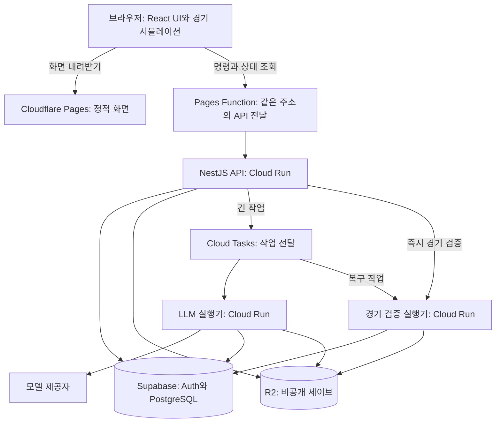

# Gaffer 전체 인프라 — React + NestJS 기준

초기 목표는 동시 접속 10명 이하의 초대제 베타다. 화면은 React/Vite 정적 앱, 서버는 NestJS와 기존 TypeScript 게임 패키지로 구성하는 제안이다. [상세 설계](final-design.md)의 소유권·저장·작업·비용·복구 계약을 적용한다. 기존 Codex·Claude 교차 검토는 그 계약과 Next 기반 배포안을 대상으로 했으며, React/Nest 전환과 프론트 프록시 경계는 후속 대화에서 정리한 제안이다.

## 작업 실행기는 왜 있는가

작업 실행기는 **접수된 게임 작업을 끝내고 결과를 저장하는 서버 역할**이다. 별도 언어나 별도 회사의 서비스가 아니다. API와 같은 저장소·공통 서버 모듈·게임 엔진을 사용하고 실행 진입점만 나눌 수 있다.

LLM 응답을 `await`한다고 Node.js가 다른 HTTP 요청을 전혀 받지 못하는 것은 아니다. 실행기를 나누는 이유는 다음 세 가지다.

1. **사용자 연결과 작업의 수명을 분리한다.** API가 DB에 작업을 접수한 뒤 작업 ID를 반환한다. 탭을 닫아도 전달된 작업이 처리되고, 재접속하면 상태와 결과를 찾는다. 중간에 프로세스가 죽으면 기록을 기준으로 제한적으로 다시 실행한다.
2. **빠른 조회와 긴 계산을 격리한다.** 로그인·게임 목록·피드백은 빠르게 처리한다. 긴 모델 호출, 큰 세이브의 직렬화, CPU를 쓰는 경기 검증에는 별도 시간·메모리·동시 실행 제한을 적용한다.
3. **유료 호출 수를 통제한다.** 한꺼번에 들어온 요청을 영구 대기열에 두고 허용된 만큼만 실행한다. 새 실행 시도마다 예산과 제공자 한도를 확인한다.

이 역할을 별도 Cloud Run 서비스로 배포하는 것은 운영 선택이다. **10명이라는 숫자만으로 별도 서비스가 필수는 아니다.** 한 Nest 서비스 안에 사용자 API와 인증된 작업 처리 경로를 함께 둘 수도 있다. 그 경우에도 DB 작업 기록·큐 전달·재시도 계약은 필요하고, CPU 계산은 thread/process로 격리해야 한다. API와 작업이 메모리·장애·배포·확장 설정을 공유하는 부담이 있어 이 설계는 별도 서비스 배포를 권장한다.

실행기만 추가하면 복구가 되는 것도 아니다. 책임은 나뉜다.

| 구성                     | 책임                                                      |
| ------------------------ | --------------------------------------------------------- |
| PostgreSQL의 job·receipt | 무엇을 접수했고 무엇이 확정됐는지 기록                    |
| Cloud Tasks              | 실행 요청을 전달하고 전달 실패를 다시 시도                |
| 실행기                   | 모델 호출·계산·검증·저장 수행                             |
| 실행권과 조건부 커밋     | 중복 전달이나 늦은 결과가 게임을 두 번 바꾸지 못하게 차단 |

외부 모델 호출 자체가 정확히 한 번만 발생한다고 보장하지 않는다. 장애 복구 중 추가 호출 비용이 생길 수 있어 호출별 원장을 유지한다.

## 전체 구성

화면 호스팅의 작은 프록시 함수는 HTTP를 전달할 뿐 게임 작업을 실행하지 않는다. 여기서 말하는 게임 실행기와 다른 역할이다.

| 영역             | 선택                                         | 담당                                                                    |
| ---------------- | -------------------------------------------- | ----------------------------------------------------------------------- |
| 화면             | React + Vite, Cloudflare Pages               | 기존 React 컴포넌트·스타일·브라우저 sim 재사용. SSR 서버 없이 정적 배포 |
| 사용자 API       | NestJS, Cloud Run                            | 초대·세션·소유권·게임 조회·작업 제출·가벼운 명령·피드백                 |
| 긴 작업          | 같은 백엔드 코드의 worker 진입점, Cloud Run  | LLM 턴·게임 생성·기억 편집. Cloud Tasks 요청 안에서 완료                |
| CPU 작업         | 같은 코드의 sim 진입점, Cloud Run            | 브라우저 경기 checkpoint의 결정적 재실행·검증                           |
| 인증·작은 데이터 | Supabase Free                                | Google 로그인, 초대·사용자·게임 소유권·작업 상태·비용·피드백            |
| 큰 데이터        | Cloudflare R2 private                        | 압축 GameState·화면 데이터·선택 진단 자료                               |
| 주기 작업        | Cloud Scheduler + 유지보수 실행기            | 5분마다 미전달/중단 작업 복구, 매일 백업·정리                           |
| 관측             | Cloud Logging + Sentry Free + PostHog 무료량 | 운영 로그·오류·선별 제품 이벤트. 원문은 기본 미수집                     |
| 백업             | R2 별도 bucket + 독립 GCS 사본               | DB와 참조 객체를 묶어 매일 암호화 백업, 복원 검증                       |

Cloud Run의 API·LLM·sim·유지보수는 **서로 다른 실행 설정이며 상시 켜진 VM 4대가 아니다.** 모두 min instances 0으로 시작한다. API는 짧은 요청, LLM 실행기는 네트워크 대기와 큰 메모리, sim은 CPU 계산에 맞게 동시성과 한도를 정한다. 같은 백엔드 이미지를 역할별로 배포하고 축구 규칙 코드를 복제하지 않는다.

LLM과 sim 실행기도 합칠 수 있지만, 기존 로컬 측정에서 하프 검증은 무시할 수 없는 CPU 작업이었다. 동시에 경기 검증이 몰려도 LLM 진행 기록과 실행권 갱신에 영향을 덜 주도록 권장안은 분리한다. 10명 단계에서는 Kubernetes·별도 Redis·기능별 마이크로서비스를 추가하지 않는다.

## 한 턴이 처리되는 과정

1. 브라우저가 명령과 중복 방지 키를 API에 보낸다.
2. API가 세션·초대·게임 소유권·예산을 검사하고 DB에 job과 전달 기록을 함께 저장한다.
3. API는 작업 ID와 접수 상태를 반환한다. Cloud Tasks에는 게임 전체 대신 작업 ID만 전달한다.
4. Cloud Tasks가 실행기에 인증된 HTTP 요청을 보낸다. 실행기는 DB에서 실행권을 얻고 R2에서 세이브를 읽는다.
5. 실행기가 LLM과 결정적 엔진을 실행하고, 진행 이벤트를 기록한다. 브라우저는 API를 통해 생성 중인 작업만 1–2초 간격으로 조회한다.
6. 검증한 결과를 R2에 새 객체로 올리고, DB에서 현재 revision·실행권을 확인해 새 참조와 완료 상태를 함께 확정한다.
7. API가 확정 결과를 브라우저에 전달한다. 접수·생성 중 상태와 저장 완료를 구분한다.

탭을 닫아도 API가 **접수를 확정한 작업**은 이 경로를 유지한다. 실행기가 죽으면 만료된 실행권을 회수한다. 이미 끝난 작업은 receipt를 반환하고 다시 게임을 변경하지 않는다. 작업 단위 재실행이며 임의의 LLM 토큰 위치부터 이어지는 것은 아니다.

게임 목록·채팅 이력·피드백·라인업 같은 짧은 명령은 API에서 바로 처리한다. 경기 화면은 브라우저에서 실행하고, checkpoint 검증은 API가 sim 실행기를 직접 호출한다. 모든 화면 조작이 긴 작업 큐를 거치지는 않는다.

**현재 코드의 checkpoint는 경기가 멈췄을 때만 제출한다.** `main`의 `0a69fac6` 기준으로 5분 간격·골/카드 등 사건마다 보내던 checkpoint와 자동 정지점 GM 턴은 제거됐지만, 감독 입력·전술 편집·수동 정지·탭 숨김·하프 종료·경기 종료 시 구간 재실행과 digest 비교는 남아 있다. 현재 구현은 이 검증을 기존 웹 API 프로세스에서 수행한다. 위의 별도 sim 서비스는 이번 배포 제안이며 이미 존재하는 인프라가 아니다. [클라이언트 제출](../../apps/web/screens/match/use-live-match.ts), [서버 처리](../../apps/web/game/live-match-server.ts), [코어 재실행](../../packages/engine/src/match/match-flow.ts)

## 로그인과 프론트 배포

무료 기본 주소를 사용할 때도 쿠키가 제3자 쿠키에 의존하지 않도록 브라우저는 한 주소의 `/api/*`만 호출한다. Pages Function은 이 경로만 허용된 Nest origin에 전달한다. OAuth 시작·callback도 `/api/auth/*`를 사용한다. 사용자 세션은 Nest가 검증하고 브라우저 주소 기준 host-only `HttpOnly; Secure; SameSite=Lax` 쿠키를 발급한다.

프록시는 API 응답·오류·OAuth callback을 캐시하지 않고 `Set-Cookie`를 보존한다. 반환 URL은 설정된 앱 origin으로 고정하고 임의의 Host/forwarded header를 신뢰하지 않는다. `/api/*` 실패는 SPA의 HTML fallback으로 바꾸지 않는다. API 원본 주소를 직접 호출해도 세션·소유권·CSRF 검사를 우회할 수 없다. 작업 실행기는 별도로 Google IAM/OIDC로 보호한다.

Pages 정적 파일 요청은 무료이고 함수 요청은 Workers 무료 사용량을 소비한다. 프록시는 별도 사용량이므로 폴링을 포함한 일별 요청 수를 계측한다. [Cloudflare Pages Functions](https://developers.cloudflare.com/pages/functions/), [요금](https://developers.cloudflare.com/pages/functions/pricing/)

## 무료 운영의 경계

Cloud Run의 요청 기반 과금에서는 요청을 처리하는 동안 CPU가 할당된다. API가 응답하고 `setTimeout`이나 메모리 큐만으로 작업을 계속 돌리는 방식에 의존하지 않는다. Cloud Tasks가 보낸 **별도의 실행 요청이 완료될 때까지 열린 상태**로 작업을 수행한다. 유휴 인스턴스를 0으로 줄일 수 있지만 LLM 대기 중 실행 시간은 과금 대상이다. [Cloud Run 실행·과금](https://docs.cloud.google.com/run/docs/configuring/billing-settings)

Nest의 BullMQ 통합은 Redis를 필요로 한다. 초기에는 관리형 Cloud Tasks로 전달해 Redis 운영을 추가하지 않는다. [Nest 큐 문서](https://docs.nestjs.com/techniques/queues)

무료 인프라는 LLM API를 무료로 만들지 않는다. 기존 $0–10/월의 가벼운 인프라 예산은 추정이며, 새 프록시 요청량·API 기동 시간·네트워크도 측정해야 한다. DB 무료 휴면 가능성과 정상 일일 백업 기준 RPO 24시간은 유지된다. 실제 배포 전에 프록시 경유 OAuth·쿠키·CSRF·폴링, 10세션 부하, 작업 중단/중복, 백업 복원을 검증한다.
